# Cloud Computing — Module 1 Notes: Definition of Cloud Computing & its Basics

Nov 23, 2026 · Radha Rani Basak

## 0. How to Use These Notes

**These notes cover Unit 1 of MAKAUT's Cloud Computing paper (PEC-CS701B, 9 lectures) in syllabus order. They follow the six prescribed books and place every previous-year question on this unit under its topic.** The books: Barrie Sosinsky, *Cloud Computing Bible* (Wiley); Rajkumar Buyya, Christian Vecchiola and S. Thamarai Selvi, *Mastering Cloud Computing* (McGraw Hill, 2013); Anthony T. Velte, Toby J. Velte and Robert Elsenpeter, *Cloud Computing: A Practical Approach* (Tata McGraw-Hill); Michael Miller, *Cloud Computing* (Pearson); Christopher Moyer, *Building Applications in the Cloud: Concepts, Patterns and Projects* (Pearson); Kumar Saurabh, *Cloud Computing*, 2nd edition (Wiley India).

### 0.1 Exam pattern

MAKAUT papers for this subject carry 70 marks over 3 hours. The usual split is below; check it against your latest paper.

| Group | Usual format | What a full-marks answer has |
| --- | --- | --- |
| A | 10 multiple-choice or one-line questions × 1 mark | The exact keyword, e.g. "SaaS is the most complete service model" |
| B | Any 3 of 5 short questions × 5 marks | Definition, 4–5 crisp points or a small table, one example, a small diagram if one exists |
| C | Any 3 of 5 long questions × 15 marks, often split 5+5+5 or 7+8 | Definition, labelled diagram, every part explained, examples, a comparison table, a one-line conclusion |

### 0.2 How each section is built

- **The bold first line** of a section is the definition to memorise.
- **Book tags** such as \[Buyya\] or \[Miller\] mark a definition or list from that book. In the exam, write it under that author's name.
- **PYQ tags** such as *(PYQ 2014, 2018)* mark questions from past WBUT/MAKAUT papers, taken from the Popular Publications question bank you shared. *(DSZ)* marks a Debkanta Study Zone suggestion.
- **Tables** are the comparisons examiners ask for ("differentiate between…").
- **Diagrams** are the ones to redraw by hand. Practise these eleven: NIST visual model, Cloud Cube, hybrid cloud, service-model stack, Buyya's reference model, CSA reference model, NIST reference architecture, VPS partitioning, pods–aggregation–silos, Open SaaS with an ESB, IDaaS single sign-on.
- **Exam tip** boxes say how to frame an answer.
- **Answer-key warnings:** a few MCQ keys printed in the question bank are wrong. Section 17 flags each one.

### 0.3 Textbook names versus today's names

The textbook was written around 2010–2011, so several products have since been renamed. Write the textbook name and add the current one in brackets.

| Name in the textbook | Current name |
| --- | --- |
| Windows Azure | Microsoft Azure |
| SQL Azure | Azure SQL Database |
| Google Apps | Google Workspace |
| Force.com | Salesforce Platform |
| Azure Active Directory | Microsoft Entra ID |
| Liberty Alliance | Kantara Initiative |
| OpenID 2.0 | OpenID Connect |
| Windows CardSpace | Discontinued; replaced by OpenID Connect, passkeys and similar standards |

## 1. Defining a Cloud

**Cloud computing turns servers, storage, networks, platforms and software into a self-service utility: you rent them over a network, on demand, and pay by use.** The "cloud" is the pool of resources behind the service. You see the service, never the machines.

### 1.1 Why the word "cloud"?

- Network diagrams have long drawn the Internet as a cloud symbol, meaning "the details in here are not your concern".
- The term carries two essential ideas:
  - **Abstraction**: the user does not need to know which machine runs the application, where the data is stored, or who administers the hardware. The service is simply reachable from anywhere.
  - **Virtualization**: resources are pooled and shared. Capacity is carved out of a central pool on request, billed by metering, shared among many tenants, and grown or shrunk quickly.

### 1.2 The standard definition: NIST SP 800-145 (learn it word for word)

> "Cloud computing is a model for enabling ubiquitous, convenient, on-demand network access to a shared pool of configurable computing resources (e.g., networks, servers, storage, applications, and services) that can be rapidly provisioned and released with minimal management effort or service provider interaction. This cloud model is composed of five essential characteristics, three service models, and four deployment models."

| Phrase in the definition | What it means |
| --- | --- |
| ubiquitous, convenient | reachable from anywhere, on any device |
| on-demand network access | you get resources the moment you ask, over a network |
| shared pool of configurable computing resources | many customers draw from one pool; each configures what it takes |
| rapidly provisioned and released | capacity is added or removed in minutes, not weeks |
| minimal management effort or service provider interaction | self-service: no purchase order, no phone call |
| five, three, four | 5 essential characteristics, 3 service models, 4 deployment models (Section 2) |

### 1.3 Definitions in the prescribed books

- **\[Sosinsky\]** The word "cloud" refers to two essential concepts, **abstraction** and **virtualization** (1.1).
- **\[Buyya\]** A cloud has four defining parts:
  1. it is a parallel and distributed system;
  2. it is made of interconnected, virtualized computers;
  3. they are provisioned dynamically and presented as one or more unified computing resources;
  4. all of this is governed by service-level agreements negotiated between provider and consumer.
- **\[Buyya, citing Armbrust et al., Berkeley 2009\]** Cloud computing means two things together: the *applications delivered as services over the Internet*, and the datacenter hardware and system software that provide them.
- **\[Buyya, citing Reese\]** Three tests of a cloud-style service: it is reached through a web browser or a Web-services API; starting needs zero capital expenditure; you pay only for what you use, as you use it.
- **\[Buyya\]** The vision is computing as a utility. In 1969 Leonard Kleinrock predicted "computer utilities" serving homes and offices the way electricity and telephone utilities do.
- **\[Miller\]** Cloud computing is web-based: applications and files sit on a "cloud" of thousands of interconnected computers and servers, reached over the Internet. It is **not network computing** (applications on one company's server, reached over its own network) and **not traditional outsourcing** (hiring an outside firm to run your IT).
- **\[Velte\]** You reach applications and data kept on remote servers over the Internet. A cloud solution has three components: clients, the datacenter and distributed servers (Section 9.2).
- **\[Moyer\]** The cloud is the step after the mainframe, the PC and the fast Internet: computing bought on demand, scaled up and down, and reached over HTTP.
- **One-liner for 1-mark answers:** cloud computing is the on-demand delivery of computing resources over the Internet with pay-per-use pricing.

### 1.4 Key terms

| Term | One-line meaning |
| --- | --- |
| Virtualization | Running several virtual machines (VMs) on one physical machine through a hypervisor |
| Multi-tenancy | One shared infrastructure or application instance serves many customers (tenants), kept logically separate |
| Provisioning / de-provisioning | Allocating resources to a consumer / releasing them back to the pool |
| Scalability | Ability to grow capacity to meet load; may be planned or manual |
| Elasticity | Scaling out and in automatically and quickly as demand rises and falls |
| Utility computing | Paying for computing by metered use, like electricity or water |
| SLA (service-level agreement) | Contract fixing service levels such as uptime, response time and penalties |
| On-premises / off-premises | Inside the organization's own site / in a provider's data center |
| Cloud service provider (CSP) | Company that runs a cloud and sells its services, e.g. AWS, Microsoft Azure, Google Cloud |

### 1.5 How cloud computing evolved

| Year | Milestone |
| --- | --- |
| 2010 | Microsoft's Windows Azure (now Microsoft Azure) becomes commercially available |
| 2008 | Google App Engine opens as a preview: PaaS for web applications |
| 2006 | Amazon launches S3 storage and EC2 virtual servers: IaaS goes mainstream |
| 1999 | Salesforce.com sells CRM through a web browser: an early SaaS |
| 1990s | Grid computing and application service providers (ASPs) |
| 1961 | John McCarthy suggests computing may one day be sold as a public utility |

Three textbook views of how we got here:

- **\[Buyya\]** Five core technologies made cloud computing possible: **distributed systems** (mainframes, clusters, grids), **virtualization**, **Web 2.0**, **service-oriented computing** and **utility-oriented computing**.
- **\[Miller\]** Client/server computing, then peer-to-peer, then distributed computing, then collaborative computing, then cloud computing.
- **\[Moyer\]** The mainframe, then the PC revolution, then the fast Internet, then the cloud.

### 1.6 Two ways to classify clouds ("cloud types")

- **Deployment models**: where the infrastructure sits and who may use it. Public, private, hybrid, community (Section 4).
- **Service models**: what you rent. IaaS, PaaS, SaaS (Section 5).
- Two frameworks organize these: the **NIST model** (Section 2) and the **Cloud Cube Model** (Section 3).

> Exam tip: for "Define cloud computing" (5 marks), write the NIST definition, name the 5-3-4 parts, and draw the NIST model diagram from Section 2.

### 1.7 Cloud computing compared with other computing models

| Basis | Cloud computing | Grid computing | Cluster computing | Pervasive (ubiquitous) computing |
| --- | --- | --- | --- | --- |
| Idea | Rent pooled, virtualized resources as a service over the Internet | Many networked computers, often in different organizations, pooled for one large task | Tightly coupled computers in one place acting as one system | Computing embedded everywhere, in any device, in any place |
| Ownership | One provider owns, many tenants rent | Shared across organizations | One organization | Users' devices and embedded chips |
| Resources | Virtualized, elastic, on demand | Jobs scheduled on shared machines | Dedicated, similar nodes | Small connected devices and sensors |
| Payment | Pay per use (utility) | Usually shared or allocated | Owned outright | Not a payment model |
| Typical work | Web applications, storage, business services | Embarrassingly parallel jobs, e.g. a bank pricing all its holdings overnight; science | High-performance computing | Smart homes, wearables, IoT |
| Example | AWS, Google Workspace | Worldwide LHC Computing Grid | A Beowulf cluster | A smart thermostat or smartwatch |

**\[Saurabh\]** also compares the cloud with older architectures. In **client–server**, a fixed server serves fixed clients; the cloud adds elastic, pay-per-use, multi-tenant pools. In **peer-to-peer**, every node is both client and server with no central control; a cloud is run by a provider.

### 1.8 Scalability vs elasticity; vertical vs horizontal scaling

| Basis | Scalability | Elasticity |
| --- | --- | --- |
| Meaning | Ability to handle growing load by adding resources | Ability to add *and remove* resources automatically to match demand |
| Time frame | Long-term, planned growth | Short-term, in real time |
| Direction | Mainly growth | Up and down |
| Automation | Can be manual | Automatic |
| Aim | Meet future demand | Pay only for current demand |
| Example | Upgrading a database server as users grow over a year | Auto scaling adds servers for a sale and removes them after |

| Basis | Vertical scaling (scale up) | Horizontal scaling (scale out) |
| --- | --- | --- |
| How | Add CPU, RAM or disk to an existing machine | Add more machines to the pool |
| Data | Stays on one node | Partitioned or copied across nodes |
| Limit | The ceiling of one machine | Practically unlimited |
| Downtime | Often needs a restart | Usually none |
| Failure | Single point of failure | Survives the loss of a node |
| Tools | A bigger instance type | Load balancer, clustering, distributed file systems |
| Example | Moving from 8 GB to 32 GB of RAM | Going from 3 to 10 web servers behind a load balancer |

### 1.9 Previous-year questions on this topic

- What is cloud computing? What are its advantages and limitations? *(PYQ 2018; DSZ)* → 1.2, Section 8.
- Define cloud computing. Explain the service models with examples. *(PYQ 2016; DSZ)* → 1.2, Section 5.
- How does cloud computing differ from grid computation and pervasive computation? *(PYQ 2014)* → 1.7.
- What is the difference between scalability and elasticity? *(PYQ 2014)* → 1.8.
- What are the differences between vertical and horizontal scalability? *(PYQ 2018; DSZ)* → 1.8.
- What is a cloud? *(model question)* → 1.1 to 1.3.
- MCQs on technologies that shaped the cloud *(2016)*, the essential concept of the cloud *(2018)*, and pooling and sharing of resources *(2018)* → Section 17.

## 2. Cloud Types and the NIST Model

**The NIST model describes cloud computing through 5 essential characteristics, 3 service models and 4 deployment models; NIST's visual model adds 8 common characteristics that most clouds share.** It comes from [NIST SP 800-145](https://nvlpubs.nist.gov/nistpubs/Legacy/SP/nistspecialpublication800-145.pdf) (September 2011), the definition textbooks and examiners use.

### 2.1 The parts of the model

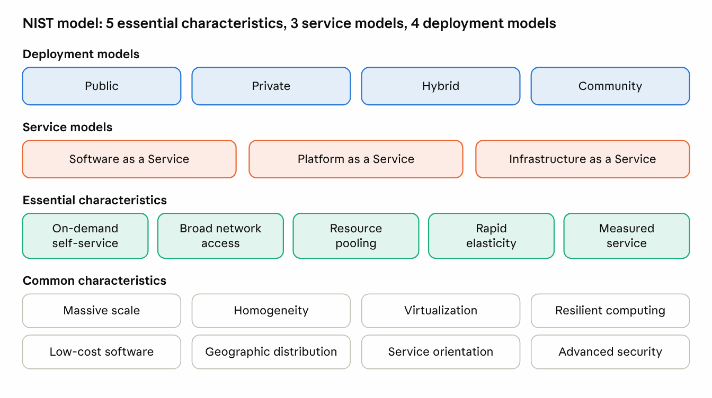

Draw it top-down: deployment models over service models over the five essential characteristics, with the common characteristics as the base.

Remember it as **5-3-4**, plus the 8 common characteristics shown in the base of the figure.

### 2.2 The five essential characteristics

| Characteristic | What NIST means | Example |
| --- | --- | --- |
| On-demand self-service | The consumer provisions computing capabilities (server time, storage) on its own, automatically, with no human interaction with the provider | Launching a virtual machine from the AWS console in under a minute |
| Broad network access | Capabilities are reached over the network through standard mechanisms, from thin or thick clients: phones, tablets, laptops, workstations | Opening the same Gmail account from a phone app and a laptop browser |
| Resource pooling | The provider pools its resources to serve many consumers on a multi-tenant model, assigning and reassigning physical and virtual resources by demand. Location independence: the customer can choose only a high-level location such as country, region or data center | One physical server hosts VMs of many customers; you pick the Mumbai region, never the rack |
| Rapid elasticity | Capabilities are provisioned and released elastically, sometimes automatically, scaling out and in with demand. To the consumer they look unlimited | A shopping site grows from 4 to 40 servers during a festive sale, then shrinks back |
| Measured service | The cloud meters usage at a level that suits the service (storage, processing, bandwidth, active user accounts). Usage is monitored, controlled and reported, so both sides see it | Bills per GB-month of storage, per instance-hour, or per user per month |

Mnemonic: **"Only Brave Rangers Reach Mountains"** (On-demand, Broad network, Resource pooling, Rapid elasticity, Measured).

### 2.3 The eight common characteristics

| Common characteristic | Meaning |
| --- | --- |
| Massive scale | Very large data centers that give economies of scale |
| Homogeneity | Standard, uniform commodity hardware and configuration, so it is easy to manage and automate |
| Virtualization | Physical resources are abstracted into virtual ones that can be shared |
| Resilient computing | Redundancy and failover, so no single failure stops the service |
| Low-cost software | Open-source and pay-per-use licensing keep software costs down |
| Geographic distribution | Data centers in many regions: lower latency, disaster recovery |
| Service orientation | Everything is offered as a service through defined interfaces (SOA) |
| Advanced security | Encryption, identity management and monitoring built in at scale |

Essential characteristics are what a system **must** have to count as cloud. Common characteristics are what clouds **usually** have.

### 2.4 Service and deployment models in one line each

- **SaaS**: you use the provider's application, e.g. Gmail. Details in Section 5.
- **PaaS**: you deploy your own application on the provider's platform, e.g. Google App Engine.
- **IaaS**: you rent processing, storage and networks and run any software, including the OS, e.g. Amazon EC2.
- **Public cloud**: open to the general public, on the provider's premises. Details in Section 4.
- **Private cloud**: for the exclusive use of one organization, on or off premises.
- **Community cloud**: shared by organizations with common concerns such as mission, security or compliance.
- **Hybrid cloud**: two or more distinct clouds bound together so data and applications can move between them.

### 2.5 A point examiners like

Sosinsky notes that the earliest NIST drafts did not insist that a cloud use virtualization to pool resources, or that it support multi-tenancy. The final definition does: resource pooling is defined on a multi-tenant model. Multi-tenancy means two or more clients share the same resources.

> Exam tip: for "Explain the NIST model" (15 marks), draw the figure above, explain all five essential characteristics with an example each, then give one line for each service and deployment model.

### 2.6 Previous-year questions on this topic

- Explain the NIST model with a diagram. *(PYQ 2014)* Write about the NIST model. *(PYQ 2018; DSZ)*
- With respect to the NIST Reference Model of cloud computing, explain (i) essential characteristics, (ii) service models, (iii) deployment models, with suitable schematics and examples. *(PYQ 2015, 2017)*
- What are the essential characteristics of the different service models and the deployment models as per the NIST Reference Model? Describe with examples. *(PYQ 2017)*
- Define a cloud in the context of the NIST cloud model. *(DSZ)*

> Note: when WBUT papers say "NIST Reference Model" they mean this 5-3-4 model from SP 800-145. NIST's reference *architecture* with five actors is Section 6.3.

## 3. The Cloud Cube Model (Jericho Forum)

**The Cloud Cube Model classifies a cloud "formation" along four dimensions, so an organization can choose the right formation for secure collaboration.** It was published by the Jericho Forum of The Open Group in April 2009 ([paper](https://csitauthority.github.io/8thSem/ebooks-and-classnotes/classnotes/files/CSC458%20CC%20-%20cloud_cube_model_v1.0.pdf)). Its core message: in cloud computing the network firewall is no longer the security boundary.

### 3.1 Who made it and why

- The Jericho Forum was a security group inside The Open Group. It worked on **de-perimeterisation**: keeping systems secure once the traditional network boundary dissolves.
- The model helps a customer match each business function, and each class of data, to a suitable cloud formation.
- The paper also says plainly that not everything belongs in the cloud. Some functions are better run the traditional way.

### 3.2 The four dimensions

| Dimension | Two states | Question it answers | Explanation and example |
| --- | --- | --- | --- |
| 1. Physical location of data | Internal (I) / External (E) | Does the cloud sit inside or outside my organization's boundary? | Virtual disks in your own data center are Internal; Amazon S3, run off-site, is External. Internal is not automatically safer; a mix may be the most secure. |
| 2. Ownership | Proprietary (P) / Open (O) | Who owns the technology and interfaces, and can I move my data? | Measures interoperability, data portability and vendor lock-in. Proprietary: the provider keeps the means of delivery, so switching is costly. Open: non-proprietary technology, more suppliers, easier sharing, e.g. email over SMTP. |
| 3. Security boundary (architectural mindset) | Perimeterised (Per) / De-perimeterised (D-p) | Am I working inside my traditional IT perimeter (the firewall) or outside it? | Per: extend your perimeter into the cloud over a VPN, control access with your own directory, then pull it back. D-p: protection travels with the data (metadata, encryption), following the Jericho Commandments and Collaboration Oriented Architecture. |
| 4. Sourcing | Insourced / Outsourced | Who runs my cloud? | Insourced: your own staff, under your control. Outsourced: a third party. A business policy decision written into the contract, not a technical one. Shown by colour in the cube. |

Mnemonic: **LOBS** = Location, Ownership, Boundary, Sourcing.

### 3.3 Reading the cube

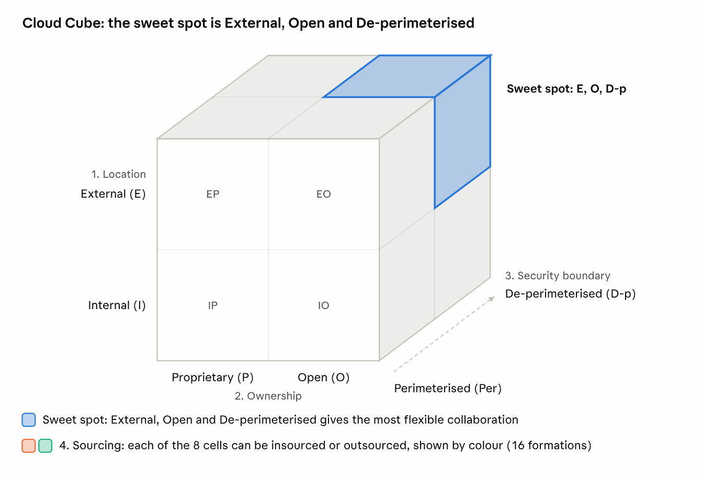

The front face holds the four perimeterised cells; the shaded corner at the top right of the back is External, Open and De-perimeterised, the sweet spot.

- The first three dimensions are the cube's axes: 2 × 2 × 2 = **8 cloud forms**, written Per(IP, IO, EP, EO) and D-p(IP, IO, EP, EO).
- The fourth dimension gives each of the 8 forms two states, insourced or outsourced: **16 formations** in all.
- The **"sweet spot"** is External, Open, De-perimeterised: it gives the most flexibility and the easiest collaboration.
- Proprietary suppliers tend to keep customers on the proprietary side. Moving out needs open interfaces that the supplier has little reason to offer.

| Formation (illustrative) | Example |
| --- | --- |
| Internal, Proprietary, Perimeterised, Insourced | A company's own private cloud, run by its IT team behind its firewall |
| External, Proprietary, Perimeterised, Outsourced | Servers rented in a public IaaS cloud and joined to the company network over a VPN |
| External, Open, De-perimeterised, Outsourced | Partners collaborating through open-standard services, with access rules attached to the data itself |

### 3.4 Questions the paper says a customer should ask the supplier

1. Where in the cube does the supplier operate, for each service?
2. How will the supplier show that the formation's features are delivered, and stay delivered?
3. How do I keep my data and services available if the supplier goes bankrupt or changes direction?

### 3.5 Why the firewall boundary breaks down

Data now sits in several clouds outside the organization, users connect from anywhere, and partners need access. So protection has to move from the network edge to the data and the identity: encryption, strong authentication, and access policies that travel with the data. Today's "zero trust" security follows the same idea.

> Exam tip: draw the cube with three labelled axes, mark the sweet spot, and state that the fourth dimension is shown by colour. Expand every abbreviation: I/E, P/O, Per/D-p.

### 3.6 Previous-year questions on this topic

- Explain precisely the Jericho Forum's Cloud Cube model with a diagram. *(PYQ 2014)*
- Discuss in detail, with diagram(s), the Cloud Cube model. *(PYQ 2017)*
- Short note: the Cloud Cube Model of cloud computing. *(PYQ 2015, 2017)*
- Explain the Cloud Cube model and its significance in defining a cloud environment. *(DSZ)*
- MCQ: "Which are valid dimensions of the cloud cube?" *(2016)* → **Ownership, Sourcing**. The question bank prints (d), but "Platform" is not a dimension.

## 4. Deployment Models

**A deployment model says where the cloud infrastructure lives, who owns and runs it, and who may use it. There are four: public, private, community and hybrid.**

### 4.1 Public cloud

- **NIST:** "The cloud infrastructure is provisioned for open use by the general public. It may be owned, managed, and operated by a business, academic, or government organization, or some combination of them. It exists on the premises of the cloud provider."
- **Features:** multi-tenant, pay-per-use, very large scale, reached over the Internet. The provider manages all hardware and facilities.
- **Advantages:** no up-front capital cost, near-unlimited elasticity, global reach, start in minutes, no maintenance burden.
- **Disadvantages:** less control; shared hardware raises security, privacy and compliance worries; depends on the Internet; risk of vendor lock-in; bills can grow at large scale.
- **Examples:** Amazon Web Services, Microsoft Azure, Google Cloud, IBM Cloud, Oracle Cloud Infrastructure.
- **Best for:** startups, websites, development and testing, workloads that rise and fall.

### 4.2 Private cloud

- **NIST:** "The cloud infrastructure is provisioned for exclusive use by a single organization comprising multiple consumers (e.g., business units). It may be owned, managed, and operated by the organization, a third party, or some combination of them, and it may exist on or off premises."
- **Forms:** on-premises (in the organization's own data center) or hosted/managed (dedicated hardware at a third party).
- **Advantages:** full control and customization, strongest security and compliance position, predictable performance.
- **Disadvantages:** high capital cost, the organization must staff and run it, elasticity limited by its own hardware, hardware may sit idle.
- **Examples:** a bank running its core systems on OpenStack or VMware in its own data center.
- **Best for:** regulated or sensitive data, steady and predictable workloads.
- **Note:** a *virtual private cloud* (VPC) is a logically isolated network inside a public cloud. It feels private but runs on shared public infrastructure.

### 4.3 Community cloud

- **NIST:** "The cloud infrastructure is provisioned for exclusive use by a specific community of consumers from organizations that have shared concerns (e.g., mission, security requirements, policy, and compliance considerations). It may be owned, managed, and operated by one or more of the organizations in the community, a third party, or some combination of them, and it may exist on or off premises."
- **Advantages:** members share the cost; one environment meets their common compliance rules; easier collaboration.
- **Disadvantages:** capacity and bandwidth are shared; members must agree on governance; less elastic than a public cloud.
- **Examples:** the Government of India's GI Cloud (MeghRaj) for government departments; AWS GovCloud (US) for US government agencies and their contractors; a research cloud shared by universities.
- **Best for:** organizations bound by the same rules, such as government, healthcare or banking.

### 4.4 Hybrid cloud

- **NIST:** "The cloud infrastructure is a composition of two or more distinct cloud infrastructures (private, community, or public) that remain unique entities, but are bound together by standardized or proprietary technology that enables data and application portability (e.g., cloud bursting for load balancing between clouds)."
- **Cloud bursting:** an application runs in the private cloud and overflows ("bursts") into a public cloud when demand peaks.

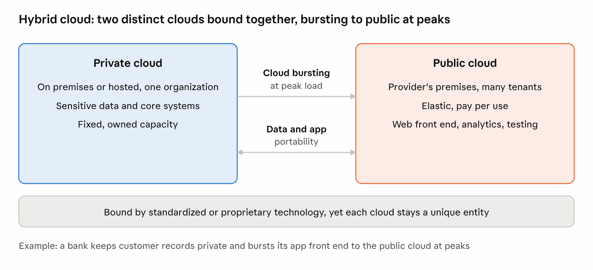

Sensitive work stays private; extra load overflows to the public cloud and returns when the peak passes.

- **Advantages:** keep sensitive data private while using the public cloud for scale; pay for peaks only when they happen; disaster recovery; a gradual path to migration.
- **Disadvantages:** integration and management are complex; security must hold across the boundary; network latency and bandwidth between clouds; needs wider skills.
- **Example:** a bank keeps customer records in its private cloud and runs its mobile-app front end and analytics on a public cloud. Tools such as AWS Outposts and Azure Arc help join the two.
- **Hybrid is not multi-cloud.** Multi-cloud means using two or more public providers (say AWS and Google Cloud), with or without a private cloud.

### 4.5 Comparison of the four models

| Feature | Public | Private | Community | Hybrid |
| --- | --- | --- | --- | --- |
| Who uses it | General public, many tenants | One organization | Several organizations with shared concerns | Users of each joined cloud |
| Location | Provider's premises | On or off premises | On or off premises | Both |
| Owned and run by | Provider | The organization or a third party | Members or a third party | A combination |
| Cost model | Pay-per-use, no capital cost | High capital cost | Cost shared by members | Mixed |
| Control and customization | Low | High | Medium | Medium to high |
| Security and privacy | Lowest (shared) | Highest | High | High for the private part |
| Scalability | Very high | Limited by own hardware | Limited (shared) | High: bursts to public |
| Example | AWS, Azure, Google Cloud | OpenStack in a bank's data center | MeghRaj, AWS GovCloud (US) | Private core plus public bursting |

> Exam tip: for each model write the NIST definition, two advantages, two disadvantages and one example; finish with the comparison table. Draw the hybrid figure for a 15-mark answer.

### 4.6 Deployment models in Buyya

- **Public cloud:** the first and canonical form of cloud: services open to anyone, from anywhere, at any time over the Internet. Structurally it is one or more datacenters joined together, with the provider's services built on top. Any customer signs in with credentials and billing details. It is multi-tenant and governed by SLAs.
- **Private cloud:** a virtual distributed system on an organization's own infrastructure that gives internal users dynamic provisioning. Buyya's three key advantages: **customer information protection**, **infrastructure ensuring SLAs**, and **compliance with standard procedures and operations**. It is built with software such as Eucalyptus, OpenNebula, OpenStack or VMware vCloud on the organization's datacenters or clusters.
- **Hybrid cloud:** lets an enterprise keep its existing IT and its sensitive data on premises, while growing and shrinking by provisioning external resources and releasing them. Its key mechanisms are **dynamic provisioning** and **cloudbursting**.
- **Community cloud:** a distributed system built by integrating the services of different clouds for the needs of one industry, community or business sector.
  - Candidate sectors: media, healthcare, energy and other core industries, the public sector, scientific research.
  - Benefits: **openness, community, graceful failures, convenience and control, environmental sustainability**.

### 4.7 Case: which model for a company handling sensitive financial data? *(DSZ scenario)*

- **Recommend a private cloud, or a hybrid cloud that keeps every sensitive record in the private part.**
- **Why private:** full control over where data sits and who can touch it; easier to satisfy banking rules on data location and audit (RBI); dedicated hardware removes multi-tenant risk; custom security such as in-house encryption keys; predictable performance for core systems.
- **Where the public part fits:** non-sensitive or bursty work such as the marketing website, analytics on masked data, development and testing.
- **Why not public alone:** shared hardware and less control over data location and audits. A community cloud suits only if several banks share one regulated cloud.

### 4.8 Previous-year questions on this topic

- Briefly explain the deployment models for cloud computing. *(PYQ 2014)* → 4.1 to 4.4.
- What are the differences between private cloud and public cloud? *(PYQ 2018; DSZ)* → table 4.5.
- Short note: hybrid cloud. *(PYQ 2014; DSZ)* → 4.4. Useful examples: sensitive workloads on the private cloud with test and development on Google Compute Engine and backup archives on Amazon S3; a holiday-season order system that bursts to the public cloud; big-data analytics run in the public cloud on data kept privately.
- What is cloud bursting? *(DSZ)* → 4.4.
- What key characteristic distinguishes a public cloud from a private cloud? *(DSZ)* → who may use it: open to the general public, or exclusive to one organization.
- Which deployment model suits a company handling sensitive financial data? *(DSZ scenario)* → 4.7.
- MCQs: what a private cloud is *(2014, 2018)*, what an internal cloud is *(2017)*, which feature does not belong in a private cloud *(2014)* → Section 17.

## 5. Service Models (SPI): IaaS, PaaS, SaaS

**A service model says what the provider hands you and what you still manage: IaaS gives raw infrastructure, PaaS gives a platform to deploy your code on, SaaS gives a finished application.** Together they form the **SPI** model, and each model is built on top of the one below it.

### 5.1 Who manages what

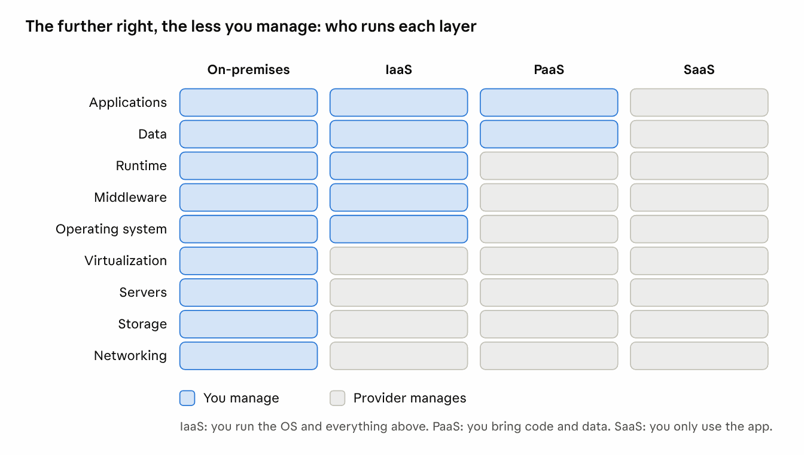

Each step right hands more layers to the provider: IaaS from virtualization down, PaaS from the runtime down, SaaS everything.

The further right you move, the less you manage and the less you control. A popular analogy is pizza: making it at home is on-premises, take-and-bake is IaaS, home delivery is PaaS, and dining out is SaaS.

### 5.2 Infrastructure as a Service (IaaS)

- **NIST:** "The capability provided to the consumer is to provision processing, storage, networks, and other fundamental computing resources where the consumer is able to deploy and run arbitrary software, which can include operating systems and applications. The consumer does not manage or control the underlying cloud infrastructure but has control over operating systems, storage, and deployed applications; and possibly limited control of select networking components (e.g., host firewalls)."
- **You get:** virtual machines, block and object storage, virtual networks, load balancers, IP addresses.
- **You manage:** the operating system and its patches, middleware, runtime, applications and data.
- **Typical user:** system administrators and DevOps engineers.
- **Examples:** Amazon EC2 and S3, Azure Virtual Machines, Google Compute Engine, DigitalOcean; OpenStack to build your own. Deep dive in Section 11.

### 5.3 Platform as a Service (PaaS)

- **NIST:** "The capability provided to the consumer is to deploy onto the cloud infrastructure consumer-created or acquired applications created using programming languages, libraries, services, and tools supported by the provider. The consumer does not manage or control the underlying cloud infrastructure including network, servers, operating systems, or storage, but has control over the deployed applications and possibly configuration settings for the application-hosting environment."
- **You get:** language runtimes, frameworks, managed databases, development tools, automatic scaling and deployment.
- **You manage:** your code, your data and the application's configuration.
- **Typical user:** application developers.
- **Examples:** Google App Engine, Salesforce Platform (Force.com), Azure App Service, AWS Elastic Beanstalk, Heroku, Red Hat OpenShift. Deep dive in Section 12.

### 5.4 Software as a Service (SaaS)

- **NIST:** "The capability provided to the consumer is to use the provider's applications running on a cloud infrastructure. The applications are accessible from various client devices through either a thin client interface, such as a web browser (e.g., web-based email), or a program interface. The consumer does not manage or control the underlying cloud infrastructure including network, servers, operating systems, storage, or even individual application capabilities, with the possible exception of limited user-specific application configuration settings."
- **Sosinsky calls SaaS the "most complete" service model**: the vendor supplies the hardware, the software and the solution itself. A frequent MCQ.
- **You manage:** only your settings and the data you enter.
- **Typical user:** end users.
- **Examples:** Salesforce CRM, Google Workspace (Gmail, Docs, Drive), Microsoft 365, Zoom, Slack, Dropbox, Zoho CRM. Deep dive in Section 13.

### 5.5 IaaS vs PaaS vs SaaS

| Basis | IaaS | PaaS | SaaS |
| --- | --- | --- | --- |
| What you get | Virtual servers, storage, networks | A platform: runtime, middleware, database, tools | A ready-to-use application |
| You manage | OS, runtime, middleware, applications, data | Applications and data | Only settings and your data |
| Provider manages | Virtualization, servers, storage, networking, facilities | All of IaaS plus OS, runtime, middleware | Everything |
| Typical user | System administrator, DevOps | Developer | End user |
| Control and flexibility | Highest | Medium | Lowest |
| Skill needed | Most | Medium | Least |
| Lock-in risk | Lowest: standard VMs can be moved | High: code is tied to the platform's APIs | High: data and workflows live in the vendor's app |
| Typical billing | Per VM-hour, GB stored, data transferred | Per instance, request or resource used | Per user per month |
| Examples | Amazon EC2, Azure VMs, Google Compute Engine | Google App Engine, Heroku, Azure App Service | Gmail, Salesforce, Microsoft 365 |

### 5.6 Examples of services by provider

| Provider | IaaS | PaaS | SaaS |
| --- | --- | --- | --- |
| Amazon (AWS) | EC2, S3, EBS, VPC | Elastic Beanstalk, Lambda | Amazon Connect (contact center) |
| Microsoft | Azure Virtual Machines, Blob Storage | Azure App Service, Azure Functions | Microsoft 365, Outlook.com |
| Google | Compute Engine, Cloud Storage | App Engine, Cloud Run | Google Workspace |
| Salesforce | — | Salesforce Platform (Force.com), Heroku | Sales Cloud CRM, Slack |
| Zoho (India) | — | Zoho Creator (low-code) | Zoho CRM, Zoho Mail, Zoho Books |

Textbook-era names you may also see: Eucalyptus, GoGrid and Rackspace Cloud (IaaS); Force.com, Google AppEngine and Windows Azure (PaaS); Google Apps and Salesforce.com (SaaS).

### 5.7 XaaS: "Everything as a Service"

The same idea extends to many narrower services:

- **Storage as a Service:** Amazon S3, Google Drive.
- **Database as a Service (DBaaS):** Amazon RDS, MongoDB Atlas.
- **Desktop as a Service (DaaS):** Amazon WorkSpaces, Windows 365.
- **Function as a Service (FaaS, serverless):** AWS Lambda, Azure Functions.
- **Backend as a Service (BaaS):** Firebase.
- **Identity as a Service (IDaaS):** Okta, Microsoft Entra ID. Section 14.
- **Compliance as a Service (CaaS):** Section 15. Careful: "CaaS" also stands for Containers as a Service; in this syllabus it means Compliance.

> Exam tip: for "Differentiate between IaaS, PaaS and SaaS", give the table in 5.5, draw the stack in 5.1, and name two examples of each.

### 5.8 Service models as the prescribed books present them

**\[Buyya\] classification of cloud services:**

| Category | What customers get | Product type | Examples |
| --- | --- | --- | --- |
| SaaS | Applications reachable any time, from anywhere | Web applications and services (Web 2.0) | Salesforce.com (CRM), Google Apps |
| PaaS | A platform for developing applications hosted in the cloud | Programming APIs and frameworks; deployment systems | Google AppEngine, Microsoft Azure, Manjrasoft Aneka |
| IaaS / HaaS | Virtualized hardware and storage on which to build their own infrastructure | VM management, storage management, network management | Amazon EC2 and S3, GoGrid |

- **\[Velte\]** names three services: SaaS, PaaS and **Hardware as a Service (HaaS)**, his term for renting hardware, i.e. IaaS. He also describes Microsoft's **Software plus Services**: local software working together with cloud services, such as desktop Office with online storage.
- **\[Miller\] four types of cloud service development:**
  1. **SaaS**: one application delivered to many users through the browser. Customers avoid buying servers and licences; the vendor maintains one copy.
  2. **PaaS**: a variation of SaaS in which the *development environment* is the service. Developers build on the vendor's building blocks.
  3. **Web services**: software that lets machines talk to machines over a network through APIs, such as a mapping or payment service called from your own site.
  4. **On-demand (utility) computing**: processing and storage packaged and metered like a public utility, e.g. Amazon EC2.
- **\[Moyer\]** builds his examples on AWS (EC2, S3, SQS, SimpleDB, RDS, SNS, VPC), Google (App Engine, Google Storage) and Rackspace (Cloud Files, Cloud Servers, Cloud Sites).
- **\[Saurabh\]** groups everything under XaaS, adding Database as a Service (DBaaS) and other specialized services to IaaS, PaaS and SaaS (5.7).

### 5.9 Google's two kinds of cloud offering *(PYQ 2016)*

- **SaaS:** Google Apps, now Google Workspace (Gmail, Calendar, Docs, Drive).
- **PaaS:** Google App Engine, for building and hosting your own web applications.
- Google now also sells IaaS (Compute Engine) as part of Google Cloud.

### 5.10 Case: PaaS or IaaS for a new e-commerce startup? *(DSZ scenario)*

| Factor | PaaS | IaaS |
| --- | --- | --- |
| Development speed | Fast: push code, the platform runs the servers | Slower: build and run the stack yourself |
| Early cost | Low; pay per use, no operations staff | Cheap compute, but needs system-administration time |
| Control | Limited to the platform's runtimes | Full control of OS and software |
| Scaling | Automatic | You configure auto scaling |
| Lock-in | Higher | Lower |

**Recommendation:** start on PaaS (App Engine, Elastic Beanstalk or Heroku) to launch fast with a tiny team. Move any part that needs special control, such as a custom search engine, to IaaS later.

### 5.11 Previous-year questions on this topic

- What are the concepts of IaaS, PaaS and SaaS? Explain each with an appropriate schematic diagram and example. *(PYQ 2018)*
- Compare the three service models of cloud computing using suitable examples and explanations. *(PYQ 2017; DSZ)*
- Explain the different cloud service models, with examples of products using them. *(PYQ 2017)*
- Explain the concept of IaaS and SaaS, with examples and schematic diagrams. *(PYQ 2015)*
- Define cloud computing and explain the service models with examples. *(PYQ 2016; DSZ)*
- What are the two different kinds of cloud service offerings by Google? *(PYQ 2016)* → 5.9.
- Name the three primary service models. Give an example of a SaaS provider. *(DSZ)*
- Differentiate PaaS and SaaS with examples of platforms and their use cases. *(DSZ)* → 5.5.
- Explain the roles of PaaS and IaaS for an e-commerce startup and recommend one. *(DSZ scenario)* → 5.10.
- MCQs on AWS, EC2 and Rackspace *(2014, 2015, 2018)*, "not PaaS" *(2014, 2016, 2017)*, closest to traditional hosting *(2016)*, not a major type of usage *(2017)* → Section 17.

## 6. Cloud Reference Model

**In Buyya's book (prescribed), the cloud computing reference model is a layered stack: cloud resources at the bottom, core middleware that manages them (IaaS), user-level middleware for building applications (PaaS), and applications on top (SaaS).** Two other standard pictures are also asked: the Cloud Security Alliance (CSA) model used in Sosinsky's book, and NIST's reference architecture of five actors. Learn all three.

### 6.1 Buyya's cloud computing reference model

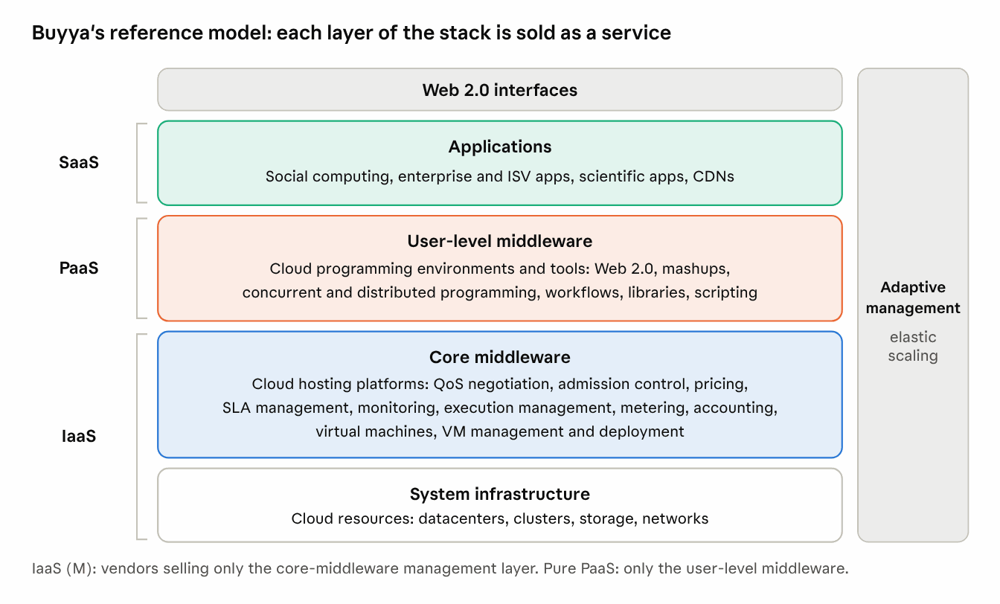

Read it bottom-up: resources and the core middleware that manages them are IaaS, the programming layer is PaaS, and applications reached through Web 2.0 interfaces are SaaS.

- **Cloud resources (system infrastructure):** datacenters of servers, storage and networks, and even clusters or networked PCs, that supply the raw computing power.
- **Core middleware:** manages the physical infrastructure and gives applications a runtime environment. Hypervisors expose the hardware as virtual machines; virtualization gives customization, isolation, sandboxing and quality of service. Its functions include QoS negotiation, admission control, execution management and monitoring, accounting and billing. Hosting platforms plus resources make up **IaaS**. Vendors who sell only this management layer offer **IaaS (M)**.
- **User-level middleware:** cloud programming environments and tools: web interfaces, command-line tools, frameworks for concurrent and distributed programming, APIs. Developers build cloud applications against it, so it is **PaaS**. "Pure PaaS" offers only this layer, to run on someone else's infrastructure.
- **Applications:** services delivered to end users through Web 2.0 interfaces, which is **SaaS**: social networking, gaming portals, office automation, CRM, scientific applications.
- **Adaptive management:** every layer should scale elastically and behave autonomically. SaaS does this automatically; IaaS and PaaS expose it through their APIs.
- **XaaS:** services from different providers can be combined into a complete stack, for example a virtual Web farm of web servers, databases and load balancers built on IaaS virtual machines.

### 6.2 The CSA Cloud Reference Model (Sosinsky)

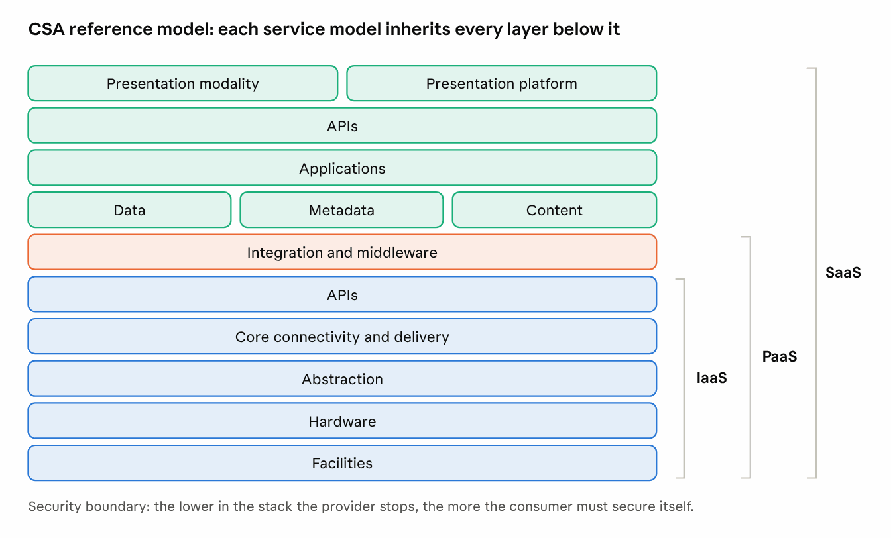

The brackets nest: IaaS is the bottom five layers, PaaS adds integration and middleware, SaaS adds data, applications and presentation.

- **IaaS** covers the whole infrastructure stack: facilities, hardware, the abstraction (virtualization) layer, and core connectivity and delivery, all exposed through APIs.
- **PaaS** sits on IaaS and adds **integration and middleware**: application frameworks, databases, messaging and queuing.
- **SaaS** sits on PaaS and adds everything the user sees: data, metadata and content; the applications and their APIs; and the presentation layer, meaning how and on what devices the user sees it.
- The model is **cumulative**: each service model inherits every layer beneath it.
- **Security rule:** the lower in the stack the provider stops, the more security and management the consumer must do itself. A SaaS consumer secures little beyond its users and data; an IaaS consumer secures the OS, middleware, applications and data.

### 6.3 The NIST Cloud Computing Reference Architecture

Published as [NIST SP 500-292](https://nvlpubs.nist.gov/nistpubs/Legacy/SP/nistspecialpublication500-292.pdf) in September 2011, it is an actor-and-role model. It names who takes part in cloud computing, not which technology to use.

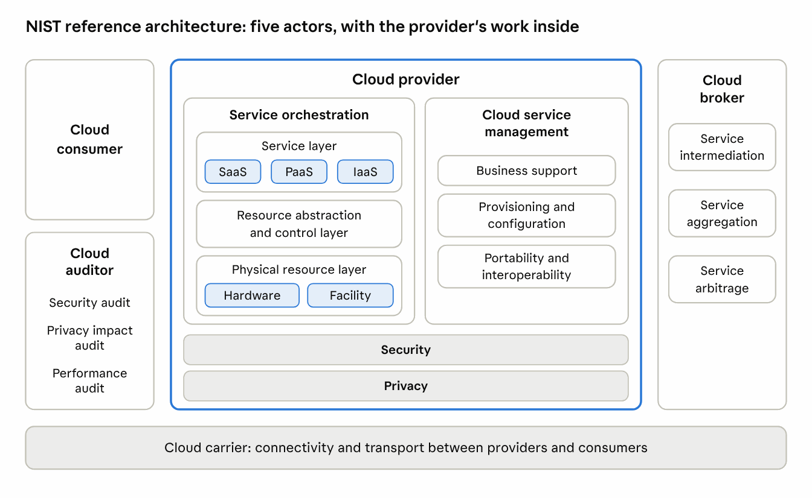

The provider box holds service orchestration, service management, security and privacy; the broker, auditor and carrier sit around it.

| Actor | NIST definition | Example |
| --- | --- | --- |
| Cloud consumer | "A person or organization that maintains a business relationship with, and uses service from, Cloud Providers." | A college using Google Workspace for Education |
| Cloud provider | "A person, organization, or entity responsible for making a service available to interested parties." | AWS, Microsoft, Google |
| Cloud auditor | "A party that can conduct independent assessment of cloud services, information system operations, performance and security of the cloud implementation." | A firm certifying a provider against ISO/IEC 27001 |
| Cloud broker | "An entity that manages the use, performance and delivery of cloud services, and negotiates relationships between Cloud Providers and Cloud Consumers." | A reseller or management platform that combines AWS and Azure services for a customer |
| Cloud carrier | "An intermediary that provides connectivity and transport of cloud services from Cloud Providers to Cloud Consumers." | Network operators and ISPs such as Airtel, Jio, Tata Communications |

Mnemonic: **"Can People Buy A Car?"** = Consumer, Provider, Broker, Auditor, Carrier.

**What the cloud provider does: five activity areas**

1. **Service deployment**: offering the service as a public, private, community or hybrid cloud.
2. **Service orchestration**, in three layers:
   1. *Service layer*: the SaaS, PaaS and IaaS interfaces consumers use.
   2. *Resource abstraction and control layer*: software (hypervisors, virtual machines, virtual storage) that virtualizes physical resources and controls their allocation, access and use.
   3. *Physical resource layer*: hardware (servers, network, storage) and the facility (power, cooling, buildings).
3. **Cloud service management**, in three parts:
   1. *Business support*: customer accounts, contracts, billing, reporting, pricing.
   2. *Provisioning and configuration*: rapid provisioning, resource changes, monitoring, metering, SLA management.
   3. *Portability and interoperability*: moving data and applications between clouds, and letting them work together.
4. **Security**: shared between provider and consumer, depending on the service model.
5. **Privacy**: protecting personal information collected and processed in the cloud.

**What the cloud broker does: three kinds of service**

- **Service intermediation**: improves one service by adding a capability, such as identity management or security reporting.
- **Service aggregation**: combines several services into one new service, for example joining data from two providers.
- **Service arbitrage**: like aggregation, but the services are not fixed. The broker picks the best provider each time, for example the cheapest.

**What the cloud auditor does:** security audits, privacy-impact audits and performance audits, each checking the cloud against agreed criteria.

**How the actors interact:** a consumer may request services from a provider directly or through a broker. The carrier carries traffic between them. The auditor may contact any of the others to collect evidence.

**Worked example:** a college (consumer) buys a learning-management SaaS through a reseller that bundles it with single sign-on (broker). The SaaS runs on a hyperscale cloud (provider). Students reach it over their ISPs (carriers), and an independent firm certifies the provider's security (auditor).

> Exam tip: draw the NIST figure with all five actors and the provider's inner boxes, define each actor in one line, then explain the three service-orchestration layers.

### 6.4 The cloud ecosystem *(PYQ 2016)*

- **Definition:** a cloud ecosystem is the network of interdependent parties and components that together deliver cloud services: providers (IaaS, PaaS, SaaS), consumers, brokers, carriers and auditors (the NIST actors), plus software vendors, system integrators, developers, marketplaces and standards bodies.
- **How it works:** each party builds on the others. A SaaS vendor runs on an IaaS provider, sells through a marketplace, integrates with partners' APIs and is checked by auditors.
- **Examples:**
  - **AWS:** EC2 and S3 at the core, AWS Marketplace selling third-party software, consulting and technology partners, and independent SaaS firms built on AWS.
  - **Salesforce:** its CRM (SaaS), the Salesforce Platform (PaaS) and AppExchange, where partners sell apps that plug into Salesforce.
  - **Microsoft:** Azure, Microsoft 365, Azure Marketplace and its partner network.
  - **Google:** Google Cloud, Google Workspace and Google Cloud Marketplace.
- **Why it matters:** customers get complete solutions from many sources and providers grow through partners, but a deep ecosystem also deepens lock-in.

### 6.5 Previous-year questions on this topic

- Explain the cloud computing reference model with a neat diagram. → 6.1.
- Draw the diagram of the CSA cloud reference model with security boundaries. *(PYQ 2014)* → 6.2: mark where the provider's responsibility ends for IaaS, PaaS and SaaS.
- Write a brief note on the cloud ecosystem with examples. *(PYQ 2016)* → 6.4.
- MCQ: the organization helping to foster security standards for cloud computing *(2014)* → **Cloud Security Alliance**. The question bank ticks "cloud security watchdog", which is a misprint.

## 7. Characteristics of Cloud Computing: A Shift in Paradigm

**Cloud computing is a paradigm shift because computing moves from something you buy, install and own to a service you rent from huge shared data centers, provision yourself in minutes and pay for by use.** The technologies are older (virtualization, the Internet, Web services); the way of consuming them is new.

### 7.1 Traditional data centre (in-house IT) vs cloud computing

| Aspect | Traditional IT | Cloud computing |
| --- | --- | --- |
| Ownership | Buy and own hardware and licences | Rent from a provider |
| Cost | Capital expenditure (CapEx) up front | Operating expenditure (OpEx), pay per use |
| Capacity | Fixed, sized for the peak, idle most of the time | Elastic, follows demand |
| Provisioning time | Weeks to order, install and configure | Minutes, self-service |
| Maintenance | In-house team patches and repairs | Provider runs the infrastructure |
| Location | The organization's own server room | Provider data centers around the world |
| Access | Mostly from the office network | Anywhere, any device, over the Internet |
| Tenancy | Single tenant | Multi-tenant, shared |
| Security boundary | The firewall around the office network | Identity, encryption and data-level controls |
| Economics | Every firm builds its own capacity | Provider spreads cost over millions of users |

### 7.2 Why it counts as a shift

- **You lease a slice of an enormous infrastructure.** Choosing a provider means renting part of data centers that cost their owners hundreds of millions of dollars or more.
- **Economies of scale.** Providers site data centers where power, cooling, land and network links are cheap, and fill them with commodity hardware bought in huge volume. No single customer can match that cost.
- **Global footprint.** Large providers run many data centers across the world, so a service can sit close to its users and survive the loss of a site.
- **Utility model.** Like electricity: you do not build a power plant to switch on a light.
- **Product becomes service.** Software becomes a subscription, and a server becomes an API call.

### 7.3 Characteristics in one list (for a 5-mark question)

1. On-demand self-service
2. Broad network access
3. Resource pooling and multi-tenancy
4. Rapid elasticity and scalability
5. Measured service, pay-per-use
6. Virtualization
7. Resilience and high availability
8. Automatic maintenance and upgrades by the provider
9. Location independence and geographic distribution
10. Service orientation: everything is reached through APIs

### 7.4 Technologies that made the shift possible

- **Virtualization** (hypervisors) to pool and partition hardware.
- **Broadband Internet**, which makes remote resources usable.
- **Web services and SOA** (SOAP, REST, XML, JSON) for standard interfaces.
- **Cheap multi-core servers and storage.**
- **Automation and orchestration**: APIs, scripts, infrastructure as code.
- **Open-source software**: Linux, Xen and KVM, Apache, MySQL.
- **Grid and utility computing**, which brought metering and shared distributed resources.

> Exam tip: for "Cloud computing is a paradigm shift. Justify", give the table in 7.1 and three points from 7.2.

### 7.5 Characteristics as the prescribed books list them

**\[Buyya\] seven characteristics that benefit both consumers and providers:**

1. **No up-front commitments**: no capital outlay to start.
2. **On-demand access**: resources whenever you need them.
3. **Nice pricing**: pay for what you use; costs turn from capital into operating expense.
4. **Simplified application acceleration and scalability**: an application grows or shrinks quickly.
5. **Efficient resource allocation**: providers share hardware among many users at high utilization.
6. **Energy efficiency**: consolidated datacenters use less energy per workload.
7. **Seamless creation and use of third-party services**: services from several providers are combined easily.

Mnemonic: **"No One Needs Slow, Expensive, Energy-hungry Servers."**

**\[Miller\] six key properties of cloud computing:**

1. **User-centric**: once you are connected, your documents, messages and applications are yours, reachable and shareable from anywhere.
2. **Task-centric**: the focus is on what you need done, not on the application.
3. **Powerful**: thousands of connected computers give more power than any single PC.
4. **Accessible**: data kept in the cloud can be retrieved instantly from many repositories.
5. **Intelligent**: so much data is stored that data mining and analysis are needed to reach it intelligently.
6. **Programmable**: many tasks are automated; for example, data on a computer that fails is copied to another automatically.

Mnemonic: **"Ultra Tough Pilots Always Inspect Planes."**

### 7.6 Why organizations are interested in cloud computing *(model question)*

They pay only for what they use and avoid capital spending; get capacity in minutes instead of weeks; scale with demand; reach users worldwide; hand maintenance and upgrades to the provider; gain cheaper disaster recovery; let staff work from anywhere and collaborate; and free IT staff to work on the business instead of servers.

### 7.7 Previous-year questions on this topic

- What is the difference between traditional data centres and cloud? *(PYQ 2016; DSZ)* → 7.1.
- State the characteristics of cloud computing. → 7.3 and 7.5.
- Why are organizations interested in cloud computing? *(model question)* → 7.6.
- MCQs on what cloud computing can replace *(2015, 2017)*, services built on the cloud *(2015, 2017)* and the company not yet a cloud leader *(2017)* → Section 17.

## 8. Benefits and Advantages of Cloud Computing

**The cloud's main benefit is economic: you swap large up-front spending for small pay-per-use bills, and get capacity, reliability and global reach you could not build yourself.** Sosinsky lists seven benefits on top of NIST's five essential characteristics.

### 8.1 Sosinsky's seven benefits

| Benefit | Explanation |
| --- | --- |
| 1. Lower costs | Shared resources in efficient data centers run at high utilization, and you pay only for what you use. No capital spending on hardware. |
| 2. Ease of utilization | No hardware to buy and no licences to install. Depending on the application, you can start almost at once. |
| 3. Quality of Service (QoS) | Service quality is fixed in a contract (SLA) with the vendor. |
| 4. Reliability | Scale, redundancy and load balancing often make cloud services more reliable than in-house IT, though outages still happen. |
| 5. Outsourced IT management | The provider runs the infrastructure while you run your business, often at lower staff cost. |
| 6. Simplified maintenance and upgrade | The system is centralized, so the provider applies patches and new versions for everyone; users always run the latest version. |
| 7. Low barrier to entry | Little up-front capital is needed, so startups and students can begin with a few rupees of usage. |

Mnemonic: **"Lazy Engineers Quietly Rely On Simple Labs"** (Lower costs, Ease, QoS, Reliability, Outsourced IT, Simplified maintenance, Low barrier).

### 8.2 Other advantages often asked

- **Scalability and elasticity:** absorb spikes such as a festive sale or results day, then scale back.
- **CapEx to OpEx:** pay-as-you-go instead of buying for the peak.
- **Speed and global reach:** deploy in several regions in minutes; faster time to market.
- **Mobility and collaboration:** work from any device; several people edit one Google Doc at the same time.
- **Backup and disaster recovery:** data copied across regions at a fraction of the cost of a second site.
- **Automatic updates:** security patches and features arrive without user effort.
- **Green computing:** consolidation raises utilization, so less energy is used per workload.
- **Focus on the core business:** fewer staff hours spent on servers.

### 8.3 Disadvantages and limitations

- **Internet dependence:** no connectivity means no service; latency hurts real-time applications.
- **Security and privacy:** a third party holds your data on shared hardware. Information security is usually rated the number one concern, a frequent MCQ.
- **Compliance and data location:** laws can restrict where data is stored or processed. For example, the RBI requires payment-system data to be stored in India.
- **Vendor lock-in:** proprietary APIs, data formats and data-transfer (egress) charges make switching providers hard.
- **Limited control and customization:** the provider decides hardware, software versions and maintenance windows.
- **Outages:** even the largest providers fail at times, and SLA credits do not repay lost business.
- **Cost surprises:** for steady, heavy workloads, pay-per-use can cost more than owned hardware.
- **Poor fit for some applications:** custom or legacy applications, or those needing special hardware, may not move easily.
- **Variable performance:** "noisy neighbours" on shared hardware can slow your workload.

### 8.4 When the cloud fits

- **Good fit:** unpredictable workloads, new projects and startups, collaboration, backup and disaster recovery, development and testing, users spread across the world.
- **Poor fit:** strict data-residency or secrecy rules, very low-latency control systems, large steady workloads already running cheaply on owned hardware.

> Exam tip: for "Advantages and disadvantages of cloud computing", give five points on each side with one line of explanation, and an example for at least two of them.

### 8.5 Advantages and disadvantages in Miller

- **Advantages (15):** lower-cost computers for users; improved performance; lower IT infrastructure costs; fewer maintenance issues; lower software costs; instant software updates; increased computing power; unlimited storage capacity; increased data safety; better compatibility between operating systems; better document-format compatibility; easier group collaboration; universal access to documents; the latest version always available; no tie to one particular device.
- **Disadvantages (6):** needs a constant Internet connection; works poorly on low-speed connections; can be slow; features may be limited; stored data may not be secure; if the cloud loses your data, you may have no way to get it back.
- **Who benefits:** collaborators, road warriors (people always travelling), cost-conscious users, cost-conscious IT departments, users with growing needs.
- **Who should not rely on it:** people with poor Internet access, offline workers, the security-conscious, anyone tied to existing applications.

### 8.6 Benefits and limitations in Velte

- **Benefits:** scalability (capacity follows demand), simplicity (nothing to install or maintain), knowledgeable vendors who run the systems, and security handled by specialists.
- **Limitations:** your sensitive information sits with a third party; some applications are not ready for the cloud; building your own cloud applications needs new skills.

### 8.7 Cloud economics and pricing (Buyya)

- **Capital cost (CapEx):** paid in advance for assets such as servers and licences, then depreciated over years. **Operational cost (OpEx):** paid while you use a service.
- The cloud turns IT capital costs into operational costs and removes the depreciation and upkeep of owned assets.

| Pricing model | How you pay | Example |
| --- | --- | --- |
| Tiered pricing | Fixed configurations at fixed prices per unit of time | Amazon EC2 instance sizes, billed per hour |
| Per-unit pricing | Per unit of a resource used: GB stored or transferred, memory per hour | Storage and data-transfer billing |
| Subscription-based pricing | A fixed periodic fee | Most SaaS, per user per month |

### 8.8 Open challenges (Buyya)

- **Cloud definition:** still debated; NIST's is the reference.
- **Interoperability and standards:** moving between providers without lock-in.
- **Scalability and fault tolerance:** systems that grow and survive failures.
- **Security, trust and privacy:** your data sits in someone else's datacenter.
- **Organizational aspects:** new roles, processes and governance for IT.

### 8.9 Business and technical benefits of cloud architecture *(PYQ 2017)*

- **Business benefits:** almost zero up-front infrastructure investment; just-in-time infrastructure, so no guessing of capacity; more efficient use of resources; usage-based costing; shorter time to market. Also: no rip-and-replace of existing hardware, agility through automation, and portable applications.
- **Technical benefits:** automation through scriptable infrastructure; auto-scaling; proactive scaling ahead of known peaks; a faster development cycle, since production can be cloned for testing; better testability; disaster recovery and business continuity; overflow of peak traffic to the cloud (cloud bursting).

### 8.10 Behavioural factors in cloud adoption *(PYQ 2014; Sosinsky)*

Ten human factors slow or speed the move to the cloud:

1. People are risk-averse and loss-averse.
2. People have a flat-rate bias: they prefer a fixed fee even when paying per use is cheaper.
3. People need to control their environment and remain anonymous.
4. People fear change.
5. People value what they own more than what they are given.
6. People favour the status quo and invest accordingly.
7. People discount future risk and favour instant gratification.
8. People favour things that are free.
9. People need status.
10. People are paralysed by too much choice.

### 8.11 Service Level Agreement (SLA): key parameters *(PYQ 2015)*

- **An SLA** is the performance contract negotiated between a customer and a provider. It fixes measurable service levels and what happens when they are missed.
- **\[Sosinsky\] An SLA usually specifies:** availability of the service (uptime); response time or latency; reliability of the service components; the responsibilities of each party; warranties.
- **Other common parameters:** number of concurrent users served; performance benchmarks; application response time; advance notice of network changes; help-desk response time for each class of problem; usage statistics provided; backup and recovery targets; security and data-protection terms; penalties or service credits for breaches; review and exit terms.
- **Example:** 99.9% monthly uptime allows about 43 minutes of downtime a month. Below that, the provider owes service credits.

### 8.12 Worked cases from past papers

**a) Clean-and-Green Energy: real-time load management and online consumer billing in the cloud** *(PYQ 2015; DSZ)*

| System | Advantages in the cloud | Disadvantages and risks |
| --- | --- | --- |
| Real-time load management | Elastic computing for spikes in smart-meter and sensor data; large-scale analytics and forecasting; data from all substations in one place; disaster recovery | Latency and Internet dependence for control decisions; security of critical infrastructure; an outage could affect the grid; rules on handling control data |
| Online consumer billing | Scales for month-end billing peaks; pay per use; customers view and pay bills online from anywhere; easy link to payment gateways; lower IT cost | Privacy of customers' personal and payment data; vendor lock-in; downtime during billing runs; data-location compliance |

**Suggestion:** billing suits a public cloud or a SaaS billing platform. Load management suits a private or hybrid cloud, with local control on site and the cloud used for analytics.

**b) Email for a small enterprise** *(PYQ 2016)*

- **Suggest a cloud email service** such as Google Workspace, Microsoft 365 or Zoho Mail rather than an in-house mail server.
- **Reasons:** no server hardware or licences; low cost per user; set up in a day; access from any device; automatic updates; spam and virus filtering; backup and uptime handled by the provider under an SLA; scales as staff grow; shared calendars and documents.
- **When a traditional server may still win:** strict data-location or secrecy rules, unreliable Internet, or an existing investment in on-premises mail.

### 8.13 Previous-year questions on this topic

- What are the advantages and disadvantages of cloud computing? *(PYQ 2014; DSZ)* → 8.1 to 8.6.
- Discuss three main advantages and two major disadvantages with examples; describe the key parameters of a cloud SLA. *(PYQ 2015)* → 8.5, 8.11.
- What are the advantages and limitations of cloud computing? *(PYQ 2018; DSZ)*
- Discuss the business benefits involved in cloud architecture. *(PYQ 2017)* → 8.9.
- What are the behavioural factors relating to cloud adoption? *(PYQ 2014)* → 8.10.
- Describe the benefits of cloud computing from business and technological perspectives. *(DSZ)* → 8.9.
- Clean-and-Green Energy *(PYQ 2015; DSZ)* and small-enterprise email *(PYQ 2016)* → 8.12.
- What are the benefits of cloud computing? *(model question)* Ten points to write: economies of scale; lower spending on infrastructure; a global workforce at low cost; streamlined processes; lower capital cost; better accessibility; closer monitoring of projects; less staff training; fewer software licences to buy; more flexibility.
- MCQs on what is not an advantage *(2014)*, the number one concern *(2014, 2015, 2017)*, factors to consider *(2015, 2017)* and pricing models *(2017)* → Section 17.

## 9. The Cloud Computing Stack

**Cloud architecture is a stack: infrastructure (virtual machines on a hypervisor) at the bottom, platforms above it, applications on top, with virtual appliances packaging software for the VMs and standard Internet protocols connecting everything.** The stack works because it is built from composable parts. These six ideas come from Sosinsky's Chapter 3.

### 9.1 Composability

- **Definition:** cloud applications are often assembled from a collection of components. A **composable** system combines standard parts and tailors them to a specific purpose.
- A composable component must be:
  - **Modular**: a self-contained, independent unit that cooperates with others and can be reused or replaced.
  - **Stateless**: it handles each transaction on its own, without depending on earlier requests.
- Cloud computing does not require composability, but it is highly desirable: design becomes easier, and solutions become more portable and interoperable.
- **Why statelessness matters:** any copy of a stateless component can serve any request, so you scale by adding copies. State lives in a database or cache, not in the component.
- **Example:** an online shop built from separate services for login, catalogue, cart, payment (a payment-gateway API) and email. Each can be replaced without touching the rest. Microservices and serverless functions are composability today.
- Hardware can be composable too: CPU, storage and network are drawn from pools and assembled into a server on demand.

### 9.2 Infrastructure

- Most IaaS providers deliver servers as **virtual machines (VMs)**. A VM is a container assigned specific resources: CPU cycles, memory, storage and network bandwidth.
- A **machine image** is a template (an OS plus software). An **instance** is a running VM started from that image, e.g. an Amazon Machine Image (AMI) launched as an EC2 instance.
- The **virtual machine monitor (VMM), or hypervisor**, is the low-level software that lets several operating systems run, each in its own memory space, and manages I/O for the VMs.
  - **Type 1 (bare-metal)** runs directly on the hardware: Xen, VMware ESXi, Microsoft Hyper-V, KVM.
  - **Type 2 (hosted)** runs on a host operating system: VirtualBox, VMware Workstation. Module 2 covers hypervisors in depth.
- The hardware is generic; the software running inside the VMs is what makes the cloud useful. Section 11.2 draws a physical server split into VMs.

**\[Velte\] The three components of a cloud solution:**

- **Clients:** the devices people use to reach the cloud: mobile, thin and thick clients (10.2).
- **Datacenter:** the collection of servers that houses the application. Virtualization lets many virtual servers run on one physical server.
- **Distributed servers:** servers in geographically separate places that look like one to the user. They add flexibility and safety: another site takes over if one fails.

**\[Velte\] Infrastructure techniques:** grid computing (many computers working on one task), full virtualization (an unmodified OS runs in each virtual machine) and paravirtualization (the guest OS is modified to cooperate with the hypervisor for speed). Module 2 covers virtualization in depth.

### 9.3 Platforms

- A **platform** in the cloud is a software layer used to build higher levels of service.
- It supplies all the hosted hardware and software needed to build and deploy web applications, within the limits the platform sets.
- A platform covers almost the whole software stack. Only the user interface (presentation layer) is left for the developer.
- **Textbook examples:** Salesforce.com's Force.com, the Windows Azure Platform, Google Apps with Google App Engine.
- **Today:** Google App Engine, Azure App Service, AWS Elastic Beanstalk, Heroku, Cloud Foundry.

* **\[Sosinsky\] more platform examples:** a platform built on a Sun xVM hypervisor with the NetBeans IDE and the GlassFish web stack; Microsoft's Azure platform, letting Windows developers run on a Hyper-V virtual machine with ASP.NET, SQL Server and Visual Studio. Platforms come with tools for design and deployment, and user interfaces built with HTML and JavaScript or, in the textbook era, rich-media tools such as Flash, Flex, AIR or Silverlight.
* **\[Velte\] three ways to build on a platform:** a **web application framework** (libraries for templates, database access, URL mapping, sessions and security, e.g. Django, Ruby on Rails, ASP.NET); a **web hosting service** (space and a ready software stack on a provider's server); **proprietary methods** (the vendor's own platform, such as Force.com or App Engine).

### 9.4 Virtual appliances

- A **virtual appliance** is a pre-built, pre-configured virtual machine image that bundles an application, such as a web server, database server or firewall, with just enough operating system to run it.
- You import the image and boot it: no installation, no configuration. Like a household appliance, you plug it in and use it.
- **Benefits:** fast deployment, identical configuration every time, fewer setup errors, vendor-tested, easy to move between hypervisors and clouds.
- **Packaging standard:** the Open Virtualization Format (OVF), or its single-file form OVA (covered in Module 2).
- **Examples:** a ready-made WordPress or LAMP server image from AWS Marketplace; virtual firewall appliances such as pfSense; VMware's virtual appliance marketplace (the textbook's example).

* **\[Moyer\]** calls this pattern **prepackaged images**: build one machine image with everything installed, then launch identical servers from it. Related patterns in his book are singleton instances and prototype images.

### 9.5 Communication protocols

- Cloud services talk over the standard Internet protocol suite (TCP/IP), mostly through **HTTP and HTTPS**.
- HTTP is **stateless**: every request stands alone. State is carried by cookies, tokens and session IDs, or kept in a database.
- How inter-process communication (IPC) evolved for distributed systems:
  1. **RPC (Remote Procedure Call):** call a function on another machine as if it were local. Implementations: DCOM, Java RMI, CORBA. They struggled across the Internet because of firewalls and platform dependence.
  2. **XML-RPC:** the first truly Web-centric RPC. Calls are encoded in platform-independent XML and carried over HTTP.
  3. **SOAP:** the XML messaging standard that replaced XML-RPC. A message carries the data plus the rules for using it, usually over HTTP. SOAP is the base of the WS-\* Web services stack; services are described in **WSDL** and listed in **UDDI** registries.
  4. **REST (Representational State Transfer):** an architectural style that applies the HTTP verbs GET, POST, PUT and DELETE to resources named by URLs, usually exchanging **JSON**. Most cloud APIs today are REST.
  5. **Newer:** gRPC for fast service-to-service calls, WebSockets for real-time push, message queues (AMQP, MQTT) for asynchronous work.
- **Secure transport:** TLS (HTTPS), SSH, IPsec VPNs (Section 10).

A SOAP message is an XML envelope; a REST call is a plain HTTP request:

```xml
<soap:Envelope xmlns:soap="http://www.w3.org/2003/05/soap-envelope">
  <soap:Header/>            <!-- optional: security, transactions -->
  <soap:Body>
    <GetInstance><Id>42</Id></GetInstance>
  </soap:Body>
</soap:Envelope>
```

```http
GET /v1/instances/42 HTTP/1.1
Host: api.example.com
Authorization: Bearer <token>
```

| Basis | SOAP | REST |
| --- | --- | --- |
| Nature | A protocol (W3C standard) | An architectural style |
| Data format | XML only | JSON mostly; also XML, HTML, text |
| Transport | HTTP, SMTP and others | HTTP/HTTPS |
| Interface description | WSDL | OpenAPI (optional) |
| Message weight | Heavy: envelope, header, body | Light |
| State | Can support stateful operations through WS-\* | Stateless |
| Security | WS-Security at message level | TLS and OAuth tokens at transport level |
| Caching | Not cacheable | Uses HTTP caching |
| Typical use | Banking and enterprise integration | Web, mobile and public cloud APIs |

**\[Moyer\] HTTP and REST in more detail**

- An HTTP request has a **header** (method, URL, host, content type, authorization) and an optional **body** (the data). The response carries a status code, headers and a body.
- **Methods:** GET reads a resource; PUT creates or replaces it; POST creates or triggers an action; DELETE removes it; HEAD fetches only the headers.
- **Status codes:** 2xx success (200 OK, 201 Created); 3xx redirection; 4xx client error (400, 401, 403, 404); 5xx server error (500, 503).
- **REST principles:** resources named by URLs; one uniform interface (the HTTP methods); stateless requests; representations such as JSON or XML; cacheable responses; a layered system.
- **MCQs:** DCOM, Java RMI and CORBA are forms of **RPC** *(2016)*. WSDL stands for **Web Service Description Language** *(2016)*.

### 9.6 Applications

- Cloud applications run over a network that is stateless, shared, and exposed to latency and failure. So they are designed differently from desktop software:
  - **Stateless, horizontally scalable** components behind load balancers.
  - **Multi-tenant** data models.
  - **Fault tolerant**: retries, and copies across availability zones.
  - **Latency-aware**: caching, content delivery networks, asynchronous processing.
  - Reached through browsers, mobile apps or APIs.
- **Kinds of cloud application:** web mail (Gmail), collaboration (Google Docs, Slack), business software (Salesforce CRM, Workday HR), analytics and big data, AI and machine-learning services, media streaming, IoT back ends, games.
- **Cloud-native** applications combine microservices, containers (Docker), orchestration (Kubernetes) and continuous delivery (CI/CD).

* **\[Velte\] three common cloud applications:** storage (files kept online), databases (hosted database services) and synchronization (data kept identical across devices).
* **\[Miller\] everyday cloud services:** calendars and schedules, contact and project management, word processing, spreadsheets, databases and presentations, file storage and sharing, web email, instant messaging, web conferencing, social networks, blogs and wikis.
* **\[Moyer\] layers of a cloud application:** a **data layer** (cloud databases and storage), an **application layer** (servers behind a load balancer), an **authorization layer** (who may do what) and a **client layer** (browser-based clients or native applications).

> Exam tip: short notes on composability or virtual appliances (5 marks) are common. Give the definition, the properties (modular and stateless; pre-configured and portable) and one example.

### 9.7 Previous-year questions on this topic

- What is composability and what are its benefits? *(model question)* → 9.1.
- Discuss composability and virtual appliances and how they make cloud platforms flexible. *(DSZ)* Use them to design a scalable global ERP system. *(DSZ scenario)* → 9.1, 9.4.
- What is cloud infrastructure? Explain the cloud platform. *(model questions)* → 9.2, 9.3.
- What are the communication protocols in cloud computing? *(model question)* → 9.5.
- MCQ: must hardware or software be composable? *(2016)* → **neither is required**. Sosinsky: composability is highly desirable, not mandatory.
- MCQs on forms of RPC and WSDL *(2016)*, server virtualization and VirtualBox *(2018)* → Section 17.

## 10. Connecting to the Cloud by Clients

**Clients reach the cloud through a web browser or a proprietary application, over a network that is insecure and transient, so every connection is protected by a secure protocol, a tunnel, data encryption, or best of all two or more of these together.**

### 10.1 Two ways in

| Client | How it connects | Examples |
| --- | --- | --- |
| Web browser | HTTP/HTTPS; nothing to install; works on any device | Gmail, Salesforce, the AWS console in Chrome |
| Proprietary application | The vendor's desktop or mobile app, agent or command-line tool, calling the vendor's APIs (usually over HTTPS); may work offline and sync later | Dropbox sync client, Microsoft Teams app, AWS CLI |

These clients may run on a server, a PC, a tablet or a phone. What they share is that their data crosses the Internet, a medium nobody controls end to end.

### 10.2 Thin, thick and zero clients

| Client | Meaning | Example |
| --- | --- | --- |
| Thin client | Little local processing; relies on the cloud for computing and storage | A Chromebook running web apps |
| Thick (fat) client | Does much of the processing locally and syncs with the cloud | Desktop Microsoft Office with OneDrive sync; a mobile app with offline mode |
| Zero client | No local OS or storage; only displays a remote desktop | Virtual desktop (VDI) terminals |

NIST's "broad network access" characteristic is exactly this: heterogeneous thin and thick clients reaching the cloud through standard mechanisms.

- **\[Velte\] client types:** **mobile** (smartphones and PDAs), **thin** (no hard drive; the server does the work and holds the data) and **thick** (an ordinary computer using a web browser to reach the cloud).
- **\[Velte\] why thin clients:** lower hardware cost, lower IT cost, better security because no data sits on the desk, data security, lower power use, easy repair or replacement, less noise.
- **\[Moyer\] the client layer:** browser-based clients (HTML and JavaScript calling the service's REST API) or native applications (desktop or mobile apps calling the same API).

### 10.3 Securing the connection: the three basic methods

1. **Use a secure protocol** to move the data: SSL/TLS (HTTPS), FTPS or IPsec, or log in through SSH (Secure Shell).
2. **Create a virtual connection (tunnel):** a VPN, or a remote-display protocol such as Microsoft RDP or Citrix ICA, where a tunnelling mechanism protects the data.
3. **Encrypt the data itself**, so that even if it is intercepted ("sniffed") it is meaningless.

The best client connections **combine two or more** of these, for example a VPN tunnel carrying TLS traffic with encrypted files inside.

| Protocol | Works at | Typical cloud use |
| --- | --- | --- |
| TLS/SSL (HTTPS, FTPS) | Transport and application layers | Web traffic, APIs, file transfer |
| SSH (with SFTP, SCP) | Application layer | Administrator login to Linux VMs, secure file copy |
| IPsec | Network layer | Site-to-site VPN between an office and a cloud network |
| RDP, Citrix ICA | Application layer | Remote desktop to Windows VMs or virtual desktops |
| VPN (IPsec, SSL VPN, WireGuard) | Network layer | A private tunnel from a user or office into the cloud |

### 10.4 The browser as the operating system

- Many cloud services need nothing but a browser, so the browser itself becomes the client platform.
- **Chromium OS** *(short note, PYQ 2014; DSZ)*: an open-source project by Google to build an operating system for people who spend most of their time on the web.
  - It is a lightweight variant of Linux that takes very little disk space, boots fast and is built around the Chrome browser, whose interface it resembles.
  - It runs on x86 and ARM processors, and needs no separately installed device drivers.
  - Applications and data live in the cloud, so there is little to install, update or back up, and security is simpler.
  - In the textbook era it printed through Google Cloud Print, which Google shut down in 2020.
- **ChromeOS** on Chromebooks is the commercial version: a thin client for the cloud.
- **Jolicloud**, the textbook's other example, was a netbook OS built around web apps; it has since been discontinued.

### 10.5 Accelerated delivery: making remote feel local

Distance and congestion add latency, so providers bring content and code closer to the user:

- **Content delivery networks (CDNs)** cache content on edge servers near users: Akamai, Amazon CloudFront, Cloudflare.
- **WAN optimization** compresses and de-duplicates traffic between sites and speeds up chatty protocols.
- **Edge computing** runs code at locations near users.
- **Nearby regions and private links:** deploy in the closest region, or bypass the public Internet with dedicated links such as AWS Direct Connect or Azure ExpressRoute.

**\[Velte\] Four ways to connect to the cloud:**

1. **Basic public Internet:** the cheapest; no guarantee of speed or security.
2. **Accelerated Internet:** the provider adds acceleration such as caching, compression and protocol optimization on top of the Internet.
3. **Optimized Internet overlay:** an overlay network of edge servers (e.g. Akamai) routes traffic over the best paths.
4. **Site-to-site VPN:** an encrypted tunnel between the organization's network and the cloud provider.

> Exam tip: for "How do clients connect to the cloud securely?", name the two kinds of client, give the three methods with one protocol each, and end with "use two or more together".

### 10.6 Previous-year questions on this topic

- Short note: Chromium OS. *(PYQ 2014; DSZ)* → 10.4.
- How do businesses get connected to the clients via the cloud? *(model question)* → 10.1, 10.3.
- What is the purpose of a content delivery network (CDN) in a cloud environment? *(DSZ)* → 10.5: it caches content near users to cut latency and load on the origin server.

## 11. IaaS in Depth: Workloads, VPS Partitioning, Pods, Aggregations, Silos

**In IaaS the provider supplies virtual machines, storage and networks. The customer rents capacity for a workload, which runs in a virtual private server instance; the provider builds its data centers from pods, aggregates pods into availability zones, and isolated deployments become silos.**

### 11.1 Basic concept

- IaaS supplies virtual machines, virtual storage, virtual networks and other hardware assets as resources that clients provision for themselves.
- **Provider manages** all the infrastructure. **Client manages** everything deployed on it: the operating system, applications and how users interact with them.
- **Building blocks:** compute (VM instances); storage (block, object, file); networking (virtual networks, IP addresses, load balancers, firewall rules); management (monitoring, billing, APIs).
- **Characteristics:** resources delivered as a service, dynamic scaling, utility pricing per hour or second, multi-tenancy, self-service through console and API, choice of OS image.
- **Examples:** AWS (EC2, EBS, S3, VPC), Azure Virtual Machines, Google Compute Engine, IBM Cloud, Oracle Cloud Infrastructure, DigitalOcean. For private IaaS: OpenStack, Apache CloudStack.
- **Typical uses:** hosting web servers, development and testing, high-performance computing, big-data clusters, backup and disaster recovery, moving legacy applications as they are ("lift and shift").
- **Advantages:** full control of OS and software, no hardware to buy, elastic, pay-per-use, ready in minutes, standard VMs are portable.
- **Disadvantages:** you still patch and secure the OS and applications, it needs system-administration skill, costs can sprawl, shared hardware, variable performance.

**\[Buyya\] IaaS reference implementation, three layers:**

1. **User interface:** a web-based management portal plus Web-service (REST) APIs for programs.
2. **Infrastructure management software:** scheduling, pricing and billing, monitoring, reservation, QoS/SLA management, VM image repository, VM pool management, provisioning, and connectors to third-party clouds.
3. **Physical infrastructure:** datacenters, clusters, or even desktop machines.

Some vendors sell only the management layer (**IaaS-M**), to run on other infrastructure.

**\[Sosinsky\]** In IaaS the developer creates virtual private servers, virtual storage and virtual private networks, then fills them with the applications the solution needs. Requests made to the virtual systems are redirected to the real servers that do the work.

### 11.2 Workload

- The **workload** is the basic unit of virtualized client in an IaaS deployment. It represents the work a certain type of real, physical server can do.
- Its size is measured by throughput: **Transactions Per Minute (TPM)** or a similar metric for that kind of system.
- A workload has other attributes too:
  - disk I/O, in **Input/Output Operations Per Second (IOPS)**;
  - memory used under load, in MB or GB;
  - network throughput and latency.
- **Hosting vs cloud:** in traditional hosting, your application runs on a dedicated physical server in a rack. In the cloud you reserve a provisioned server, an **instance**, and the provider allocates the resources that would match that type of physical server.

### 11.3 Partitioning of virtual private server (VPS) instances

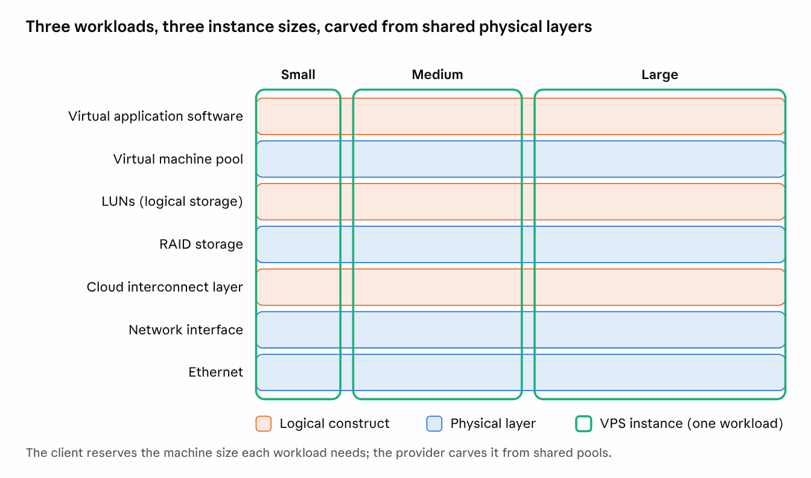

Each instance cuts across every layer: physical pools (VMs, RAID, network interfaces) below, logical constructs (software, LUNs, interconnect) above them.

- The hypervisor partitions physical servers into several **VPS instances**. Each has its own share of vCPU, memory, disk and network, runs its own OS, and is isolated from the others.
- **\[Sosinsky's figure\]** Three workloads need three sizes of machine: small, medium and large. The client reserves the machine equivalent for each workload. The provider runs these instances by drawing on three **physical** layers: a pool of virtual machines, RAID storage, and network-interface capacity.
- Three **logical** constructs sit on those: **LUNs** (logical unit numbers, i.e. logical storage containers), the **cloud interconnect layer** (a virtual network given IP addresses from the provider's pool) and the **virtual application software layer** (the software running in each instance).
- **Isolation:** a crash or break-in inside one VPS should not touch the others, and resource limits stop one tenant hogging the server.
- **Modern example, AWS EC2 instance types:** t3.micro (2 vCPU, 1 GiB), t3.medium (2 vCPU, 4 GiB), m5.large (2 vCPU, 8 GiB), m5.xlarge (4 vCPU, 16 GiB). Families suit different workloads: general purpose (t, m), compute (c), memory (r), storage (i), GPU (p, g).
- **Billing:** per second or per hour of each instance type, with discounts for long commitments or for spare capacity that can be reclaimed.
- **MCQ 2018:** server virtualization means **partitioning a normal server so it behaves as multiple servers**.

### 11.4 Pods, aggregations and silos

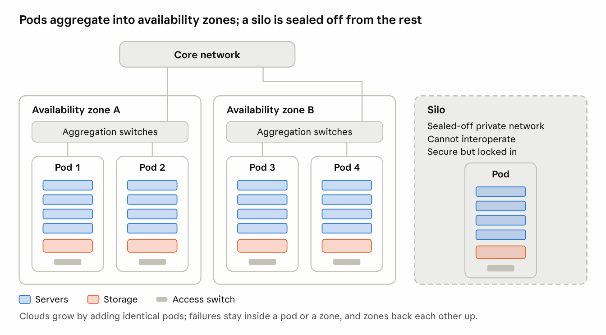

Pods hang off aggregation switches, zones meet at the core network, and the silo has no link to the rest.

| Term | What it is | Why it matters |
| --- | --- | --- |
| Pod | The building block of a large IaaS data center: a fixed group of servers with their own storage and network switches, managed as one unit and hosting a set number of workloads | The provider grows by adding identical pods, not by enlarging one. A pod is also a failure domain: trouble usually stays inside it. |
| Aggregation | Pods joined through aggregation-layer switches and pooled into a larger unit, an IaaS region or site called an **availability zone** | Large clouds fail pod by pod, and sometimes zone by zone. Failover between zones keeps private servers running. |
| Silo | A cloud deployment whose management system is isolated and cannot interoperate with other clouds: an information silo, sealed off like an island | A silo can be protected well and form its own ecosystem, but it is inflexible, blocks interoperability and causes vendor lock-in. A private virtual network inside an IaaS cloud is very likely a silo; the term is also applied to closed PaaS offerings such as Force.com. |

- **Don't confuse:** a Kubernetes "pod" is something else, the smallest deployable unit of one or more containers.

> Exam tip: for "Write short notes on pods, aggregations and silos", define each in two or three lines, draw the figure, and mention availability zones and vendor lock-in.

### 11.5 Resources IaaS provides, and why data centres move to the cloud *(PYQ 2017)*

- **Resources provided:** virtual servers (compute); block, object and file storage; virtual networks (IP addresses, subnets, firewalls, load balancers, VPNs); management tools (monitoring, billing, APIs).
- **Why data centres are migrating:** owned hardware is expensive and often idle; cloud capacity arrives in minutes; costs move from CapEx to OpEx; no hardware refresh cycles; built-in disaster recovery across regions; global reach; staff freed from maintenance; savings in power, cooling and space.

### 11.6 Previous-year questions on this topic

- What is IaaS? Mention the characteristics of IaaS. *(PYQ 2014; DSZ)* → 11.1.
- For IaaS, mention the resources it provides, and explain why more and more data centres are migrating to the cloud. *(PYQ 2017)* → 11.5.
- Explain the concept of IaaS and SaaS with examples and schematic diagrams. *(PYQ 2015)* → Sections 11 and 13.
- Write short notes on workload; VPS partitioning; pods, aggregations and silos. → 11.2 to 11.4.
- MCQs: AWS is IaaS *(2014)*; EC2 is IaaS *(2015)*; Rackspace's service is **Cloud Servers** *(2014)* and an example of **IaaS** *(2018)* → Section 17.

## 12. PaaS in Depth: Concept, Tools and Development Environment

**PaaS gives developers a complete hosted environment (language runtime, frameworks, database and deployment tools) in which they build and run their own applications without managing servers, operating systems or storage.**

### 12.1 Basic concept

- PaaS is a software environment in which a developer builds customized solutions using the development tools the platform provides. A platform may be based on particular languages, application frameworks or other constructs.
- It is often a **fully integrated development environment**: every tool and service is part of the PaaS offering.
- To be useful it must let developers build user interfaces, so it supports web standards such as HTML, CSS and JavaScript, and rich-media technologies.
- **Customer's job:** build and customize applications within the limits the vendor allows, and use the platform. The customer does not maintain hardware or system software.
- **Vendor's job:** every operational aspect: hardware, OS, runtime, maintenance, scaling, and managing the product's lifecycle.

### 12.2 Characteristics

- Development, testing, deployment, hosting and maintenance in one integrated environment.
- Multi-tenant, with scaling, load balancing and failover built in.
- Web-based tools for building user interfaces; several languages supported.
- Integration with databases and web services through APIs.
- Team tools: version control, continuous integration and delivery.
- Billing by usage.

### 12.3 Tools and development environment

| Component | What it does | Examples |
| --- | --- | --- |
| Language runtimes | Run your code | Python, Java, Node.js, Go, PHP, Ruby, .NET |
| Frameworks | Structure the application | Django, Flask, Spring Boot, Express |
| SDK and CLI | Local emulators, deploy commands | Google Cloud CLI (gcloud), Heroku CLI, EB CLI, Azure CLI |
| IDE integration | Code, debug and deploy from the editor | VS Code and IntelliJ extensions; browser IDEs such as Cloud Shell Editor, GitHub Codespaces |
| Managed data services | Databases and storage without administration | Cloud SQL, Firestore, Amazon RDS, Heroku Postgres |
| Build and deploy | Turn source code into running instances | Buildpacks, containers, Git-push deploys, Cloud Build, GitHub Actions |
| Configuration files | Declare runtime, scaling and environment | app.yaml (App Engine), Procfile (Heroku) |
| Monitoring and logging | Watch health, errors and performance | Cloud Logging and Monitoring, Amazon CloudWatch, Azure Monitor |
| Add-on marketplaces | Plug in email, caching, queues | Heroku Elements, Salesforce AppExchange |

### 12.4 How a developer works on a PaaS

1. Write the code with the platform's SDK and test it on a local emulator.
2. Describe the app in a configuration file: runtime, scaling rules, environment variables.
3. Deploy with one command or a Git push.
4. The platform builds the app, provisions instances, sets up load balancing and starts it.
5. The platform adds and removes instances with traffic, and replaces failed ones.
6. The developer watches logs and metrics, then ships the next version, often by shifting traffic gradually.

For Google App Engine the whole setup is one small file and one command:

```yaml
# app.yaml
runtime: python312
instance_class: F2
automatic_scaling:
  max_instances: 10
```

```bash
gcloud app deploy        # App Engine
git push heroku main     # the Heroku equivalent
```

**In practice:** to run a Django or Node.js app on an IaaS VM you install the runtime, a web server and a process manager, set up TLS, and configure scaling yourself. On a PaaS you push the code and the platform does the rest.

### 12.5 Examples

| Platform | Provider | Key points |
| --- | --- | --- |
| Google App Engine | Google | The most-quoted PaaS. Developers program against Google's published APIs; Google defines the tools, file layout and data stores. Standard environment (sandboxed runtimes, scales to zero) and flexible environment (Docker containers on VMs). Managed datastore, automatic scaling, versions with traffic splitting. |
| Salesforce Platform (Force.com) | Salesforce | An **add-on development environment** that extends Salesforce's SaaS. Apex language, Lightning (formerly Visualforce) for user interfaces, SOQL queries; apps are shared on AppExchange. |
| Azure App Service | Microsoft | Web apps and APIs in .NET, Java, Node.js, Python or PHP; deployment slots; tight Visual Studio integration. |
| AWS Elastic Beanstalk | Amazon | Upload code and it provisions EC2 instances, a load balancer and auto scaling, while you keep access to those resources. |
| Heroku | Salesforce | Git-based deploys, apps run in containers called dynos, large add-on marketplace. |
| Red Hat OpenShift, Cloud Foundry | Red Hat; open source | Run your own PaaS on Kubernetes, in a private or hybrid cloud. |
| Firebase | Google | Backend as a Service for mobile and web apps: authentication, database, hosting. |

### 12.6 Advantages and disadvantages

- **Advantages:** faster development and time to market; no infrastructure to manage; scaling and high availability built in; lower cost; easy team collaboration; ready services (database, authentication, queues); many languages.
- **Disadvantages:**
  - **Vendor lock-in**, the big one: code written against proprietary APIs and data stores is hard to move to another platform.
  - Less control over runtime versions and the OS.
  - Platform limits: sandbox restrictions, request time limits, supported languages only.
  - Data security and compliance concerns.
  - Limited performance tuning; cost can climb at scale.

**IaaS vs PaaS in one line:** with IaaS you get a server and build the platform yourself; with PaaS you get the platform and bring only your code.

> Exam tip: "Explain PaaS with an example" (5 marks): definition, four characteristics, a paragraph on Google App Engine. For 15 marks, add the tools table, the workflow and the advantages and disadvantages.

### 12.7 PaaS as the prescribed books describe it

**\[Buyya\] essential characteristics of PaaS:**

1. **Runtime framework:** the software stack that runs end users' code according to the provider's policies.
2. **Abstraction:** users deploy and manage applications, not virtual machines.
3. **Automatic scaling:** resources are added and released as the application's load changes.
4. **Cloud services:** ready services and APIs (storage, queues, email, authentication) to build applications with.

**\[Buyya\] three categories of PaaS:**

| Category | What it offers | Examples |
| --- | --- | --- |
| PaaS-I | A web-hosted development environment with its runtime, for rapid prototyping | Force.com, LongJump |
| PaaS-II | A runtime for hosting and scaling web applications | Google AppEngine, Heroku |
| PaaS-III | Middleware and a programming model for distributed applications in the cloud | Microsoft Azure, Manjrasoft Aneka |

- **\[Miller\]** PaaS is a variation of SaaS in which the development environment is the service. Developers build on the vendor's building blocks, and the result runs on the vendor's infrastructure.
- **\[Velte\]** PaaS supplies every tool needed to build and host web applications, so developers need nothing installed locally.

### 12.8 Leveraging PaaS: productivity, languages, choosing a provider

Saurabh's chapter on cloud services covers these points; the lists are the standard answers.

- **Productivity:** no time spent on servers, patches or scaling; ready-made services; built-in continuous delivery; a whole team works in one shared environment.
- **Languages for PaaS:** most platforms support Java, .NET (C#), Python, Ruby, PHP, Node.js and Go. Some tie you to one language, such as Apex on Force.com.
- **Choosing a provider:** supported languages and frameworks; portability of code and data (open standards); pricing model; scalability and SLA; security and compliance; integration with existing systems; the vendor's reputation and support.
- **Concerns with PaaS:** vendor lock-in; limited control; data security and privacy; platform outages; restrictions on what code may do.

### 12.9 Previous-year questions on this topic

- Differentiate PaaS and SaaS with examples of platforms and their use cases. *(DSZ)* → 5.5, Sections 12 and 13.
- Explain the roles of PaaS and IaaS for an e-commerce startup, and recommend one. *(DSZ scenario)* → 5.10.
- How does Google App Engine or Windows Azure help a developer build a mobile app's back end? How does it show the PaaS model? *(DSZ scenario)* → 12.4, 12.5, 12.7.
- MCQs on Cloud Foundry *(2014)*, the language Google included for App Engine *(2015)*, "not PaaS" *(2014, 2016, 2017)* and the model closest to traditional hosting *(2016)* → Section 17.

## 13. SaaS in Depth: Characteristics, Open SaaS and SOA, Examples

**SaaS is the most complete service model: the vendor delivers the hardware, the software and the solution itself as one service, usually through a browser and on subscription. It is the cloud's equivalent of shrink-wrapped software.**

### 13.1 Basic concept

- Software runs on a hosted service and is reached from anywhere over the Internet, most often in a browser.
- Apart from the user's interaction with the software, everything about the service is hidden (abstracted away).
- Instead of buying a boxed CD and installing it, you subscribe and log in.
- **Common uses:** CRM, email and collaboration, office productivity, HR, accounting and ERP, video meetings, customer support, content management.

### 13.2 Characteristics of SaaS

1. Available over the Internet, globally and on demand, through a browser.
2. Licensed by subscription or by usage and billed on a recurring basis; occasionally a flat fee plus a maintenance fee.
3. The vendor monitors and maintains the software and the service, wherever its parts run. Even if some code runs on the client, the user does not maintain it.
4. Lower distribution and maintenance costs and minimal client hardware usually make SaaS cheaper than the boxed version.
5. Upgrades, updates and patches are automatic, so changes roll out much faster.
6. Low barrier to entry, a known recurring cost, and scaling on demand.
7. Every user runs the same version, so everyone's software is compatible.
8. Many users share one data model through a **single-instance, multi-tenant** design. A separate virtualized instance per customer also exists but is less common.

### 13.3 Multi-tenancy: the heart of SaaS

| Basis | Single-instance multi-tenant | Multi-instance (single-tenant) |
| --- | --- | --- |
| Structure | One application instance and database shared by all customers; a tenant ID keeps each customer's data apart | A separate instance, often a separate VM, per customer |
| Cost | Lowest | Higher |
| Upgrades | One upgrade serves everyone | Each instance is upgraded separately |
| Customization | Configuration only | Deeper changes possible |
| Isolation | Logical, enforced by software | Stronger, separate instances |
| Example | Salesforce, Google Workspace | A dedicated hosted instance of an ERP for one large client |

### 13.4 Open SaaS

- **Open SaaS** is SaaS built on open-source software.
- **Advantages:**
  - Cheaper to deploy: no operating-system or software licences to buy.
  - Less vendor lock-in and more portable applications.
  - A large pool of people already trained on the LAMP stack (Linux, Apache, MySQL, PHP/Perl/Python).
  - Lower development cost, better margins for the provider, and robust, community-tested code.
- **A typical open-source SaaS stack, bottom to top:** hardware, virtualization (Xen, KVM), Linux, web and application servers (Apache, Nginx, Tomcat), database (MySQL, PostgreSQL), language runtime (PHP, Python, Java), the open-source application, and the browser front end (HTML, AJAX).
- **Examples:** WordPress.com (hosted WordPress), GitLab.com, MoodleCloud (hosted Moodle), Odoo Online (ERP).
- The term is sometimes also used for SaaS that offers open APIs and easy data export.

### 13.5 SaaS and SOA

- **SOA (Service-Oriented Architecture)** builds software as a set of loosely coupled services that talk over a network through standard interfaces (SOAP with WSDL, or REST).
- **SOA principles:** loose coupling, a standard service contract, reusability, abstraction (hidden implementation), composability, statelessness, discoverability (a registry such as UDDI) and autonomy.
- **The three SOA roles:** a service provider *publishes* its service to a registry; a service consumer *finds* it there and *binds* to the provider to call it.
- **How they relate:** SOA is the architecture; SaaS is the delivery model built on it. Each SaaS application exposes its functions as services (APIs) and is itself assembled from internal services. Companies join their SaaS applications together the SOA way: through APIs or an enterprise service bus (ESB).
- **Example:** Salesforce exposes REST and SOAP APIs; a company's ERP calls them to keep customer records in sync, while payment and email services plug in the same way.

| Basis | SOA | SaaS |
| --- | --- | --- |
| What it is | An architectural style for designing software as services | A delivery model for complete applications |
| Main users | Architects and developers | End users and businesses |
| Scope | Within or across enterprises | Over the Internet, from a vendor |
| Output | Reusable services (APIs) | A ready application on subscription |
| Example | Order and payment services linked by an ESB | Salesforce CRM, Gmail |

**A modern implementation of SaaS with SOA components \[Sosinsky\]** *(PYQ 2014, 2017)*

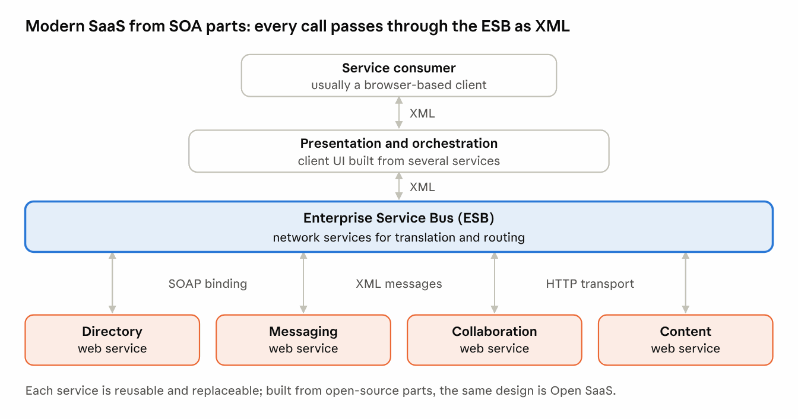

Requests flow down as XML through the ESB, which translates and routes them to the right web service; replies flow back up.

- **Service consumer:** usually a browser-based client.
- **Presentation and orchestration:** builds the client's user interface and combines calls to several services into one task.
- **Enterprise Service Bus (ESB):** network services that translate messages and route them between consumers and services.
- **Messages:** XML documents, wrapped in SOAP and carried over HTTP.
- **SaaS web services:** separate services for directory, messaging, collaboration and content, each reusable and replaceable.
- **Role of XML:** one platform-independent format for every message, and the language of SOAP and WSDL, so services written in different languages can talk to each other. With open-source parts at every layer, this becomes an Open SaaS environment.

**SOA protocol stack** *(asked with this question in 2014)*, bottom to top:

1. **Transport:** HTTP, SMTP, FTP, JMS.
2. **Messaging:** SOAP over XML (or REST).
3. **Description:** WSDL and XML Schema.
4. **Quality of service:** WS-Security, WS-ReliableMessaging, WS-Transaction, WS-Policy.
5. **Discovery:** UDDI registries.
6. **Composition:** business-process orchestration with BPEL.

### 13.6 Examples of SaaS platforms

| Category | Examples |
| --- | --- |
| CRM | Salesforce Sales Cloud, Zoho CRM, HubSpot |
| Email and productivity | Google Workspace, Microsoft 365, Zoho Workplace |
| Communication | Slack, Zoom, Microsoft Teams |
| File storage and sharing | Dropbox, Google Drive, OneDrive |
| HR and finance | Workday, SAP SuccessFactors, Zoho Books |
| Customer support | Freshdesk (Freshworks), Zendesk |
| E-commerce | Shopify |
| Design | Canva, Figma |
| Developer tools | GitHub, Jira |

### 13.7 Salesforce.com: the classic SaaS case

- Founded in 1999, it pioneered CRM delivered entirely over the web, under the slogan "no software".
- Single-instance, multi-tenant architecture: all customers run one version, upgraded through three major releases a year.
- Products include Sales Cloud (sales force automation), Service Cloud (customer service), Marketing Cloud and Slack.
- **AppExchange** is its marketplace for third-party apps, and the **Salesforce Platform (Force.com)** is its PaaS for customization. One ecosystem therefore offers both SaaS and PaaS.

### 13.8 Advantages and disadvantages of SaaS

- **Advantages:** nothing to install, works anywhere, low up-front cost, automatic updates, scales easily, quick to roll out, everyone on the same version.
- **Disadvantages:** little control or customization, the vendor holds your data, needs the Internet, lock-in through data formats and export limits, can be slower than local software, integration with in-house systems can be hard, subscriptions add up over time.

> Exam tip: "Characteristics of SaaS" wants all eight points. "Open SaaS and SOA" wants both definitions, the open-source stack, how SaaS rests on SOA, and the comparison table.

### 13.9 SaaS as the prescribed books describe it

- **\[Buyya, citing the Software & Information Industry Association\]** In SaaS: the product sold is **access to the application**; the application is **centrally managed**; the service is **one-to-many**; and it is an **integrated solution delivered on contract**. SaaS grew out of the application service providers (ASPs) of the 1990s.
- **\[Sosinsky\]** SaaS replaces or substitutes locally installed software. End-user examples: Gmail and Google Calendar, QuickBooks Online, the Zoho Office Suite. Business examples: billing and invoicing, CRM, help desk, HR. SaaS is not always fixed: Salesforce.com and Quicken.com expose APIs so developers can build custom composite applications.
- **\[Miller\]** SaaS is the most common kind of cloud service development: one application delivered through the browser to thousands or millions of users.
- **Mashups** *(MCQ 2018)*: because SaaS is componentized, a solution can combine data and functions from several services into one application.

### 13.10 Previous-year questions on this topic

- Explain in brief what multi-tenancy is in the context of SaaS; mention three significant characteristics of a typical SaaS solution. *(PYQ 2015; DSZ)* → 13.2, 13.3.
- What is SaaS, and what are the main characteristics of a SaaS solution? *(PYQ 2017)* → 13.2.
- Explain the modern implementation of SaaS using SOA components; explain the protocol stack for an SOA architecture with a diagram. *(PYQ 2014)* → 13.5.
- Describe through a schematic diagram how XML and SOA are used to implement an Open SaaS environment. *(PYQ 2017)* → 13.4, 13.5.
- What is Service-Oriented Architecture (SOA)? *(DSZ)* → 13.5.
- Give an example of a SaaS provider. *(DSZ)* → 13.6.
- MCQ: the componentized nature of SaaS supports **mashups** *(2018)*.

## 14. Identity as a Service (IDaaS)

**IDaaS delivers identity and access management (authentication, single sign-on, directories, provisioning and access policies) as a cloud service, so one trusted provider checks who users are and what they may reach across many applications.**

### 14.1 What is an identity?

- An **identity** is a set of characteristics or traits that makes something recognizable or known.
- A **digital identity** is the attributes and metadata of an object, together with its relationships to other objects, that make the object identifiable. It must be unique, even if only through a serial number.
- **Attributes:** user name, password or other credential, email address, employee ID, role, department, device ID, certificates, biometrics, location. **Relationships:** member of the Finance group, manager of a team.
- Identities belong to people, and also to devices, applications and services (machine identities).

### 14.2 Why identity becomes a service

- People now use dozens of SaaS applications, from many devices, outside the company firewall. If each application keeps its own passwords, the result is password fatigue, reused weak passwords, slow joining and leaving, and forgotten accounts left active.
- Identity protection is one of the most expensive and complex parts of running a network. A specialist cloud service centralizes it and does it better.
- Identity services such as token and ticket services, certificate servers and other trust mechanisms can be moved out of the private network into the cloud.

### 14.3 Networked identity service classes

The identity services an IDaaS can offer:

- **Authentication**: verifying that a user is who they claim to be.
- **Directory services**: the store of users, groups and attributes, e.g. LDAP or Active Directory.
- **Federated identity**: trust across organizations, so one organization's login works at another.
- **Identity governance**: deciding and reviewing who should have which access.
- **Identity and access management (IAM)**: overall control of identities and their access rights.
- **Policies, roles and enforcement**: rules such as role-based access control, and applying them.
- **Provisioning**: creating and removing accounts in target applications (external policy administration).
- **Registration**: enrolling new identities, often through self-service.
- **Risk and event monitoring, including audits**: spotting suspicious logins and reporting on access.
- **Single sign-on (SSO)**: one login for many applications (pass-through authentication).
- **Multi-factor authentication (MFA)**: a second proof such as an app prompt or a security key, standard in today's IDaaS.

### 14.4 How single sign-on works through an IDaaS

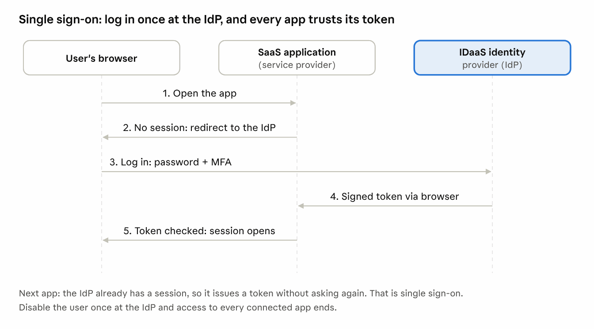

The password is typed only at the identity provider; the application sees only a signed token it can verify.

1. The user opens a SaaS application, the **service provider (SP)**, such as Salesforce.
2. The application finds no session and redirects the browser to the IDaaS **identity provider (IdP)**, such as Okta or Microsoft Entra ID.
3. The IdP authenticates the user once, with a password plus MFA.
4. The IdP issues a **signed token** (a SAML assertion or an OpenID Connect ID token) and sends the browser back to the application.
5. The application checks the signature, trusts the IdP, and opens a session.
6. At the next application the IdP already has a session, so it issues a new token without asking again. That is single sign-on.
7. When the user leaves the organization, disabling one account at the IdP ends access to every connected application.

### 14.5 Identity system codes of conduct

Sosinsky's criteria for judging an IDaaS follow Kim Cameron's "Seven Laws of Identity" (Microsoft, 2005):

| Principle | Meaning |
| --- | --- |
| User control and consent | Users control their identity and must consent before their information is used |
| Minimal disclosure | Reveal only the minimum information needed for the intended use |
| Justifiable access | Only parties with a justified need, and a trusted relationship with the owner, get access |
| Directional exposure | Public entities use two-way, discoverable identifiers; private entities use one-way identifiers that protect them |
| Interoperability | The system must work with identity services from other providers |
| Unambiguous human identification | A clear way for a person to use the system while staying protected from identity attacks such as phishing |
| Consistency of service | Simple to use, and consistent across contexts and technologies |

### 14.6 IDaaS interoperability: the standards

An IDaaS works with thousands of applications only because both sides speak common standards:

| Standard | What it does |
| --- | --- |
| SAML 2.0 (Security Assertion Markup Language) | XML assertions about authentication and authorization, exchanged between an IdP and a service provider; the classic enterprise SSO standard (OASIS) |
| OAuth 2.0 | Delegated authorization: an app gets a token to act on the user's behalf without seeing the password ("Allow this app to access your Drive"); IETF RFC 6749 |
| OpenID Connect (OIDC) | An identity layer on top of OAuth 2.0 that issues ID tokens as JSON Web Tokens; behind "Sign in with Google"; successor of OpenID 2.0 |
| SCIM (System for Cross-domain Identity Management) | A standard REST API for creating, updating and removing user accounts across applications automatically; IETF RFC 7643 and 7644 |
| XACML (eXtensible Access Control Markup Language) | An XML language for writing and evaluating fine-grained access policies (OASIS) |
| SPML (Service Provisioning Markup Language) | An older XML provisioning standard, largely replaced by SCIM |
| LDAP | Protocol for reading and updating directory services |
| Kerberos | Ticket-based authentication inside enterprise networks |
| FIDO2 / WebAuthn (passkeys) | Passwordless, phishing-resistant login based on public-key cryptography |

**\[Sosinsky\] IDaaS and its interoperability services**

- IDaaS gives an easy way to add identity services to individual applications with minimal development, by keeping the identification logic and the storage of an identity's attributes outside the application.
- IDaaS applications are set apart from other distributed security systems by following SOA standards, so they depend on developing industry standards for interoperability:
  - **User-centric authentication**, usually as information cards; the OpenID and CardSpace specifications support it.
  - **XACML policy language:** a general-purpose authorization policy language. When SAML presents a request for ID authorization, XACML checks it against its policies and allows or denies it.
  - **SPML provisioning language:** an XML request/response language for integrating service-provisioning requests; an OASIS standard that conforms to SOA.
  - **XDAS audit system:** the Distributed Audit Service makes users accountable for access, and detects policy violations by unauthorized users or unauthorized use.

Textbook-era names: user-centric "information cards" (Windows CardSpace) and OpenID 2.0, both since superseded.

### 14.7 Examples of IDaaS providers

- **Workforce identity (employees):** Okta, Microsoft Entra ID (formerly Azure AD), Ping Identity, OneLogin, JumpCloud, Google Cloud Identity, AWS IAM Identity Center.
- **Customer identity (an app's own users):** Auth0 (part of Okta), Amazon Cognito, Firebase Authentication.
- **Open source, self-hosted:** Keycloak.

### 14.8 Benefits and risks

- **Benefits:** single sign-on (fewer passwords, smoother experience); central control and instant de-provisioning; stronger security through MFA and risk-based checks; audit trails for compliance; no identity servers to run; scales to many users and applications; easy federation with partners.
- **Risks:** the IdP is a single point of failure, so an outage blocks every application; it is a high-value target, so a breach exposes everything; you must trust the provider's security and privacy; legacy applications may not support the standards; vendor lock-in; identity data may be stored abroad.

> Exam tip: for "What is IDaaS?", define identity and IDaaS, list the service classes, and draw the SSO flow. For "identity system codes of conduct", give all seven principles. For "IDaaS interoperability", name SAML, OAuth, OpenID Connect, SCIM and XACML with one line each.

### 14.9 Previous-year questions on this topic

- Short note: IDaaS. *(PYQ 2014)* → Section 14.
- Explain what is meant by Identity as a Service. *(PYQ 2016)* Write about Identity as a Service. *(PYQ 2018)*
- What is IDaaS and what are its core functions? Describe how a user's identity is authenticated and resource authorization is enforced in a typical IDaaS scenario. *(PYQ 2017)* → 14.3, 14.4. Authentication happens once at the IdP (password plus MFA); SSO tokens carry it to each application; each application then authorizes by roles and policies (XACML-style rules).
- What is an identity? *(model question)* → 14.1.
- What is the primary concern addressed by IDaaS? *(DSZ)* → knowing who users are and what they may access, across many applications, from one place.
- MCQ: IDaaS provides identity governance, provisioning, and risk and event monitoring: **all of these** *(2018)*.

> Exam tip: the question bank's printed answer to "Explain Identity as a Service" actually describes IaaS. Don't mix them up: IDaaS is identity, IaaS is infrastructure.

## 15. Compliance as a Service (CaaS)

**Compliance as a Service uses a cloud service to meet regulatory and policy requirements: the provider supplies the controls, monitoring, evidence and reports needed to prove compliance with laws and standards such as HIPAA, PCI DSS, GDPR or India's DPDP Act.** It is the least settled of the "as a service" terms in this syllabus; some argue that compliance is a business process, not a service.

### 15.1 Why compliance is hard in the cloud

- Laws dictate how data is stored, protected, retained and reported. When data moves to a provider, the customer is still accountable.
- The customer cannot inspect the provider's data center, so it needs assurance, evidence and audit trails from the provider.
- Data location, shared (multi-tenant) hardware and the split of responsibilities make it unclear who does what.

### 15.2 Laws and standards a CaaS helps with

| Law or standard | Scope | Typical requirement |
| --- | --- | --- |
| HIPAA (US) | Health information | Protect patient data; access controls; audit logs |
| Sarbanes-Oxley Act (SOX), Section 404 (US) | Financial reporting of listed companies | Internal controls over financial data; audit trails |
| PCI DSS | Anyone handling payment-card data | Protect cardholder data; encryption; network segmentation; regular testing |
| GDPR (EU) | Personal data of people in the EU | Lawful processing and consent; breach notice to the regulator within 72 hours; right to erasure |
| DPDP Act 2023 and DPDP Rules 2025 (India) | Digital personal data in India | Notice and consent, reasonable security safeguards, breach notification, rights requests answered within 90 days ([PIB](https://static.pib.gov.in/WriteReadData/specificdocs/documents/2025/nov/doc20251117695301.pdf)) |
| ISO/IEC 27001 | Information security, international | A certified information security management system |
| SOC 2 (AICPA) | Service organizations | Independent report on controls for security, availability, processing integrity, confidentiality and privacy |
| FedRAMP (US) | Cloud services for US federal agencies | Authorization against a standard security baseline |
| RBI directions (India) | Payment-system data | Store payment-system data only in India |

India's DPDP Rules were notified on 14 November 2025, with an eighteen-month phased compliance period. Failing to keep reasonable security safeguards can draw a penalty of up to ₹250 crore.

### 15.3 What a CaaS offering must provide

- **Continuous monitoring** of controls against the chosen frameworks.
- **Automated evidence collection** and audit-ready reports.
- **Audit trails**: tamper-proof logs of who accessed or changed what, and when.
- **Data retention and archiving** for the legally required periods, with legal hold and e-discovery.
- **Encryption** at rest and in transit, with key management.
- **Identity and access controls**, usually through an IDaaS (Section 14).
- **Data-residency controls** that keep data in a required country or region.
- **Policy management and enforcement**, often written as code.
- **Risk assessment**, including risk from vendors.
- **Incident detection and response**, and support for breach notification.
- A **trusted-party role**: records that auditors and regulators can rely on.

**\[Sosinsky\] Why CaaS is hard, and what it must do**

- Cloud computing spans jurisdictions: the laws where a request starts, where it is processed and where the service is provided may all differ. Compliance is complex, needs real expertise, and few CaaS products existed when the book was written.
- A CaaS must act as a **trusted third party**, a man-in-the-middle service, and may need to be built as its own layer of an SOA architecture to be trusted.
- It must manage cloud relationships, understand security policies and procedures, handle information and administer privacy, be aware of geography, provide incident response, archive, and allow the system to be queried, all to a level that can be written into an SLA.
- It is easiest to build inside a private cloud, where one entity controls the data and every transaction can be audited.
- A good CaaS could measure compliance risk and indemnify customers against it, or certify that an email meets set standards: a possible service for national postal networks, and a weapon against spam.

### 15.4 Vertical clouds

- To offer CaaS, providers build **vertical clouds**: clouds specialized for one industry, with that industry's regulations built in.
- **Textbook examples:** athenahealth (healthcare), Bankserv (banking), ClearPoint PCI Compliance-as-a-Service (merchant card transactions under PCI DSS), FedCloud (government), Rackspace's PCI-compliant cloud.
- **Today's equivalents:** AWS GovCloud (US) and Azure Government for government work, Microsoft Cloud for Healthcare, IBM Cloud for Financial Services, and MeitY-empanelled cloud services for Indian government workloads.

### 15.5 How CaaS works: continuous compliance

1. Choose the frameworks, for example ISO/IEC 27001 plus the DPDP Act.
2. Connect the CaaS tool to cloud accounts, the identity provider, the HR system and code repositories.
3. The tool maps controls to the framework and tests them continuously: is encryption on, is MFA enforced, are logs kept?
4. Gaps raise alerts and tickets, and the team fixes them.
5. Evidence, policies and staff training records are collected automatically.
6. The auditor receives an audit-ready package, and the certificate or report is issued.
7. The cycle repeats all year, not once a year.

### 15.6 Examples of CaaS tools and services

- **Compliance-automation SaaS:** Vanta, Drata, Secureframe (SOC 2, ISO/IEC 27001, HIPAA, GDPR).
- **Built into the big clouds:** AWS Audit Manager and AWS Artifact (the provider's own compliance reports), Microsoft Purview Compliance Manager, Azure Policy, Google Cloud Assured Workloads.
- **Managed security service providers** that run PCI DSS or HIPAA compliance for clients.

### 15.7 Benefits and limits

- **Benefits:** cheaper than a full in-house compliance team; continuous rather than annual checking; experts who track changing laws; automation replaces manual evidence gathering; faster audits and certification; lets small firms sell to regulated customers.
- **Limits:**
  - **You can outsource the work, not the accountability.** The customer stays legally responsible.
  - Shared responsibility: a provider's certificate covers only the provider's layers, not your configuration.
  - Tools cannot fix weak business processes.
  - Sensitive data is shared with yet another third party.
  - Laws differ by country and keep changing.
  - Risk of "checkbox compliance": passing the audit without being secure.

### 15.8 A note on the acronym

"CaaS" also stands for **Containers as a Service** and **Communication as a Service**. In this syllabus it means Compliance as a Service; if you mention the others, say so.

> Exam tip: for "Explain Compliance as a Service", give the definition, why it is needed, the main regulations, what a CaaS must provide, vertical clouds with examples, and one line on accountability.

### 15.9 Previous-year questions on this topic

- What is CaaS? *(model question)* → Section 15.
- MCQ: What does CAAS stand for? *(2018)* → in this syllabus, **Compliance as a Service**. The question bank prints "none of these".
- MCQ: Which provider provides Compliance as a Service? *(2016)* → Section 17.

## 16. Quick Revision Sheet

**Read this the night before: one-line definitions, the numbers to remember, the mnemonics and the facts that keep turning up as MCQs.**

### 16.1 One-line definitions

| Term | One line |
| --- | --- |
| Cloud computing (NIST) | A model for ubiquitous, convenient, on-demand network access to a shared pool of configurable computing resources, rapidly provisioned and released with minimal management effort |
| Abstraction | Hiding implementation details, such as which server or where the data lives, from users |
| Virtualization | Pooling and sharing physical resources as virtual ones |
| Multi-tenancy | Two or more clients sharing the same resources, kept logically apart |
| Elasticity | Scaling out and in automatically with demand |
| Public cloud | Provisioned for open use by the general public, on the provider's premises |
| Private cloud | Provisioned for exclusive use by one organization, on or off premises |
| Community cloud | Shared by organizations with common concerns: mission, security, compliance |
| Hybrid cloud | Two or more distinct clouds bound together so data and applications can move |
| Cloud bursting | Overflowing from a private to a public cloud at peak load |
| IaaS | Rent processing, storage and networks; run any software, including the OS |
| PaaS | Deploy your own applications with the provider's languages, libraries and tools |
| SaaS | Use the provider's applications through a browser or an API |
| Cloud Cube Model | Jericho Forum model with four dimensions for choosing secure cloud formations |
| De-perimeterisation | Security moves from the network firewall to the data and the identity |
| Cloud broker | Manages the use, performance and delivery of services; negotiates between providers and consumers |
| Cloud carrier | Provides connectivity and transport between providers and consumers |
| Cloud auditor | Independently assesses services, operations, performance and security |
| Composability | Building systems from modular, stateless, reusable components |
| Virtual appliance | A pre-configured VM image bundling an application with just enough OS |
| Workload | The unit of virtualized client in IaaS: the work one type of physical server does, measured in TPM, IOPS, RAM, network |
| Instance | A provisioned, running virtual server |
| Pod | A group of servers, storage and switches managed as one replicable unit |
| Aggregation | Pooling pods into availability zones and regions |
| Silo | An isolated cloud that cannot interoperate with others; causes lock-in |
| Open SaaS | SaaS built on open-source software |
| SOA | Software built as loosely coupled services with standard interfaces |
| Digital identity | The attributes, metadata and relationships that make an object uniquely identifiable |
| IDaaS | Identity and access management delivered as a cloud service |
| Single sign-on (SSO) | One login gives access to many applications |
| CaaS | Compliance controls, monitoring and evidence delivered as a cloud service |
| Vertical cloud | A cloud specialized for one industry's regulations |

### 16.2 Numbers to remember

- **NIST model:** 5 essential characteristics, 3 service models, 4 deployment models, 8 common characteristics.
- **Cloud Cube:** 4 dimensions, 8 cloud forms, 16 formations once sourcing is added.
- **NIST reference architecture:** 5 actors; the provider has 5 activity areas; service orchestration has 3 layers; the broker offers 3 kinds of service; the auditor does 3 kinds of audit.
- **Sosinsky:** 7 benefits, 8 SaaS characteristics, 3 ways to secure a client connection, 7 identity codes of conduct.
- **Composable component:** 2 properties, modular and stateless.
- **Dates:** Cloud Cube Model April 2009; NIST SP 800-145 and SP 500-292 both September 2011.

### 16.3 Mnemonics

| Mnemonic | Stands for |
| --- | --- |
| Only Brave Rangers Reach Mountains | NIST characteristics: On-demand self-service, Broad network access, Resource pooling, Rapid elasticity, Measured service |
| LOBS | Cloud Cube dimensions: Location (Internal/External), Ownership (Proprietary/Open), Boundary (Perimeterised/De-perimeterised), Sourcing (Insourced/Outsourced) |
| Can People Buy A Car? | NIST actors: Consumer, Provider, Broker, Auditor, Carrier |
| In An Auction | Broker services: Intermediation, Aggregation, Arbitrage |
| Lazy Engineers Quietly Rely On Simple Labs | Sosinsky's benefits: Lower costs, Ease of utilization, QoS, Reliability, Outsourced IT management, Simplified maintenance, Low barrier to entry |
| No One Needs Slow, Expensive, Energy-hungry Servers | Buyya's characteristics: No up-front commitments, On-demand access, Nice pricing, Simplified acceleration and scalability, Efficient resource allocation, Energy efficiency, Seamless third-party services |
| Ultra Tough Pilots Always Inspect Planes | Miller's properties: User-centric, Task-centric, Powerful, Accessible, Intelligent, Programmable |

### 16.4 Facts that keep turning up as MCQs

- The word "cloud" refers to two essential concepts: **abstraction and virtualization**.
- The most complete service model: **SaaS**. The most basic, foundation model: **IaaS**.
- The number one concern in cloud computing: **information security**.
- The technology vital for creating a cloud: **virtualization**.
- The Cloud Cube Model comes from the **Jericho Forum** (The Open Group).
- The hypervisor is also called the **virtual machine monitor (VMM)**.
- Amazon EC2 is **IaaS**; Google App Engine and Force.com are **PaaS**; Salesforce CRM and Gmail are **SaaS**.
- Composable components must be **modular and stateless**.
- The textbook's most widely used Web services messaging standard: **SOAP**. Most cloud APIs today: **REST**.
- The basic unit of virtualized client in IaaS: the **workload**, measured in **TPM**. IOPS = Input/Output Operations Per Second.
- Pods are aggregated into **availability zones**. A silo leads to **vendor lock-in**.
- SaaS built on open-source software: **Open SaaS**.
- SAML = Security Assertion Markup Language; XACML = eXtensible Access Control Markup Language.
- Vertical clouds are linked with **Compliance as a Service**.
- Cloud bursting is linked with the **hybrid cloud**.
- Government departments sharing one infrastructure: a **community cloud**.

More facts from past MCQs:

- Cloud Foundry is a **VMware-led open-source PaaS**. Rackspace's cloud service is **Cloud Servers**, an IaaS.
- **IBM Deep Blue** (a chess computer) is not a cloud platform. **Blackboard** is not a cloud leader.
- Correct provider and service pairs: **Intuit and QuickBooks Online**; **Amazon and EC2**.
- **Iron Mountain** shut down its cloud storage service. Amazon's **EBS** suffered a massive outage.
- The group fostering cloud security standards is the **Cloud Security Alliance**.
- An internal cloud is **a cloud that sits behind a corporate firewall**.
- "Ladder" is not a cloud pricing model. Buyya's models are tiered, per-unit and subscription-based.
- Velte's **Hardware as a Service (HaaS)** means IaaS; one 2017 MCQ treats it as "not a major type of usage".

### 16.5 Which table answers which "differentiate" question

| Question | Look at |
| --- | --- |
| Cloud vs grid vs cluster vs pervasive computing | Section 1.7 |
| Scalability vs elasticity; vertical vs horizontal scaling | Section 1.8 |
| Public vs private vs community vs hybrid | Section 4.5 |
| IaaS vs PaaS vs SaaS | Section 5.5 |
| PaaS vs IaaS for a startup | Section 5.10 |
| Traditional data centre vs cloud computing | Section 7.1 |
| SOAP vs REST | Section 9.5 |
| Thin vs thick client | Section 10.2 |
| Multi-tenant vs multi-instance | Section 13.3 |
| SOA vs SaaS | Section 13.5 |

## 17. Previous-Year Questions: Unit 1 (WBUT/MAKAUT 2014–2018)

**Every Unit 1 question from the 2014–2018 papers in the question bank you shared, with answers and the section that covers each, plus Debkanta Study Zone (DSZ) suggestions in the recent pattern.** Where the bank's printed MCQ key is wrong, the correct answer comes first and the printed one is noted. Most repeated topics: service models (5 papers), the NIST model (4), IDaaS (4), advantages and benefits (4), Cloud Cube (3), SaaS and Open SaaS (3).

Full model answers to these questions, each sized to its marks: [PYQ Answers](pyq-answers.md)

### 17.1 Group A: multiple-choice questions

| # | Question → answer | Year |
| --- | --- | --- |
| 1 | What is Cloud Foundry? → **a VMware-led open-source PaaS** | 2014 |
| 2 | Which isn't an advantage of cloud? → **easier to maintain a cloud network** | 2014 |
| 3 | Which feature does not belong in a private cloud? (metered billing, self-service portal, dial-home support, rapid elasticity) → bank key: **self-service portal**. Dial-home support, a storage-hardware support feature, is equally defensible | 2014 |
| 4 | What is a private cloud? → **a cloud architecture maintained within an enterprise data center**. The bank's tick on "inaccessible to anyone but the cultural elite" is a misprint | 2014, 2018 |
| 5 | An internal cloud is → **a cloud that sits behind a corporate firewall** | 2017 |
| 6 | Amazon Web Services is which type of cloud distribution model? → **IaaS** | 2014 |
| 7 | Amazon EC2 is which type of cloud computing model? → **IaaS** | 2015 |
| 8 | What is the name of the Rackspace cloud service? → **Cloud Servers** | 2014 |
| 9 | Rackspace Cloud Service is an example of → **IaaS** | 2018 |
| 10 | Which is not PaaS? (Force.com, Microsoft Azure, Amazon EC2, Joyent) → **Amazon EC2** | 2014 |
| 11 | Which is not considered PaaS? (Force.com, Microsoft Azure, Amazon EC2, IBM SmartCloud) → bank key: **IBM SmartCloud**. By the textbooks, Amazon EC2 (an IaaS) is the stronger answer | 2017 |
| 12 | Which is not a PaaS service? (Windows Azure, Google App Engine, Salesforce, Oracle Database as a Service) → **Salesforce** (its CRM is SaaS) | 2016 |
| 13 | Which service model is closest to traditional hosting? → bank key: **PaaS**, since web hosting gives a ready platform to upload code to | 2016 |
| 14 | Which is not a major type of cloud computing usage? (HaaS, PaaS, SaaS, IaaS) → **Hardware as a Service** | 2017 |
| 15 | Which language did Google include for development on App Engine? (C++, Java, SQL, Visual Basic) → **Java**. The bank prints SQL; App Engine launched with Python in 2008 and added Java in 2009 | 2015 |
| 16 | Which are valid dimensions of the cloud cube? → **Ownership, Sourcing**. The bank prints (d), but "Platform" is not a dimension | 2016 |
| 17 | Which technologies played a vital role in cloud computing? → bank key: **utility computing, grid computing, API**. Buyya's five technologies also support "Web 2.0, virtualization, service-oriented computing" | 2016 |
| 18 | Which technique is vital for creating cloud computing environments? → **virtualization** | 2015, 2017 |
| 19 | Which is an essential concept related to the cloud? → **abstraction** | 2018 |
| 20 | Which cloud concept is related to pooling and sharing of resources? → **virtualization** | 2018 |
| 21 | What is server virtualization? → **partitioning a normal server so it behaves as multiple servers** | 2018 |
| 22 | Which VM technology, now owned by Oracle, can run various operating systems? → **VirtualBox** | 2018 |
| 23 | Which is true of composability? → **neither hardware nor software is required to be composable** | 2016 |
| 24 | DCOM, RMI and CORBA are different forms of → **RPC** | 2016 |
| 25 | WSDL expands to → **Web Service Description Language** | 2016 |
| 26 | The componentized nature of SaaS lets solutions support a feature called → **mashups** | 2018 |
| 27 | Which is provided by Identity as a Service? → **all of these** (identity governance, provisioning, risk and event monitoring) | 2018 |
| 28 | What does CAAS stand for? → **Compliance as a Service** in this syllabus; the bank prints "none of these" | 2018 |
| 29 | Which provider provides Compliance as a Service? (IBM, HP, Microsoft, Google) → bank key: **Google**. A dated question: every major cloud now offers compliance tools | 2016 |
| 30 | What is the number one concern about cloud computing? → **security (information security)** | 2014, 2015, 2017 |
| 31 | What should a company consider before implementing cloud computing? → **all of these** (user satisfaction, potential cost reduction, information sensitivity) | 2015, 2017 |
| 32 | What can cloud computing replace? → **all of these** (corporate data centers, expensive hardware, costly software upgrades) | 2015, 2017 |
| 33 | Which widely used services are built on cloud technology? → **all of these** (Gmail, Twitter, YouTube, Skype) | 2015, 2017 |
| 34 | Which is not a cloud computing platform or service? → **IBM Deep Blue** | 2014, 2015, 2017 |
| 35 | Which company is not yet a leader in cloud computing? → **Blackboard** | 2017 |
| 36 | Correct pair of cloud provider and service? (Google and AWS, Intuit and QuickBooks Online, IBM and Azure, Microsoft and GWT) → **Intuit and QuickBooks Online**. The bank's tick on "Google and AWS" is wrong | 2015 |
| 37 | Correct pair of provider and service? (Amazon and EC2, IBM and Azure, Google and Cloudburst, Microsoft and GWT) → **Amazon and EC2** | 2017 |
| 38 | Spreading data across a provider's network worries organizations because it → bank key: **raises security concerns**. "Complicates regulatory compliance" is equally defensible | 2015 |
| 39 | Which is not a cloud computing pricing model? (free, pay per use, subscription, ladder, perpetual licence) → **ladder** | 2017 |
| 40 | Which organization helps foster security standards for cloud computing? → **Cloud Security Alliance**. The bank's tick on "cloud security watchdog" is wrong | 2014 |
| 41 | Which company shut the doors on its cloud storage service? → **Iron Mountain** | 2014 |
| 42 | Which Amazon cloud product suffered a massive outage? → **EBS (Elastic Block Store)** | 2014 |

### 17.2 Group B and C questions by year

| Year | Group | Question | Answer in |
| --- | --- | --- | --- |
| 2014 | B | What are the advantages and disadvantages of cloud computing? | Section 8 |
| 2014 | B | How does cloud computing differ from grid computation and pervasive computation? | 1.7 |
| 2014 | B | What is the difference between scalability and elasticity? | 1.8 |
| 2014 | B | Explain the NIST model with a diagram | Section 2 |
| 2014 | B | What are the behavioural factors relating to cloud adoption? | 8.10 |
| 2014 | C | (a) Explain precisely the Jericho Forum's Cloud Cube model with a diagram. (b) Briefly explain the deployment models | Sections 3, 4 |
| 2014 | C | What is IaaS? Mention its characteristics. Explain the modern implementation of SaaS using SOA components, and the protocol stack for an SOA architecture with a diagram | 11.1, 13.5 |
| 2014 | C | Draw the CSA cloud reference model with security boundaries | 6.2 |
| 2014 | C | Short notes: Chromium OS; IDaaS; hybrid cloud | 10.4, 14, 4.4 |
| 2015 | B | Clean-and-Green Energy: advantages and disadvantages of real-time load management and online consumer billing in the cloud | 8.12 |
| 2015 | B | What is multi-tenancy in SaaS? Mention three significant characteristics of a SaaS solution | 13.2, 13.3 |
| 2015 | C | With respect to the NIST Reference Model, explain essential characteristics, service models and deployment models with schematics and examples | Sections 2, 4, 5 |
| 2015 | C | (a) Three main advantages and two major disadvantages, with examples. (b) Key parameters of a typical cloud SLA | 8.5, 8.11 |
| 2015 | C | Explain the concept of IaaS and SaaS with examples and schematic diagrams | Sections 11, 13 |
| 2015 | C | Short note: Cloud Cube Model | Section 3 |
| 2016 | B | Define cloud computing. Explain the service models with examples | 1.2, Section 5 |
| 2016 | B | A small enterprise wants email for its staff: cloud or traditional? Give reasons | 8.12 |
| 2016 | B | Explain what is meant by Identity as a Service (asked with hypervisors, Module 2) | Section 14 |
| 2016 | B | What are the two kinds of cloud service offerings by Google? (asked with disintermediation, Module 2) | 5.9 |
| 2016 | C | Write a brief note on the cloud ecosystem with examples | 6.4 |
| 2017 | B | Explain the cloud service models with product examples. Discuss the business benefits of cloud architecture | Section 5, 8.9 |
| 2017 | B | Discuss in detail, with diagrams, the Cloud Cube model | Section 3 |
| 2017 | B | For IaaS, mention the resources provided. Why are more and more data centres migrating to the cloud? | 11.5 |
| 2017 | C | Essential characteristics of the service and deployment models as per the NIST Reference Model, with examples | Sections 2, 4, 5 |
| 2017 | C | Compare the three service models of cloud computing with examples | 5.5 |
| 2017 | C | What is SaaS and what are its main characteristics? How are XML and SOA used to implement an Open SaaS environment? (schematic) | Section 13 |
| 2017 | C | What is IDaaS and what are its core functions? How is identity authenticated and resource authorization enforced in a typical IDaaS scenario? | Section 14 |
| 2018 | B | What is cloud computing? What are its advantages and limitations? | 1.2, Section 8 |
| 2018 | B | Write about Identity as a Service (asked with hypervisors, Module 2) | Section 14 |
| 2018 | B | What are the differences between private cloud and public cloud? | 4.5 |
| 2018 | B | What are the differences between vertical and horizontal scalability? | 1.8 |
| 2018 | C | Concepts of IaaS, PaaS and SaaS, each with a schematic diagram and example | Sections 5, 11 to 13 |
| 2018 | C | Write about the NIST model (asked with the cloud life cycle, Module 3) | Section 2 |

### 17.3 Model questions from the question bank

| Question | Answer in |
| --- | --- |
| What is a cloud? What is a cloud platform? | 1.1 to 1.3, 9.3 |
| Why are organizations interested in cloud computing? | 7.6 |
| What are the benefits of cloud computing? | 8.1, 8.13 |
| What is composability, and what are its benefits? | 9.1 |
| What is cloud infrastructure? | 9.2 |
| Explain the cloud platform | 9.3 |
| What are the communication protocols in cloud computing? | 9.5 |
| How do businesses get connected to clients via the cloud? | 10.1, 10.3 |
| What is an identity? | 14.1 |
| What is CaaS? | Section 15 |

### 17.4 DSZ suggestions for Unit 1 (recent pattern)

- **Short:** define a cloud in the NIST model; the key difference between public and private clouds; the three service models; an example of a SaaS provider; the purpose of a CDN; the primary concern addressed by IDaaS; cloud bursting; SOA.
- **Medium:** the Cloud Cube model and its significance; PaaS vs SaaS with examples; benefits from business and technological perspectives; composability and virtual appliances.
- **Scenario:** a deployment model for sensitive financial data (4.7); PaaS vs IaaS for an e-commerce startup (5.10); composability and virtual appliances for a global ERP (9.1, 9.4); App Engine or Azure for a mobile back end (12.4 to 12.7); load management and billing in the cloud (8.12).
- **Repeats of past papers:** NIST model; IaaS; multi-tenancy and SaaS characteristics; comparing the service models; short notes on Chromium OS and hybrid cloud; private vs public; scalability; traditional data centre vs cloud; cloud computing with service models; advantages and limitations.

## 18. Practice Questions with Answer Pointers

**These are the questions this module usually produces, grouped by MAKAUT's mark pattern, with the section that answers each.** They are built from the syllabus wording and the textbook, not copied from one past paper.

### 18.1 Group A (1 mark): answer in a word or a line

1. Which two essential concepts does the word "cloud" refer to? *(abstraction and virtualization)*
2. Which is the most complete cloud service model? *(SaaS)*
3. How many deployment models does NIST define? *(four)*
4. Who proposed the Cloud Cube Model? *(the Jericho Forum)*
5. What does D-p stand for in the Cloud Cube Model? *(de-perimeterised)*
6. Which deployment model uses cloud bursting? *(hybrid)*
7. Amazon EC2 is an example of which service model? *(IaaS)*
8. Force.com is an example of which service model? *(PaaS)*
9. What is a virtual appliance? *(a pre-configured VM image with an application and just enough OS)*
10. What two properties must a composable component have? *(modular and stateless)*
11. Expand IOPS. *(Input/Output Operations Per Second)*
12. Pods are aggregated into what? *(availability zones)*
13. What is a silo? *(an isolated cloud that cannot interoperate with others)*
14. Expand SAML and XACML.
15. Which NIST actor provides connectivity between provider and consumer? *(the cloud carrier)*
16. What is Open SaaS? *(SaaS built on open-source software)*
17. Vertical clouds are associated with which service? *(Compliance as a Service)*
18. Expand SOAP and REST.
19. What is multi-tenancy?
20. Which NIST publication defines cloud computing? *(SP 800-145)*

### 18.2 Group B (5 marks)

| Question | Answer from |
| --- | --- |
| Define cloud computing according to NIST and explain its essential characteristics | Sections 1.2, 2.2 |
| Explain the Cloud Cube Model with a diagram | Section 3 |
| Differentiate public, private and hybrid clouds | Section 4.5 |
| What is a community cloud? Give examples | Section 4.3 |
| Compare IaaS, PaaS and SaaS | Section 5.5 |
| State the benefits of cloud computing | Section 8.1 |
| What is composability? Why must composable components be modular and stateless? | Section 9.1 |
| Write a short note on virtual appliances | Section 9.4 |
| Compare SOAP and REST | Section 9.5 |
| How do clients connect securely to the cloud? | Section 10.3 |
| What is a workload in IaaS? How are VPS instances partitioned? | Sections 11.2, 11.3 |
| Write short notes on pods, aggregations and silos | Section 11.4 |
| State the characteristics of SaaS | Section 13.2 |
| What is multi-tenancy? Compare single-instance and multi-instance designs | Section 13.3 |
| What is Open SaaS? How is SaaS related to SOA? | Sections 13.4, 13.5 |
| What is IDaaS? List the networked identity service classes | Sections 14.1 to 14.3 |
| Write a short note on Compliance as a Service | Section 15 |

### 18.3 Group C (15 marks), with a suggested split

1. (a) Define cloud computing according to NIST. (b) Explain the NIST model with a diagram. (c) Why is cloud computing called a paradigm shift? *\[3 + 7 + 5; Sections 1.2, 2, 7\]*
2. (a) Explain the four deployment models with their advantages and disadvantages. (b) What is cloud bursting? (c) Differentiate hybrid cloud and multi-cloud. *\[10 + 2 + 3; Section 4\]*
3. (a) Explain IaaS, PaaS and SaaS with examples. (b) Draw the responsibility stack. (c) What is XaaS? *\[9 + 3 + 3; Section 5\]*
4. (a) Explain the CSA cloud reference model. (b) Explain the NIST cloud reference architecture and the roles of the broker, auditor and carrier. *\[6 + 9; Section 6\]*
5. (a) Explain composability, infrastructure, platforms and virtual appliances in the cloud stack. (b) Discuss the communication protocols used in the cloud. (c) Compare SOAP and REST. *\[7 + 4 + 4; Section 9\]*
6. (a) Explain IaaS workloads and VPS partitioning with a diagram. (b) Explain pods, aggregations and silos. (c) Give the advantages and disadvantages of IaaS. *\[6 + 6 + 3; Section 11\]*
7. (a) What is PaaS? Describe its tools and development environment with an example such as Google App Engine or Force.com. (b) Why is vendor lock-in a concern in PaaS? *\[11 + 4; Section 12\]*
8. (a) State the characteristics of SaaS. (b) Explain Open SaaS and SOA. (c) Explain Salesforce.com as an example of SaaS. *\[6 + 6 + 3; Section 13\]*
9. (a) What is a digital identity? (b) Explain IDaaS and its service classes. (c) Explain the identity system codes of conduct. (d) Name the standards that make IDaaS interoperable. *\[2 + 5 + 5 + 3; Section 14\]*
10. (a) Define Compliance as a Service. (b) What must a CaaS offering provide? (c) What are vertical clouds? Give examples. *\[3 + 7 + 5; Section 15\]*
11. Discuss the benefits and the disadvantages of cloud computing. *\[8 + 7; Section 8\]*

### 18.4 How to write a 15-mark answer

1. Open with the definition: the bold first line of the section.
2. Draw the diagram early, labelled and titled.
3. Explain each part of the diagram as a numbered list.
4. Give at least two real examples, naming providers.
5. Add a comparison table whenever the question says "differentiate" or "compare".
6. Close with one line on what the concept achieves.

## Sources

- [NIST SP 800-145, The NIST Definition of Cloud Computing (September 2011)](https://nvlpubs.nist.gov/nistpubs/Legacy/SP/nistspecialpublication800-145.pdf)
- [NIST SP 500-292, NIST Cloud Computing Reference Architecture (September 2011)](https://nvlpubs.nist.gov/nistpubs/Legacy/SP/nistspecialpublication500-292.pdf)
- [Jericho Forum, Cloud Cube Model: Selecting Cloud Formations for Secure Collaboration, v1.0 (April 2009)](https://csitauthority.github.io/8thSem/ebooks-and-classnotes/classnotes/files/CSC458%20CC%20-%20cloud_cube_model_v1.0.pdf)
- [PIB, DPDP Rules, 2025 Notified (17 November 2025)](https://static.pib.gov.in/WriteReadData/specificdocs/documents/2025/nov/doc20251117695301.pdf)
- Prescribed textbooks (print): Sosinsky, *Cloud Computing Bible*; Buyya, Vecchiola and Selvi, *Mastering Cloud Computing*; Velte, Velte and Elsenpeter, *Cloud Computing: A Practical Approach*; Miller, *Cloud Computing*; Moyer, *Building Applications in the Cloud*; Kumar Saurabh, *Cloud Computing*, 2nd edition
- Popular Publications, *Cloud Computing* question bank (WBUT/MAKAUT): Module 1 and the 2014–2018 papers (your upload, Cloud\_Computing\_.pdf)
- Debkanta Study Zone, *MAKAUT Cloud Computing Suggestions and Answers* (your upload)
