# Unit 1 — Previous-Year Questions: Model Answers

**Model answers to every Unit 1 question from the WBUT/MAKAUT papers of 2014–2018, each written to the length its marks deserve.** The questions come from the Popular Publications question bank; the theory and diagrams come from the [notes](notes.md).

| Marks | How much to write |
| --- | --- |
| 1 (Group A) | One word or one line. All 42 MCQs are already answered in Notes, Section 17.1. |
| 5 (Group B) | About one page: a definition, 4–6 explained points or a table, one example, a small diagram if one exists. |
| 15 (Group C) | About three pages: each part answered in proportion, labelled diagrams, examples, a comparison table where it fits, and a one-line conclusion. |

The question bank does not print the marks for each sub-part, so the splits shown are suggestions, sized to the content. Where a question also asks about another unit (hypervisors, life cycle), only the Unit 1 part is answered here.

## Group B: 5-mark answers (part 1)

### B1. What is cloud computing? What are its advantages and disadvantages (limitations)?

*5 marks · PYQ 2014, 2018*

**Cloud computing** is a model for enabling ubiquitous, convenient, on-demand network access to a shared pool of configurable computing resources (networks, servers, storage, applications and services) that can be rapidly provisioned and released with minimal management effort or service-provider interaction (NIST). Example: Gmail, where Google hosts the mail and the user reaches it from any device.

**Advantages**

1. **Lower cost:** no up-front hardware; pay only for what you use, so capital expense becomes operating expense.
2. **Scalability and elasticity:** resources grow or shrink within minutes as demand changes.
3. **Access from anywhere:** any device with an Internet connection; easy collaboration.
4. **Less maintenance:** the provider handles hardware, patches and upgrades; users always run the latest version.
5. **Reliability and recovery:** redundant data centres, automatic backup and disaster recovery.

**Disadvantages (limitations)**

1. **Needs a constant Internet connection;** slow links make it slow.
2. **Security and privacy:** data sits with a third party on shared hardware.
3. **Less control and customization** over hardware, software versions and upgrade timing.
4. **Vendor lock-in:** proprietary APIs and data formats make switching hard.
5. **Outages and compliance:** provider downtime stops the business; laws may restrict where data is kept.

**Conclusion:** the cloud trades some control for lower cost, speed and scale.

### B2. How does cloud computing differ from grid computation and pervasive computation?

*5 marks · PYQ 2014*

All three spread computing across many machines or places, but their aims differ.

- **Cloud computing** rents pooled, virtualized resources from a provider over the Internet, on demand and metered, to many tenants (IaaS, PaaS, SaaS). Example: Amazon EC2.
- **Grid computing** links large numbers of networked computers, often owned by different organizations, to work together on one big task, usually many independent jobs. Example: a bank prices all its holdings overnight by submitting thousands of jobs; the grid middleware sends each job to a free node and balances the load.
- **Pervasive (ubiquitous) computing** makes computing appear everywhere: in phones, wearables, appliances and other objects with embedded chips, all connected to a network.

| Basis | Cloud | Grid | Pervasive |
| --- | --- | --- | --- |
| Aim | Computing as a rentable service | Pool machines for one large job | Computing embedded in everyday things |
| Ownership | One provider, many tenants | Shared by several organizations | Users' own devices |
| Resource model | Virtualized, elastic, on demand | Scheduled batch jobs | Small connected devices and sensors |
| Payment | Pay per use | Usually shared or allocated | Not a payment model |
| Example | AWS, Google Workspace | Worldwide LHC Computing Grid | Smartwatch, smart thermostat |

**Conclusion:** grid shares resources for big jobs, pervasive computing is about *where* computing happens, and cloud is a model for renting computing; pervasive devices often act as clients of the cloud.

### B3. What is the difference between scalability and elasticity?

*5 marks · PYQ 2014*

- **Scalability** is the ability of a system to keep performing well as its workload grows, by adding resources (bigger machines or more machines). It is usually planned and long-term.
- **Elasticity** is the ability to add *and remove* resources automatically, in real time, so capacity always matches current demand. NIST calls it rapid elasticity.

| Basis | Scalability | Elasticity |
| --- | --- | --- |
| Meaning | Handle growing load by adding resources | Match resources to demand moment by moment |
| Time frame | Long-term, planned | Short-term, real time |
| Direction | Mainly growth | Up and down |
| Automation | Can be manual | Automatic |
| Cost aim | Be ready for future demand | Pay only for current demand |

**Example:** an exam-results website is designed to *scale* to 50 servers; *elasticity* runs 50 servers only on results day and 2 on other days, so the college pays for the peak only when it happens.

**Conclusion:** an elastic system must be scalable, but a scalable system need not be elastic.

### B4. Explain the NIST model with a diagram. (Write about the NIST model.)

*5 marks · PYQ 2014; also 2018, inside a long question*

The U.S. National Institute of Standards and Technology (SP 800-145, 2011) defines cloud computing as a model with **5 essential characteristics, 3 service models and 4 deployment models**.

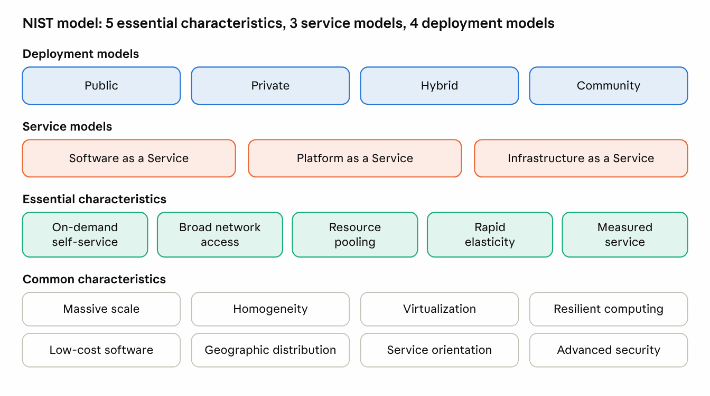

- **Essential characteristics:** on-demand self-service (provision without human help); broad network access (any device, standard protocols); resource pooling (multi-tenant, location independent); rapid elasticity (scale out and in); measured service (metered, pay per use).
- **Service models:** SaaS, use the provider's application (Gmail); PaaS, deploy your own application on the provider's platform (Google App Engine); IaaS, provision processing, storage and networks (Amazon EC2).
- **Deployment models:** public (open to everyone), private (one organization), community (organizations with shared concerns), hybrid (two or more clouds bound together).
- **Common characteristics** (base of the figure): massive scale, homogeneity, virtualization, resilient computing, low-cost software, geographic distribution, service orientation, advanced security.

**Conclusion:** the NIST model is the standard yardstick for deciding whether a service is cloud and how to classify it.

## Group B: 5-mark answers (part 2)

### B5. What are the behavioural factors relating to cloud adoption?

*5 marks · PYQ 2014*

Moving to the cloud is not decided by cost alone. Sosinsky lists ten human tendencies that slow or speed adoption:

1. **Risk- and loss-averse:** people fear losing data or control more than they value the savings, so they delay.
2. **Flat-rate bias:** they prefer a fixed monthly fee to pay-per-use, even when metering is cheaper.
3. **Need for control and anonymity:** they hesitate to hand their data and identity to a third party.
4. **Fear of change:** staff resist new tools and new ways of working.
5. **Ownership effect:** a server they own feels worth more than capacity they rent.
6. **Status quo bias:** they keep existing systems because money was already spent on them.
7. **Short-termism:** they discount future risks and favour instant gratification, such as a free trial today.
8. **Love of free:** free tiers (Gmail, Google Drive) pull users in quickly.
9. **Need for status:** a large private data centre signals importance.
10. **Choice overload:** too many providers and plans cause decision paralysis.

**Conclusion:** providers answer these with free tiers, flat-rate plans, migration help and strong SLAs.

### B6. Clean-and-Green Energy: real-time load management and online consumer billing in the cloud

*5 marks · PYQ 2015*

> A power generation and distribution company will move two customer-facing systems to the cloud: (i) real-time load management, (ii) online consumer billing. Discuss the advantages and disadvantages of each.

**(i) Real-time load management**

- *Advantages:* elastic computing absorbs spikes in smart-meter and sensor data; large-scale analytics and demand forecasting; data from every substation in one place; built-in disaster recovery.
- *Disadvantages:* control decisions need very low latency and cannot depend on an Internet link; grid control is critical infrastructure, so a breach or outage is dangerous; rules may limit where control data is processed.

**(ii) Online consumer billing**

- *Advantages:* scales for month-end billing peaks; pay per use; customers view and pay bills online from anywhere; easy link to payment gateways; lower IT cost.
- *Disadvantages:* customers' personal and payment data must be protected (privacy and payment-card rules); vendor lock-in; downtime during a billing run; data-location compliance.

**Conclusion:** billing suits a public cloud or a SaaS billing platform; load management suits a private or hybrid cloud, with control kept on site and the cloud used for analytics.

### B7. Explain multi-tenancy in SaaS. Mention three significant characteristics of a typical SaaS solution.

*5 marks · PYQ 2015*

**Multi-tenancy** means one instance of the application and its database serves many customers (tenants). Each tenant's data is kept logically separate by a tenant ID and access controls, and each tenant may configure the application, but all share the same code. The vendor upgrades once for everyone. Example: thousands of companies use one Salesforce instance, each seeing only its own records.

- **Benefits:** lowest cost per customer, one copy to maintain and patch, efficient use of servers.
- **Alternative:** multi-instance, a separate copy per customer, which gives stronger isolation but costs more.

**Three significant characteristics of SaaS:**

1. **Reached over the Internet, on demand**, usually through a browser, from anywhere.
2. **Subscription or usage-based licence**, billed on a recurring basis instead of a one-time purchase.
3. **Vendor-maintained:** the vendor runs, monitors, upgrades and patches the software automatically, so every user has the same, latest version.

(Others you may add: low barrier to entry, scaling on demand, a shared data model.)

### B8. Define cloud computing. Explain the service models of cloud with examples.

*5 marks · PYQ 2016*

**Cloud computing** is on-demand network access to a shared pool of configurable computing resources that can be rapidly provisioned and released with minimal management effort (NIST). Users pay for what they use and reach it from anywhere.

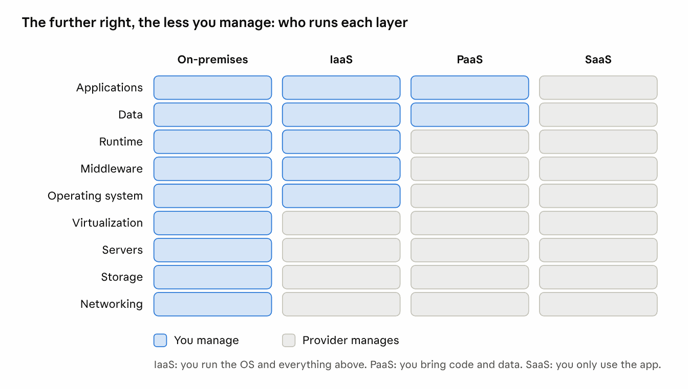

1. **Infrastructure as a Service (IaaS):** the provider supplies virtual machines, storage and networks; the user installs and manages the OS, middleware and applications. *Examples:* Amazon EC2 and S3, Google Compute Engine, Azure Virtual Machines.
2. **Platform as a Service (PaaS):** the provider supplies a ready platform (runtime, database, tools); the user deploys only code and data. *Examples:* Google App Engine, Azure App Service, Heroku, Force.com.
3. **Software as a Service (SaaS):** the provider supplies a finished application used through a browser; the user only configures and uses it. *Examples:* Gmail, Salesforce CRM, Microsoft 365.

**Conclusion:** moving from IaaS to SaaS, the provider manages more layers and the user controls less.

## Group B: 5-mark answers (part 3)

### B9. A small enterprise wants an email solution for its employees. Would you suggest a cloud solution or a traditional one? Give reasons.

*5 marks · PYQ 2016*

**Suggest a cloud email service (SaaS)** such as Google Workspace, Microsoft 365 or Zoho Mail, instead of running its own mail server.

1. **Low cost:** no server hardware, licences or mail administrator; a small fee per user per month.
2. **Quick set-up:** working in a day; just point the domain's mail records to the provider.
3. **Access anywhere:** browser and mobile apps, so staff can work on the move.
4. **No maintenance:** the provider handles updates, spam and virus filtering, and backups.
5. **Reliability:** redundant data centres and an SLA, typically 99.9% uptime.
6. **Scales with the business:** add or remove users in minutes.
7. **Collaboration built in:** shared calendars, contacts and documents.
8. **Security features:** encryption and multi-factor authentication included.

**When a traditional server may still be chosen:** strict rules on where data is kept, unreliable Internet, or an existing investment in on-premises mail.

**Conclusion:** for a small enterprise the cloud is cheaper, faster to start and easier to run.

### B10. Explain what is meant by Identity as a Service (IDaaS). (Write about Identity as a Service.)

*5 marks (Unit 1 part) · PYQ 2016, 2018; short note in 2014*

**Identity as a Service (IDaaS)** delivers identity and access management as a cloud service. A third-party provider hosts and maintains it, usually on subscription. A **digital identity** is the set of attributes, metadata and relationships that makes a user, device or service uniquely identifiable.

**Core functions:**

1. **Authentication**, including multi-factor authentication (MFA).
2. **Single sign-on (SSO):** one login opens many applications.
3. **Directory services:** the store of users, groups and attributes.
4. **Federated identity:** trust across organizations.
5. **Provisioning and de-provisioning** of accounts in each application.
6. **Policies, roles and enforcement**, plus identity governance.
7. **Risk and event monitoring, and audit.**

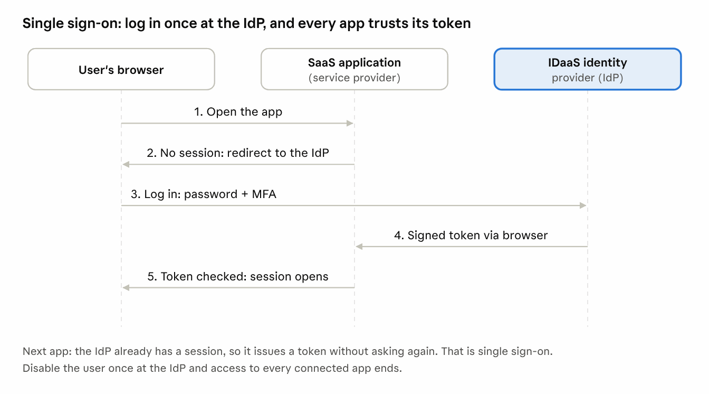

**Standards that make it interoperable:** SAML, OAuth 2.0, OpenID Connect, SCIM, XACML, SPML. **Examples:** Okta, Microsoft Entra ID, Ping Identity, OneLogin, Auth0.

**Benefits:** fewer passwords, instant removal of a leaver's access everywhere, stronger security through MFA, and audit trails for compliance.

*Careful: this question is about Identity as a Service. Do not write about IaaS (Infrastructure as a Service).*

### B11. What are the two different kinds of cloud service offerings by Google?

*Part of a 5-mark question · PYQ 2016 (the other part, disintermediation, is Unit 2)*

1. **Software as a Service: Google Apps (now Google Workspace).** Gmail, Calendar, Docs, Sheets, Drive and Sites, used through a browser. Free for individuals, on subscription for businesses. Multi-tenant, always up to date, built for real-time collaboration.
2. **Platform as a Service: Google App Engine.** Developers build and host their own web applications on Google's infrastructure, programming against Google's published APIs. It supports languages such as Python, Java, Go and PHP, scales automatically, includes a managed datastore, and charges by use.

Today Google also sells IaaS (Compute Engine) as part of Google Cloud.

### B12. Explain the different cloud service models with examples of products using them. Discuss the business benefits of cloud architecture.

*5 marks · PYQ 2017 (suggested split 2½ + 2½)*

**Service models and products**

- **IaaS:** rent virtual servers, storage and networks. *Products:* Amazon EC2, Amazon S3, Google Compute Engine, Azure Virtual Machines, Rackspace Cloud Servers.
- **PaaS:** rent a platform to build and run your own applications. *Products:* Google App Engine, Azure App Service, AWS Elastic Beanstalk, Heroku, Force.com.
- **SaaS:** use a finished application over the Internet. *Products:* Salesforce CRM, Gmail and Google Workspace, Microsoft 365, Zoom, Dropbox.

**Business benefits of cloud architecture**

1. **Almost zero up-front infrastructure investment:** no data centre to build.
2. **Just-in-time infrastructure:** capacity arrives when needed, so no guessing the peak.
3. **More efficient resource use:** no idle servers bought for a peak.
4. **Usage-based costing:** pay only for what is used; costs follow the business.
5. **Shorter time to market:** new products launch in days, not months.
6. **Agility and portability:** automation lets the business respond quickly, and well-designed applications can move between cloud and on-premises.

## Group B: 5-mark answers (part 4)

### B13. Discuss in detail, with diagram(s), the Cloud Cube model. (Short note: Cloud Cube Model.)

*5 marks · PYQ 2017; short note in 2015 and 2017*

The **Cloud Cube Model** was published by the **Jericho Forum** (The Open Group) in April 2009. It classifies cloud "formations" along four dimensions, so an organization can choose a formation that lets it collaborate securely.

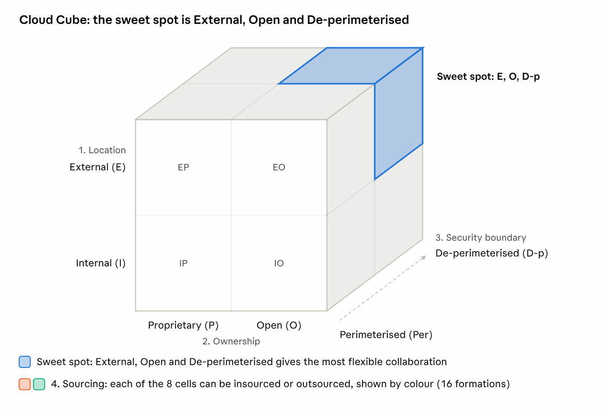

1. **Internal (I) / External (E): physical location of the data.** Inside or outside the organization's boundary. Own data-centre storage is internal; Amazon S3 is external.
2. **Proprietary (P) / Open (O): ownership of technology and interfaces.** Proprietary means switching providers is costly (lock-in); open means more suppliers and easy data sharing, e.g. email over SMTP.
3. **Perimeterised (Per) / De-perimeterised (D-p): the security boundary.** Per stays inside the traditional firewall, extended into the cloud over a VPN. D-p means protection travels with the data itself.
4. **Insourced / Outsourced: who runs the cloud.** Your own staff or a third party. A business decision fixed in the contract, shown by colour in the cube.

- The first three dimensions make **8 cloud forms**; sourcing doubles them to **16 formations**.
- The **sweet spot** is External, Open and De-perimeterised: the most flexible for collaboration.
- **Significance:** in cloud computing the firewall is no longer the security boundary, so each class of data should be placed in a formation that suits its sensitivity.

### B14. For IaaS, mention the resources it provides. Explain why more and more data centres are migrating to the cloud.

*5 marks · PYQ 2017 (suggested split 2 + 3)*

**IaaS** delivers virtualized hardware as a service: the provider owns and runs the equipment, and the customer provisions what it needs and manages the OS and applications on top.

**Resources provided:**

- **Compute:** virtual machines (instances) in small, medium and large sizes, e.g. Amazon EC2.
- **Storage:** block storage (Amazon EBS), object storage (Amazon S3) and file storage.
- **Networking:** virtual private networks, IP addresses, load balancers, firewalls and VPN connections.
- **Management:** machine images, monitoring, metering and billing, web portal and APIs.

**Why data centres are migrating to the cloud:**

1. Owned hardware is expensive and sits idle most of the time.
2. Cloud capacity arrives in minutes instead of weeks of purchase and installation.
3. Costs move from capital expense to pay-as-you-go operating expense.
4. No hardware refresh every few years.
5. Disaster recovery across regions comes built in.
6. Global reach: servers near customers anywhere.
7. IT staff are freed from maintenance to work on the business.
8. Savings in power, cooling and floor space.

### B15. What are the differences between private cloud and public cloud?

*5 marks · PYQ 2018*

- **Public cloud:** provisioned for open use by the general public and located on the provider's premises (NIST). Example: AWS.
- **Private cloud:** provisioned for the exclusive use of a single organization, on or off its premises (NIST). Example: a bank's own OpenStack cloud.

| Basis | Public cloud | Private cloud |
| --- | --- | --- |
| Users | General public, many tenants | One organization only |
| Location | Provider's data centres | On premises or hosted |
| Owned and run by | Provider | The organization or a third party |
| Cost | Pay per use, no capital cost | High capital and running cost |
| Control and customization | Low | High |
| Security and privacy | Shared hardware, so lower | Dedicated, so highest |
| Scalability | Practically unlimited | Limited by own hardware |
| Maintenance | Provider | The organization |
| Examples | AWS, Microsoft Azure, Google Cloud | OpenStack or VMware cloud in a bank |

**Conclusion:** public clouds win on cost and scale; private clouds win on control and security. A hybrid combines both.

### B16. What are the differences between vertical scalability and horizontal scalability?

*5 marks · PYQ 2018*

- **Vertical scalability (scale up):** increase the capacity of an existing machine by adding CPU, RAM or disk. The data stays on one node.
- **Horizontal scalability (scale out):** add more machines to the pool and spread the load across them, usually by partitioning or copying the data. It relies on clustering, distributed file systems and load balancing.

| Basis | Vertical scaling | Horizontal scaling |
| --- | --- | --- |
| Method | Bigger machine | More machines |
| Limit | Ceiling of one machine | Practically unlimited |
| Downtime | Often needs a restart | Usually none |
| Failure | Single point of failure | Survives the loss of a node |
| Complexity | Simple; no code change | Needs a load balancer and distributed design |
| Example | 8 GB to 32 GB RAM on one database server | 3 to 10 web servers behind a load balancer |

**Conclusion:** cloud applications prefer horizontal scaling, because adding and removing machines automatically is what makes them elastic.

## Group C: 15-mark answers (2014 paper)

### C1. (a) Explain precisely the Jericho Forum's Cloud Cube model with a diagram. (b) Briefly explain the deployment models for cloud computing.

*15 marks · PYQ 2014 (suggested split 8 + 7)*

#### (a) The Cloud Cube Model

The Jericho Forum, a security group of The Open Group, published *Cloud Cube Model: Selecting Cloud Formations for Secure Collaboration* in April 2009. Cloud computing offers huge scale at low cost, but an organization must pick the right **cloud formation** for each business function to stay secure and still collaborate. The model separates formations along four dimensions. The paper also warns that not everything belongs in the cloud.

1. **Internal (I) / External (E): the physical location of the data.** Does the cloud sit inside or outside the organization's boundary? Virtualized disks in your own data centre are internal; Amazon S3, off-site, is external. Internal is not automatically safer; using both may be the most secure.
2. **Proprietary (P) / Open (O): ownership of the technology, services and interfaces.** It measures interoperability, data and application portability, and how freely you can withdraw your data. Proprietary clouds may be more innovative, protected by patents and trade secrets, but leaving them takes great effort. Open clouds use non-proprietary technology with many suppliers, so partners can share data easily, e.g. email over SMTP. The paper's premise: clouds best for collaboration between organizations will be open.
3. **Perimeterised (Per) / De-perimeterised (D-p) architectures: the architectural mindset.** Per works inside the traditional IT perimeter, guarded by network firewalls. You can extend that perimeter into an external cloud over a VPN, run the virtual server in your own IP domain, control access with your own directory services, then pull the perimeter back. D-p designs the perimeter by the Jericho Forum's Commandments and Collaboration Oriented Architecture: data is wrapped with metadata and mechanisms that protect it wherever it goes, and sharing is limited to the parties of the collaboration.
4. **Insourced / Outsourced: who runs the cloud.** Your own staff under your control, or a third party. It is a business and policy decision, written into the contract. In the cube it is shown by colour, and any of the eight forms can take either value.

- **Structure:** the first three dimensions give 2 × 2 × 2 = **8 cloud forms**, Per(IP, IO, EP, EO) and D-p(IP, IO, EP, EO). Sourcing gives each two states: **16 formations**.
- **Sweet spot:** External, Open, De-perimeterised, where flexibility and collaboration are greatest. Proprietary suppliers tend to keep customers on the proprietary side.
- **Questions a customer should ask the supplier:** where in the cube does it operate for each service; how will it prove the formation's features are delivered and maintained; how will data and services stay available if the supplier fails or changes direction.
- **Significance:** the network firewall no longer marks the security boundary, so each class of data should go to the formation that suits its sensitivity.

#### (b) Deployment models

1. **Public cloud:** open to the general public, on the provider's premises; multi-tenant and pay-per-use. *Example:* AWS, Microsoft Azure, Google Cloud. *Pro:* no capital cost, near-unlimited scale. *Con:* shared hardware, less control.
2. **Private cloud:** for the exclusive use of one organization, on or off its premises, run by it or a third party. *Example:* a bank's own OpenStack cloud. *Pro:* control, security, compliance. *Con:* high cost, limited capacity.
3. **Community cloud:** shared by organizations with common concerns such as mission, security or compliance. *Example:* the Government of India's MeghRaj (GI Cloud); AWS GovCloud (US). *Pro:* shared cost, common compliance. *Con:* shared capacity, joint governance.
4. **Hybrid cloud:** two or more distinct clouds that stay separate but are bound together so data and applications can move; **cloud bursting** sends peak load from private to public. *Example:* a bank keeps customer records private and runs its app front end on a public cloud. *Pro:* flexibility. *Con:* complex to integrate and secure.

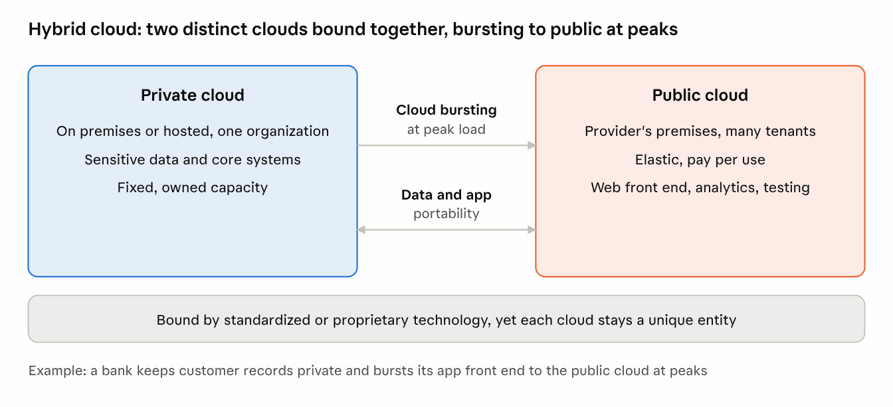

| Basis | Public | Private | Community | Hybrid |
| --- | --- | --- | --- | --- |
| Users | Everyone | One organization | A group with shared concerns | Mix |
| Cost | Pay per use | High capital cost | Shared | Mixed |
| Control | Low | High | Medium | Medium to high |
| Scalability | Very high | Limited | Limited | High (bursting) |

### C2. What is IaaS? Mention its characteristics. Explain the modern implementation of SaaS using SOA components. Explain precisely the protocol stack for an SOA architecture with a diagram.

*15 marks · PYQ 2014 (suggested split 3 + 4 + 4 + 4)*

#### (i) What is IaaS?

**Infrastructure as a Service** lets the consumer provision processing, storage, networks and other basic computing resources, and run any software on them, including the operating system (NIST). The consumer controls the OS, storage and applications but not the underlying cloud. In Sosinsky's words, hardware is virtualized in the cloud: the vendor owns the servers, storage and network, and the developer creates virtual servers, storage and networks and fills them with the applications the solution needs. Requests to these virtual systems are passed to the real servers that do the work. *Examples:* Amazon EC2 and S3, Google Compute Engine, Azure Virtual Machines, Rackspace Cloud Servers.

#### (ii) Characteristics of IaaS

1. **Resources as a service:** servers, storage and networks are rented, not bought.
2. **Virtualization:** a hypervisor partitions physical servers into virtual private server instances; each workload gets a small, medium or large instance.
3. **Dynamic scaling:** instances are added or removed as load changes.
4. **Utility pricing:** pay per hour or second; a variable cost.
5. **Multi-tenancy:** many customers share the same physical hardware, isolated from each other.
6. **Self-service:** provisioning through a web portal or API in minutes.
7. **Customer control:** full control of OS and software; the provider manages hardware and facilities.
8. **Distribution:** regions and availability zones built from pods, for resilience.

#### (iii) Modern implementation of SaaS using SOA components

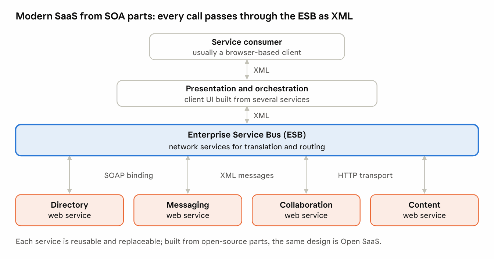

- **Service consumer:** usually a browser-based client.
- **Presentation and orchestration:** builds the user interface and combines several service calls into one task.
- **Enterprise Service Bus (ESB):** network services that translate messages and route each request to the right service.
- **Messages:** XML, bound to SOAP and carried over HTTP.
- **SaaS web services:** separate directory, messaging, collaboration and content services, each reusable and replaceable.
- **Benefits:** loose coupling, reuse, standard interfaces, independent scaling of each service. Built from open-source parts (Linux, Apache, MySQL, PHP), the same design becomes **Open SaaS**: cheaper, more portable, less lock-in.

#### (iv) Protocol stack for an SOA architecture

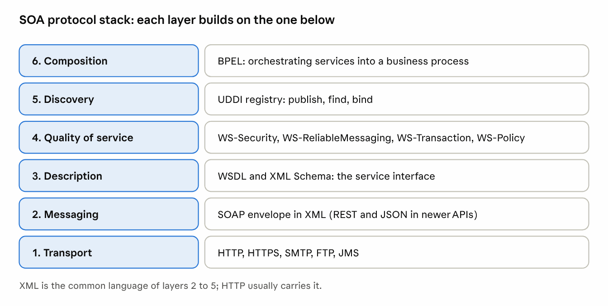

1. **Transport:** moves messages between machines, mostly HTTP and HTTPS; also SMTP, FTP and JMS.
2. **Messaging:** SOAP defines an XML envelope (an optional header for security or transactions, and a body for the data). REST with JSON is the lighter alternative today.
3. **Description:** WSDL describes the service interface: operations, messages, data types (XML Schema), binding and endpoint address.
4. **Quality of service:** WS-Security (integrity, confidentiality, tokens), WS-ReliableMessaging (guaranteed delivery), WS-Transaction (coordinated transactions), WS-Policy (requirements).
5. **Discovery:** a UDDI registry where providers publish services and consumers find and bind to them.
6. **Composition:** BPEL orchestrates many services into one business process.

**Conclusion:** each layer relies on the one below, and XML is the common language that lets services built on different platforms work together.

### C3. Draw the diagram of the CSA cloud reference model with security boundaries.

*Part of a 15-mark question · PYQ 2014 (suggested 7–8 marks; part (a), the cloud life cycle, belongs to Unit 3)*

The Cloud Security Alliance (CSA) reference model, used in Sosinsky's book, stacks the layers that each service model provides. Each model **inherits** every layer below it.

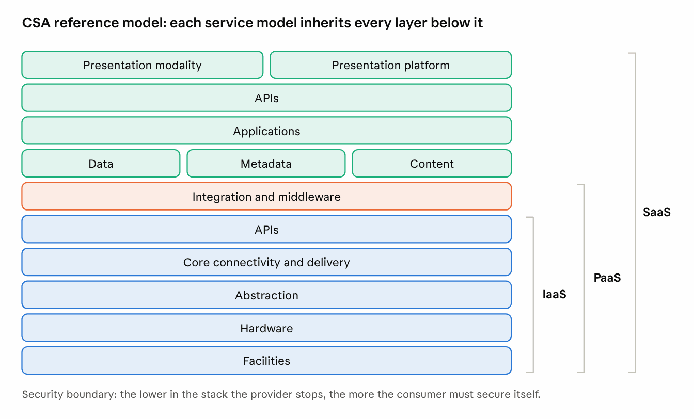

- **IaaS:** facilities, hardware, abstraction (the hypervisor), core connectivity and delivery, and APIs.
- **PaaS:** everything in IaaS plus **integration and middleware**: runtimes, databases, messaging, queuing.
- **SaaS:** everything in PaaS plus **data, metadata and content; applications and their APIs; presentation modality and platform**.

**Security boundaries.** A security boundary is the line where the provider's responsibility ends and the customer's begins. It sits at a different height for each service model:

| Service model | Provider secures | Customer secures |
| --- | --- | --- |
| IaaS | Facilities, hardware, hypervisor, core network, the IaaS APIs | Guest OS and patches, middleware, applications, data, user access, firewall rules |
| PaaS | All of IaaS plus integration and middleware (runtime, database) | The applications it builds, its data, user access |
| SaaS | Almost the whole stack, up to the application and its presentation | Its own data, user accounts and access settings |

- **CSA's rule:** the lower down the stack the provider stops, the more security the consumer must implement and manage itself.
- **How to draw it:** draw the stack, then three dashed lines across it: the IaaS boundary above the IaaS APIs, the PaaS boundary above integration and middleware, the SaaS boundary near the top. Label each line "provider below, customer above".

### C4. Write short notes on: (a) Chromium OS, (b) IDaaS, (c) hybrid cloud.

*About 5 marks each · PYQ 2014 ("any three" of five; the other two, Google Cloud and Windows Azure, are Unit 2)*

#### (a) Chromium OS

- An **open-source operating-system project by Google** for people who spend most of their time on the web. It is the basis of ChromeOS on Chromebooks.
- A lightweight **variant of Linux**: very small on disk, quick to boot, built around the Chrome browser, whose interface it resembles.
- Runs on **x86 and ARM** processors; users do not install separate device drivers.
- Applications and data live **in the cloud** (web apps, online storage), so there is little to install, update or back up. Updates are automatic, and verified boot and sandboxing keep it secure.
- In the textbook era it printed through **Google Cloud Print**, which Google shut down in 2020.
- **Significance:** the browser becomes the operating system and the laptop becomes a **thin client** of the cloud.

#### (b) IDaaS (Identity as a Service)

- Identity and access management delivered as a **cloud service** by a third party, on subscription.
- It keeps the identification logic and the storage of identity attributes **outside the applications**, so identity can be added to any application with minimal development.
- **Services:** authentication (with MFA), single sign-on, directory, federation, provisioning and de-provisioning, policies and roles, identity governance, risk and event monitoring, audit.
- **Interoperability standards (Sosinsky):** user-centric authentication through information cards (OpenID, CardSpace); XACML policies that check SAML requests and allow or deny them; SPML for provisioning; XDAS for audit. Today: SAML, OAuth 2.0, OpenID Connect, SCIM.
- **Examples:** Okta, Microsoft Entra ID, Ping Identity, OneLogin.
- **Benefits:** one login for every application, instant de-provisioning, stronger security, audit trails.

#### (c) Hybrid cloud

- **Definition (NIST):** a composition of two or more distinct clouds (private, community or public) that remain unique entities but are bound together by standardized or proprietary technology that enables data and application portability.
- **How it is used:** sensitive or critical workloads stay in the private cloud; less critical work such as testing runs on a public cloud (e.g. Google Compute Engine); backups and archives can go to Amazon S3.
- **Cloud bursting:** an order-entry system that peaks in the holiday season runs privately and **bursts** into the public cloud for extra capacity. Big-data analytics can run in the public cloud on data stored privately.
- **Advantages:** flexibility, sensitive data kept in-house, pay for peaks only when they occur, better disaster recovery.
- **Disadvantages:** complex integration and management, security across the boundary, network latency between clouds.

## Group C: 15-mark answers (2015 paper)

### C5. With respect to the NIST Reference Model of cloud computing, explain (i) essential characteristics, (ii) service models, (iii) deployment models, with suitable schematics and examples.

*15 marks · PYQ 2015; parts repeated in 2017 (suggested split 5 + 5 + 5)*

NIST SP 800-145 defines cloud computing as "a model for enabling ubiquitous, convenient, on-demand network access to a shared pool of configurable computing resources (e.g., networks, servers, storage, applications, and services) that can be rapidly provisioned and released with minimal management effort or service provider interaction." The model has **5 essential characteristics, 3 service models and 4 deployment models**.

#### (i) Essential characteristics

| Characteristic | Meaning (NIST) | Example |
| --- | --- | --- |
| On-demand self-service | The consumer provisions server time and storage automatically, without human interaction with the provider | Launching an EC2 instance from the console in a minute |
| Broad network access | Capabilities reached over the network through standard mechanisms, from thin or thick clients: phones, tablets, laptops, workstations | The same Gmail account on a phone and a laptop |
| Resource pooling | Provider resources are pooled to serve many consumers on a multi-tenant model, assigned and reassigned by demand; the customer knows the location only roughly (country, region, data centre) | Many customers' VMs on one physical server; you choose only the Mumbai region |
| Rapid elasticity | Capabilities are provisioned and released elastically, sometimes automatically; to the consumer they look unlimited | A shopping site grows from 4 to 40 servers for a sale, then shrinks |
| Measured service | Usage is metered (storage, processing, bandwidth, active users), monitored, controlled and reported to both sides | Bills per GB-month of storage or per instance-hour |

The NIST figure also shows eight common characteristics: massive scale, homogeneity, virtualization, resilient computing, low-cost software, geographic distribution, service orientation, advanced security.

#### (ii) Service models

1. **Software as a Service (SaaS):** the consumer uses the provider's applications through a browser or a program interface. It controls nothing underneath, apart from limited user settings. *Examples:* Gmail, Salesforce CRM, Microsoft 365.
2. **Platform as a Service (PaaS):** the consumer deploys its own applications, written with the provider's languages, libraries and tools. It controls the applications and their hosting settings, not the servers, OS or storage. *Examples:* Google App Engine, Azure App Service, Heroku.
3. **Infrastructure as a Service (IaaS):** the consumer provisions processing, storage and networks and runs any software, including the OS. It controls the OS, storage and applications, and possibly some networking such as host firewalls. *Examples:* Amazon EC2, Google Compute Engine.

Together they form the **SPI** model; each builds on the one below.

#### (iii) Deployment models

1. **Private cloud:** for the exclusive use of one organization (with many business units); owned and run by it, a third party or both; on or off premises. *Example:* a bank's private OpenStack cloud.
2. **Community cloud:** for the exclusive use of a community of organizations with shared concerns (mission, security, policy, compliance). *Example:* the Government of India's MeghRaj cloud for departments.
3. **Public cloud:** for open use by the general public; owned by a business, academic or government body; on the provider's premises. *Example:* AWS, Microsoft Azure.
4. **Hybrid cloud:** two or more distinct clouds that remain unique entities but are bound together so data and applications can move between them, e.g. **cloud bursting** for load balancing. *Example:* private core banking with public-cloud bursting at peaks.

**Conclusion:** any cloud service can be described by its characteristics, its service model and its deployment model, which is why examiners keep asking for this model.

### C6. (a) Discuss three main advantages and two major disadvantages of cloud computing, with suitable examples. (b) Describe the key parameters used in a typical cloud Service Level Agreement.

*15 marks · PYQ 2015 (suggested split 8 + 7)*

#### (a) Advantages and disadvantages

**Advantage 1: Cost savings.** There is no capital spending on servers and storage, and no power, cooling or administration cost for an in-house data centre. You pay only for what you use and can stop at any time. *Example:* a startup launches its app on AWS without buying a single server, and pays a few hundred rupees in its first month.

**Advantage 2: Reliability.** Providers run redundant hardware across several data centres, with fast failover: if a server fails, the application moves to another. Most promise 99.9% or better uptime in an SLA. *Example:* Amazon S3 keeps copies of each object across several facilities, so a single disk or building failure loses nothing.

**Advantage 3: Scalability and simple management.** Capacity grows and shrinks on demand, and the provider applies updates and patches centrally. *Example:* an e-commerce site adds servers automatically for a festival sale and releases them afterwards.

**Disadvantage 1: Downtime and Internet dependence.** A provider outage stops every customer at once, and without Internet nothing works. *Example:* Amazon's EBS outage in April 2011 took several popular websites offline for hours.

**Disadvantage 2: Security and privacy.** Data sits with a third party on shared hardware, so a breach or a misconfiguration can expose it. *Example:* storage buckets accidentally left public have exposed millions of customer records.

Vendor lock-in is a third disadvantage worth naming if space allows.

#### (b) Key parameters of a cloud SLA

A **Service Level Agreement** is the contract for performance negotiated between a customer and a cloud provider. It states measurable service levels, how they are measured and reported, and the compensation if they are missed. Sosinsky lists availability (uptime), response time or latency, reliability of the service components, the responsibilities of each party, and warranties.

| Parameter | What it specifies | Example |
| --- | --- | --- |
| Availability (uptime) | Percentage of time the service is available | 99.9% a month allows about 43 minutes of downtime; 99.99% about 4 minutes |
| Response time and latency | How quickly requests are served | Average API response under a stated number of milliseconds |
| Reliability | Failure rates and durability of components and data | Stored data copied across facilities |
| Capacity | Number of concurrent users or transactions supported | A stated number of users at once |
| Performance benchmarks | Targets compared against actual performance periodically | Monthly performance review |
| Support and help desk | Response time for each class of problem | Critical issues answered within an hour |
| Backup and recovery | Recovery point and recovery time objectives | Restore within four hours |
| Security and data protection | Encryption, access control, breach notice, data location | Data kept in India; breach reported promptly |
| Change notification | Advance notice of maintenance or network changes | Seven days' notice of planned downtime |
| Usage statistics and reporting | What usage and performance data the customer receives | Monthly usage reports |
| Responsibilities and warranties | Duties of each party and what the provider guarantees | Customer secures its own accounts |
| Penalties and exit | Service credits for breaches, termination terms, return of data | A credit on the bill when uptime falls short |

**Conclusion:** an SLA turns the provider's promises into measurable numbers, and should be reviewed regularly as technology and regulations change.

### C7. Explain the concept of IaaS and SaaS, using suitable examples and/or appropriate schematic diagrams to help establish your understanding.

*15 marks · PYQ 2015 (suggested split 7 for IaaS + 8 for SaaS)*

IaaS and SaaS sit at the two ends of the SPI stack: IaaS rents out the raw computer, SaaS rents out a finished application, and PaaS sits between them.

#### Part 1: Infrastructure as a Service (IaaS)

**Definition (NIST).** “The capability provided to the consumer is to provision processing, storage, networks, and other fundamental computing resources where the consumer is able to deploy and run arbitrary software, which can include operating systems and applications.” The consumer does not manage the underlying cloud infrastructure, but controls the operating systems, storage and deployed applications, and possibly some networking components such as host firewalls.

In Sosinsky's terms, the provider offers virtual machines, virtual storage, virtual infrastructure and other hardware assets that clients provision for themselves. The provider looks after the infrastructure; the client looks after everything deployed on it: the OS, the applications and how users interact with them. Buyya discusses IaaS together with **Hardware as a Service (HaaS)**, the rental of raw hardware.

**Schematic: Buyya's IaaS reference implementation**

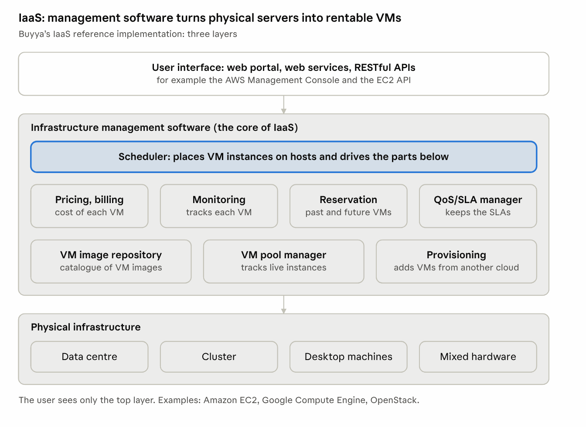

Buyya separates an IaaS solution into three layers:

1. **User interface (top).** Web portals, web services and RESTful APIs, built with Web 2.0 technologies, through which users request, start, stop and monitor VMs.
2. **Infrastructure management software (middle, the core).** The **scheduler** decides where each VM instance runs and works with the other components:
   - *pricing and billing* works out what each instance costs and keeps the data used to charge the user;
   - *monitoring* follows each instance's execution and performance;
   - *reservation* records the instances that have run or are booked to run;
   - *QoS/SLA management* stores the SLAs agreed with users and, together with monitoring, makes sure each VM gets the promised quality;
   - the *VM repository* is a catalogue of VM images (some providers let users upload their own);
   - the *VM pool manager* keeps track of all live instances;
   - *provisioning* obtains VMs from a third-party IaaS provider when local capacity is not enough.
3. **Physical infrastructure (bottom).** Data centres, clusters, desktop machines or any mix of hardware that the management layer virtualizes.

**Workload and virtual private servers (Sosinsky).** The basic unit of IaaS is the **workload**: a virtual machine instance sized to do the amount of work that a certain kind of physical server would do (for example, a stated number of transactions per minute). Each workload runs in a **virtual private server (VPS)** carved out of shared physical resources:

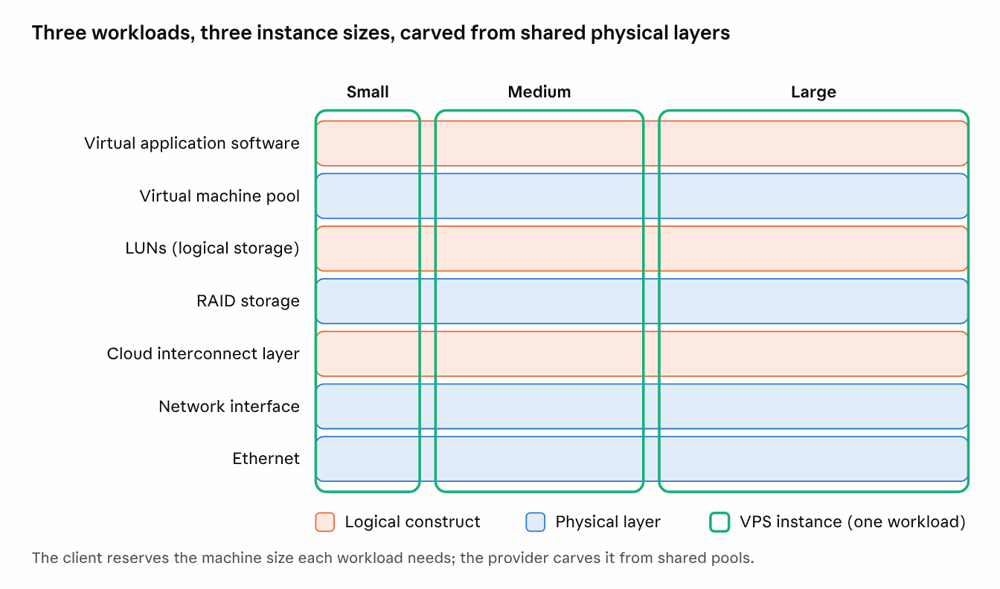

- **Physical side:** a pool of servers, RAID storage and network interface cards.
- **Logical side:** virtual machines, logical units of storage (LUNs), virtual network interconnects and virtual application software.

**Pods, aggregation and silos.** When the largest available instance cannot take more users, the provider clones it; the group of users served by one instance is a **pod**, managed by a cloud control system (in AWS, the Management Console). Pods are **aggregated** into pools inside a region or availability zone. Failures usually happen pod by pod or zone by zone, so failover between zones keeps the service available. A cloud sealed off so that it cannot interoperate with other clouds becomes a **silo**, an island of processing and data.

**Examples.** Amazon EC2 (virtual servers), Amazon S3 and EBS (storage), Google Compute Engine, Microsoft Azure Virtual Machines and Rackspace; Buyya's list also includes GoGrid and Joyent. OpenStack and Eucalyptus are used to build private IaaS clouds.

**Main features.**

- Full control of the OS and software stack, so existing applications can move across unchanged.
- Pay per use (per second or hour of instance time, per GB stored), with no capital spending.
- Scale out or in within minutes; capacity appears unlimited.
- The consumer still patches and secures the OS and backs up its own data.

#### Part 2: Software as a Service (SaaS)

**Definition (NIST).** “The capability provided to the consumer is to use the provider's applications running on a cloud infrastructure.” The applications are reached from many kinds of device through a thin client such as a web browser (for example, web-based email) or through a program interface. The consumer controls none of the infrastructure, nor the application's capabilities, apart from limited user-specific settings.

Sosinsky describes SaaS as a way of delivering software in which licensed users from many organisations reach an application's functions remotely, as a web-based service, from one shared multi-tenant system.

**Schematic: a multi-tenant SaaS application**

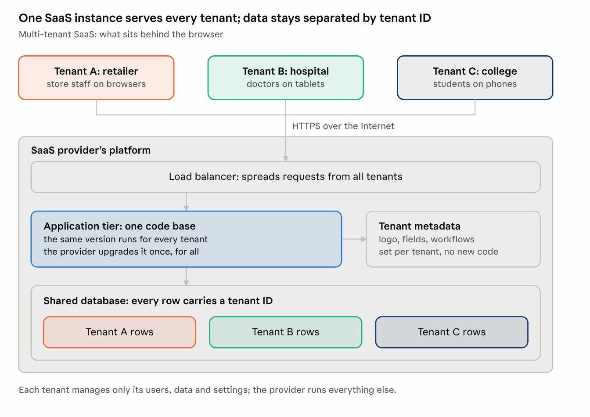

One running instance of the application and one database serve every customer organisation (**tenant**). Each tenant sees only its own rows, separated by a tenant ID, and its own look and workflow, which are stored as **metadata** rather than as separate code. When the provider upgrades the application, all tenants move to the new version together.

**Characteristics of a SaaS solution (Sosinsky).**

1. Reachable over the Internet, from anywhere, through a browser, whenever needed.
2. Paid by subscription or by use and billed at regular intervals, instead of a one-time licence.
3. The vendor monitors and maintains the software and the service, wherever its components run.
4. Cheaper to use than packaged software, because distribution and maintenance cost less and the user needs only a modest machine.
5. Upgrades, updates and patches are applied automatically, so changes reach users quickly.
6. Easy to start using, with a known recurring cost, and it scales on demand.
7. Everyone runs the same version, so users' files and features stay compatible.
8. A single instance with a shared data model serves many users (multi-tenancy).

Buyya adds the four traits identified by the Software & Information Industry Association (SIIA): what is sold is *access* to the application; the application is *managed centrally*; delivery is *one-to-many*; and the service is an *integrated solution delivered as the contract promises*.

**Examples.** Salesforce.com CRM, Google Workspace (Gmail, Docs), Microsoft 365, Zoho, Dropbox, NetSuite ERP and Workday HR. Buyya also treats social-networking sites such as Facebook and LinkedIn as SaaS.

**Limitations.** SaaS needs a dependable Internet connection, allows limited customisation, keeps data with the vendor and can make switching providers difficult.

#### IaaS and SaaS side by side

| Point | IaaS | SaaS |
| --- | --- | --- |
| What is rented | Virtual machines, storage and networks | A ready-to-use application |
| Typical user | System administrator, DevOps engineer | End user, business staff |
| Consumer manages | OS, middleware, runtime, applications, data | Only its users, data and settings |
| Flexibility | Highest: any OS and software | Lowest: the application as offered |
| Billing | Per second or hour of instance use, per GB | Per user per month, or per use |
| Examples | Amazon EC2, Google Compute Engine | Salesforce, Gmail, Microsoft 365 |

**Conclusion:** IaaS gives the most control together with the most responsibility; SaaS gives a finished service for the least effort. The right choice depends on how much of the stack the customer wants to run itself.

## Group C: 15-mark answers (2016 paper)

### C8. Write a brief note on cloud ecosystem along with examples.

*About 7–8 marks: part (a) of a 15-mark question · PYQ 2016. Part (b), Amazon EC2's service characteristics, belongs to Unit 2.*

**Meaning.** In nature, an ecosystem is a community of living things that depend on one another and on their surroundings. A **cloud ecosystem** is, in the same way, the whole network of interdependent participants (providers, consumers, partners, technologies and standards) that together make it possible to build, sell, deliver and use cloud services. No company delivers a complete cloud solution alone: a SaaS product usually runs on another company's IaaS, reaches customers over a carrier's network, is sold through a marketplace, is checked by an auditor and is set up by a consultant.

**Participants and their roles**

| Participant | Role in the ecosystem | Example |
| --- | --- | --- |
| Cloud provider | Builds, runs and sells cloud services | AWS, Microsoft Azure, Google Cloud, Salesforce |
| Cloud consumer | Chooses, uses and pays for services | A startup running on AWS; a college using Google Workspace |
| Cloud broker | Manages, combines or chooses among several providers' services for the consumer | Multi-cloud management platforms, cloud resellers |
| Cloud carrier | Carries traffic between consumers and providers | Telecom operators and Internet service providers |
| Cloud auditor | Independently assesses security, privacy and performance | Firms that audit against ISO/IEC 27001 or SOC 2 |
| Software vendors and developers | Build applications and add-ons on the platforms | Sellers on AWS Marketplace or Salesforce AppExchange |
| System integrators and consultants | Plan migrations and connect cloud services to existing systems | IT services firms such as TCS, Infosys and Accenture |
| Standards bodies and communities | Define common models, interfaces and best practice | NIST, Cloud Security Alliance, the OpenStack community |

The first five rows are the five actors of the NIST cloud reference architecture (SP 500-292); the others complete the ecosystem commercially.

**Technology view: the ecosystem behind a private cloud**

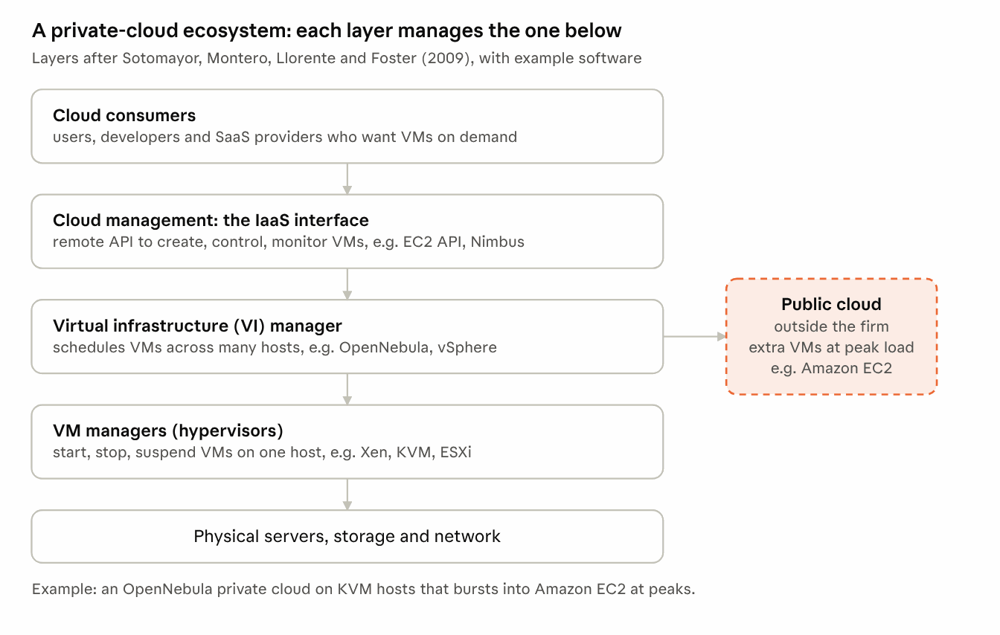

Sotomayor, Montero, Llorente and Foster (2009) describe the software layers that cooperate in a private or hybrid IaaS cloud:

1. **Cloud consumers** want flexible infrastructure on demand.
2. **Cloud management** gives them a remote, secure interface to create, control and monitor virtual resources (for example the EC2 API, Nimbus or Eucalyptus).
3. **Virtual infrastructure (VI) management** schedules and manages VMs across many physical hosts (for example OpenNebula or VMware vSphere) and can borrow capacity from a public cloud.
4. **VM managers (hypervisors)** start, stop and suspend VMs on a single host (Xen, KVM, VMware ESXi).

Each layer can come from a different vendor or open-source project, so the layers themselves form an ecosystem.

**Examples of cloud ecosystems**

- **Amazon Web Services:** EC2 and S3 at the centre, surrounded by software sellers in AWS Marketplace, consulting and technology partners, certified professionals and customers ranging from startups to large enterprises.
- **Salesforce:** the CRM applications and the Force.com platform, the AppExchange marketplace, a large developer community and implementation partners.
- **Google:** Google Cloud and Google Workspace, Android and Chrome devices as clients, and third-party apps in the Workspace Marketplace.
- **Open-source private cloud:** OpenStack (or Eucalyptus or OpenNebula) on KVM or Xen hosts, with distributors and support companies around it.

**Reference-model view.** The question bank answers this question with a *Cloud Ecosystem Reference Model*: an abstract model that names the major actors, their relationships and a minimum set of architecture building blocks (such as business capability management, governance, service catalogues, solution development and operational management), so that every participant shares one vocabulary.

**Why it matters.** Consumers get choice and complete solutions, providers grow faster through partners, and open interfaces let services from different participants work together. The main risk is depending too heavily on one dominant platform (lock-in).

**Conclusion:** a cloud service is never the work of one company; it is the output of an ecosystem of providers, partners, carriers, auditors and consumers.

## Group C: 15-mark answers (2017 paper)

### C9. What are the essential characteristics of the different service models and the various deployment models as per the NIST Reference Model of cloud computing? Describe with suitable examples.

*15 marks · PYQ 2017 (suggested split 8 for service models + 7 for deployment models)*

NIST SP 800-145 describes cloud computing through **five essential characteristics, three service models and four deployment models**. The five characteristics hold for every model; what changes from one model to the next is *which layers the consumer controls* (service models) and *who may use the cloud* (deployment models).

**The five essential characteristics, one line each**

| Characteristic | Meaning | Example |
| --- | --- | --- |
| On-demand self-service | Consumers provision resources themselves, without human help from the provider | Creating a VM from the console |
| Broad network access | Services are used from any device over standard networks | Gmail on a phone and on a laptop |
| Resource pooling | Pooled resources serve many tenants, assigned by demand, with location largely hidden | Many customers' VMs on one server |
| Rapid elasticity | Capacity grows and shrinks quickly, often automatically | Extra servers during a festival sale |
| Measured service | Use is metered, reported and billed | Billing per GB-month of storage |

#### (a) Service models and their characteristics

**1. Software as a Service (SaaS).** The consumer uses the provider's applications, running on cloud infrastructure, through a thin client such as a browser or through a program interface. It controls only limited user-specific settings. Characteristics:

- delivered over the Internet to browsers and mobile apps, with nothing to install;
- multi-tenant: one instance and one code base serve all customers;
- managed and upgraded centrally by the provider, so every user runs the same version;
- paid by subscription or by use;
- APIs allow the application to be integrated with other software.

*Examples:* Salesforce CRM, Gmail, Microsoft 365, Zoho.

**2. Platform as a Service (PaaS).** The consumer deploys applications it has written or acquired, using the provider's programming languages, libraries, services and tools. It controls those applications and possibly the hosting environment's settings, but not the network, servers, operating system or storage. Buyya lists four characteristics:

- **Runtime framework:** the software stack that runs the user's code, following policies set by the user and the provider;
- **Abstraction:** users deploy and manage applications, not virtual machines;
- **Automation:** deployment, scaling and resource provisioning happen automatically, according to the SLA;
- **Cloud services:** ready APIs and services (databases, queues, authentication, caching) for building elastic, highly available applications.

Other common features are integrated development and testing tools, built-in load balancing and failover, support for team collaboration, and a risk of lock-in, because code is written against the platform's own APIs.

*Examples:* Google App Engine, Microsoft Azure App Service, Heroku, Force.com, AWS Elastic Beanstalk.

**3. Infrastructure as a Service (IaaS).** The consumer provisions processing, storage, networks and other basic resources and can run any software, including the OS. It controls the OS, storage and deployed applications, and possibly some networking such as host firewalls. Characteristics:

- computing resources (VMs, block and object storage, virtual networks) are delivered as a service;
- it rests on hardware virtualization, with many tenants sharing one physical machine;
- resources scale up and down dynamically;
- utility pricing: the cost follows use and there is no capital expenditure;
- the consumer has full control of the software stack, and full responsibility for patching and securing it.

*Examples:* Amazon EC2 and S3, Google Compute Engine, Azure Virtual Machines; OpenStack for private clouds.

The models build on each other: SaaS can be built on PaaS, which in turn runs on IaaS.

#### (b) Deployment models and their characteristics

**1. Private cloud.** Provisioned for the exclusive use of one organisation with many consumers (such as business units); owned and operated by that organisation, a third party or both; on or off premises.

- Characteristics: a single tenant; the highest control over data, security and compliance; can be customised; capacity is limited to what the organisation owns, and the capital cost is higher.
- Advantages (Buyya): customer information stays protected; the organisation itself can guarantee its SLAs; it can follow its own standard procedures and regulations.
- *Example:* a bank's in-house cloud built with OpenStack or VMware.

**2. Community cloud.** Provisioned for the exclusive use of a community of organisations with shared concerns (mission, security requirements, policy, compliance); run by one or more members, a third party or both; on or off premises.

- Characteristics: shared by organisations with common needs; costs are spread across members; security and compliance are designed for that sector.
- Typical sectors (Buyya): media, healthcare, energy and core industries, the public sector and scientific research.
- *Example:* AWS GovCloud (US) for government agencies and their contractors; India's MeghRaj (GI Cloud) for government departments.

**3. Public cloud.** Provisioned for open use by the general public; owned and operated by a business, academic or government organisation; located on the provider's premises.

- Characteristics: multi-tenant and very large; self-service over the Internet; pay as you go; quality promised through SLAs; the least customer control.
- *Example:* AWS, Microsoft Azure, Google Cloud.

**4. Hybrid cloud.** A composition of two or more distinct clouds (private, community or public) that remain separate entities but are bound together by technology that lets data and applications move between them, for example cloud bursting for load balancing.

- Characteristics: sensitive work stays private while peaks go to the public cloud; more flexible and cheaper than a purely private cloud; harder to manage, secure and integrate.
- *Example:* an online retailer keeps its customer database in a private cloud and bursts its web servers to AWS during festival sales.

**Deployment models compared**

| Basis | Private | Community | Public | Hybrid |
| --- | --- | --- | --- | --- |
| Users | One organisation | Organisations with shared concerns | General public | Mix of the others |
| Location | On or off premises | On or off premises | Provider's premises | Spread across clouds |
| Cost | Highest (owned capacity) | Shared by members | Lowest entry cost, pay per use | Moderate |
| Control and security | Highest | High, shared | Lowest | High for the private part |
| Scalability | Limited to owned capacity | Limited to the community's capacity | Very high | High, through bursting |
| Example | A bank's OpenStack cloud | AWS GovCloud, MeghRaj | AWS, Azure | Private core plus public bursting |

**Conclusion:** the five characteristics define *what* makes a service a cloud service; the service model decides *how much of the stack* the consumer controls; the deployment model decides *who shares* the cloud.

### C10. Compare the three service models of cloud computing, using suitable examples and explanations.

*15 marks · PYQ 2017 (suggested split: each model explained with an example 6, comparison 6, how they relate and when to choose each 3)*

The three NIST service models (IaaS, PaaS and SaaS, together the **SPI model**) differ in one main way: **how much of the computing stack the provider manages and how much is left to the consumer.**

#### The three models in brief

**IaaS: rent the computer.** The provider supplies virtual machines, storage and networks; the consumer installs and manages everything from the OS upwards. In Buyya's reference model IaaS belongs to the core middleware, offering virtual hardware. *Example:* a company moves its existing ERP servers to Amazon EC2 instances, keeps its own administrators and pays for instance time and storage.

**PaaS: rent the platform.** The provider supplies a ready runtime (languages, libraries, databases, automatic scaling); the consumer writes and deploys code. Buyya places PaaS in the user-level middleware. *Example:* a student team writes a web app in Python and deploys it to Google App Engine with one command; the platform scales it during a college fest without anyone managing a server.

**SaaS: rent the application.** The provider supplies a finished application through the browser; the consumer only uses and configures it. *Example:* a small firm signs up for Salesforce CRM or Microsoft 365, pays per user per month and starts work the same day.

**Analogy (getting around a city):** running your own servers is like owning a car; IaaS is like leasing one (you still drive, fuel and park it); PaaS is like hiring a taxi (you only say where to go); SaaS is like taking a bus (fixed routes, pay per ride, no driving at all).

#### Comparison

| Basis | IaaS | PaaS | SaaS |
| --- | --- | --- | --- |
| What is provided (NIST) | Processing, storage and networks to run any software, OS included | A platform to deploy your own applications built with the provider's tools | Ready applications used through a browser or an API |
| Layer in Buyya's model | Core middleware: virtual hardware | User-level middleware: runtime and development environment | Applications |
| Provider manages | Facility, hardware, virtualization, network | All of IaaS plus OS, runtime, middleware, scaling | Everything, including the application and its upgrades |
| Consumer manages | OS, middleware, runtime, applications, data | Application code, its data and settings | Users, data and personal settings |
| Main users | System administrators, network architects | Developers | End users, business staff |
| Skill needed | High: OS, networking, security | Medium: programming | Low: using the application |
| Control and flexibility | Highest | Medium, within the platform's limits | Lowest |
| Customisation | Any OS and software | Supported languages and frameworks only | Configuration only |
| Time to start | Minutes to launch a VM, longer to build a full stack | Minutes: push the code | Immediate: sign up and log in |
| Scaling | Consumer sets up auto-scaling | Automatic, built into the platform | Invisible to the user |
| Typical billing | Per second or hour of instance use, per GB | Per instance, request or compute time | Per user per month, or per use |
| Lock-in risk | Lower: VM images can be moved | Highest: code uses the platform's own APIs | Medium: exporting data can be hard |
| Consumer's security duty | OS, applications, data, access | Application code, data, access | Access control and data |
| Examples | Amazon EC2 and S3, Google Compute Engine, Azure VMs | Google App Engine, Azure App Service, Heroku, Force.com | Salesforce CRM, Gmail, Microsoft 365, Dropbox |

#### How the three relate

- They form a stack, and each can be built on the one below: Heroku (PaaS) runs on Amazon EC2 (IaaS), and Salesforce's CRM applications (SaaS) are built on its own Force.com platform (PaaS).
- Each layer can also be used on its own; a SaaS company may build directly on IaaS without any PaaS.
- Moving up the stack, the consumer gives up control and gains convenience, and responsibility shifts from the consumer to the provider.

#### When to choose which

| Situation | Best fit | Reason |
| --- | --- | --- |
| Move existing servers to the cloud unchanged, or a custom OS is needed | IaaS | Full control of the stack |
| Build a new web or mobile application quickly | PaaS | No servers to manage; scaling built in |
| Standard e-mail, CRM, HR or office software | SaaS | Ready to use, least effort |
| Short-lived test or training labs | IaaS | VMs created and deleted on demand |

**Benefits shared by all three:** no up-front hardware cost, pay per use, elasticity, access from anywhere and the provider's reliability.

**Conclusion:** IaaS gives the most control, PaaS the fastest development and SaaS the least effort; many organisations use all three at once for different needs.

### C11. What is Software as a Service (SaaS), and what are the main characteristics of a SaaS solution? Describe through a schematic diagram and necessary explanations how XML and SOA are used to implement an Open SaaS environment.

*15 marks · PYQ 2017 (suggested split 7 + 8)*

#### Part 1: SaaS and its main characteristics

**Definition.** NIST SP 800-145 defines SaaS as the capability to use the provider's applications running on a cloud infrastructure, reached from many kinds of device through a thin client such as a web browser, or through a program interface. The consumer manages none of the infrastructure or application features, apart from limited user-specific settings. Sosinsky describes it as a way of delivering software that gives licensed users multi-tenant, remote access to an application's functions as a web-based service.

**Main characteristics**

1. **Web access on demand:** available over the Internet through a browser, from anywhere, whenever needed.
2. **Subscription or usage pricing:** billed regularly per user or per use rather than sold as a one-time licence.
3. **Vendor-managed:** the provider monitors, maintains and secures the application, wherever its parts run.
4. **Lower total cost:** no local installation, distribution or maintenance; a modest client machine is enough.
5. **Automatic updates:** upgrades and patches are applied centrally and reach every user at once.
6. **One version for all:** every user runs the same release, so data and features stay compatible.
7. **Multi-tenancy:** a single instance with a shared data model serves many organisations, each kept separate.
8. **Scales on demand,** with a low barrier to entry and a known recurring cost.
9. **Open interfaces:** APIs let the application be integrated with the customer's other systems.

Buyya also quotes the SIIA's four traits: the product sold is access to the application; the application is centrally managed; the service is delivered one-to-many; and it is an integrated solution delivered as the contract promises.

*Examples:* Salesforce CRM, Google Workspace, Microsoft 365, Zoho CRM, Workday.

#### Part 2: XML and SOA in an Open SaaS environment

**Open SaaS.** A SaaS application built from open-source software is called **Open SaaS**. Sosinsky gives three advantages: it is cheaper to deploy because no operating system or software licences have to be bought; there is less vendor lock-in; and applications are more portable. The popularity of the open-source LAMP stack (Linux, Apache, MySQL and Perl, PHP or Python) and the large number of people trained in it make Open SaaS attractive, and it tends to bring lower development costs and better profitability.

**SOA.** In a service-oriented architecture an application is assembled from **loosely coupled, reusable services**. Each service carries out one business function (for example *create invoice* or *check stock*), publishes a standard interface, and talks to other services only by exchanging messages over the network. As SaaS interfaces became more powerful and more standardised, SaaS moved towards SOA: the application is no longer one block of code but a set of services that the provider, its customers and its partners can combine.

**Schematic: Open SaaS built on SOA**

**XML: the common language of every layer.** XML is plain text, self-describing, independent of platform and programming language, and can be validated against a schema. That makes it the natural format for services written in different languages, by different vendors, to understand each other.

| Where XML is used | What it does in Open SaaS |
| --- | --- |
| SOAP messages | Each request and reply travels as an XML envelope with a header and a body |
| WSDL | Describes each service's operations, message formats and address |
| UDDI registry | Stores service descriptions so that services can be found |
| XML Schema (XSD) | Defines the data types both sides agree on, e.g. what an invoice contains |
| XSLT | Converts one XML format into another inside the ESB, so systems with different formats can talk |
| BPEL | Describes how services are combined into a business process |
| SAML, XACML, WS-Security | Carry identity assertions, access policies and message security |
| RSS/Atom feeds, REST | Publish data as XML feeds; REST services may return XML (JSON is also common) |

These standards stack up in layers, each written in XML:

**How the pieces work together**

1. **Open-source foundation.** Servers run Linux, Apache and MySQL; web services are hosted on open-source frameworks such as Apache Axis2 or Apache CXF, and an open-source enterprise service bus (ESB) such as Apache ServiceMix or Mule connects them.
2. **Functions become services.** Each business function (customers, orders, billing, e-mail) is written as a web service and described in a WSDL file.
3. **Publish and discover.** The services are listed in a UDDI registry or service catalogue, where the application and partners can find them.
4. **Messaging through the ESB.** The presentation layer (browser pages using HTML and Ajax) sends a request; it travels as SOAP/XML over HTTP to the ESB, which routes it to the right service, converts formats with XSLT and applies WS-Security.
5. **Composition.** For a complete process (place an order, check stock, raise an invoice, send a confirmation e-mail), a BPEL engine calls the services in order.
6. **Multi-tenant data.** The services keep every tenant's data in shared MySQL tables, tagged with a tenant ID.
7. **Integration and mashups.** Because every interface is open XML, customers can connect the SaaS to their own ERP, or combine it with other web services in mashups.

*Example:* an open-source CRM such as SuiteCRM (a fork of SugarCRM's community edition), hosted as a service, exposes SOAP and REST web services; a customer's accounting package calls them to keep customer records in step, exchanging XML.

**Benefits of SOA and XML for Open SaaS:** interoperability across languages and platforms, reuse of services, freedom to replace one component without rewriting the rest (less lock-in), independent scaling of busy services, and easy integration with customers' systems.

**Conclusion:** open-source software makes the SaaS cheaper and more portable, SOA breaks it into reusable services, and XML is the shared language in which those services describe themselves, exchange messages and carry security information.

### C12. What is Identity as a Service (IDaaS), and what are its core functions? Describe how user identity is authenticated and resource authorization is enforced in a typical IDaaS scenario.

*15 marks · PYQ 2017 (suggested split 7 + 8)*

#### Part 1: IDaaS and its core functions

**Identity.** An identity is the set of characteristics that makes an entity recognisable. In computing, a **digital identity** is a collection of attributes such as a user name and password, e-mail address, employee ID, roles, certificates, biometrics, device and location. People have identities, and so do devices and services.

**IDaaS.** **Identity as a Service** delivers identity and access management (IAM) as a cloud service run by a third party. Instead of each application keeping its own list of users and passwords, every application (in the cloud or on premises) trusts one identity provider. That provider keeps the directory, confirms who users are, helps decide what they may do and records what they did. *Examples:* Okta, Microsoft Entra ID (formerly Azure Active Directory), Google Cloud Identity, Ping Identity, OneLogin.

**Core functions (Sosinsky's list)**

| Function | What it does |
| --- | --- |
| Authentication services | Verify that users are who they claim to be (password, one-time code, biometrics, certificate) |
| Directory services | Keep identities and their attributes in one store, such as an LDAP or cloud directory |
| Federated identity | Let identities issued by one organisation be trusted by another organisation's applications |
| Identity governance | Review who has which access and confirm it is still needed |
| Identity and profile management | Maintain each user's attributes, including self-service updates |
| Policies, roles and enforcement | Define roles and rules and apply them to every access request |
| Provisioning (external policy administration) | Create, change and remove accounts in connected applications |
| Registration | Enrol new users and devices |
| Risk and event monitoring, including audits | Watch for suspicious activity and keep audit trails |
| Single sign-on (pass-through authentication) | One login opens many applications |

**Standards used.** OpenID and OpenID Connect (sign-in), SAML (exchanging authentication and attribute assertions), OAuth 2.0 (delegated authorization), XACML (access-control policies), SPML and SCIM (provisioning), XDAS (distributed audit) and Information Cards (Microsoft CardSpace).

**Benefits.** One login for users; central control and instant removal of access for administrators; fewer password resets; consistent multi-factor authentication; easier compliance audits.

#### Part 2: Authentication and authorization in a typical IDaaS scenario

**Scenario.** Priya works in the sales team of ABC Ltd. ABC uses Okta as its IDaaS provider, the **identity provider (IdP)**, and Salesforce as its CRM, the **service provider (SP)**. The two have exchanged certificates in advance, so Salesforce trusts assertions signed by Okta; this trust is called **federation**.

**A. Authentication by SAML single sign-on**

1. Priya opens Salesforce in her browser.
2. Salesforce finds no session for her, recognises ABC's domain and redirects the browser to Okta with a SAML authentication request.
3. Okta asks for her user name and password, then for a second factor such as a one-time code or a push approval on her phone (**multi-factor authentication**). It can also weigh risk signals: an unknown device or an unusual location may trigger extra checks.
4. Okta checks the credentials against its directory and issues a **SAML assertion** stating who she is, when and how she signed in, and attributes such as department = Sales and role = Manager. It signs the assertion with its private key.
5. The browser posts the assertion to Salesforce.
6. Salesforce verifies the signature with Okta's public certificate, checks that the assertion is meant for Salesforce and has not expired, maps Priya to her account and starts a session. Her password never reaches Salesforce.
7. When she later opens Microsoft 365, Okta already has a session for her, so she gets in without signing in again (**single sign-on**).

**B. Authorization by XACML-style policy enforcement**

1. Priya clicks *Export quarterly sales report*. The application's **policy enforcement point (PEP)** holds the request and asks the **policy decision point (PDP)**: may the subject *Priya (role Manager, department Sales)* perform the action *export* on the resource *Q3 sales report* in this environment (time, network, device)?
2. The PDP evaluates the rules that administrators wrote in the **policy administration point (PAP)**, for example “sales managers may export sales reports from company devices”. If it needs more attributes, it asks a **policy information point (PIP)**, such as the HR directory.
3. The PDP answers **Permit** or **Deny**, possibly with an obligation such as “log this export”. The PEP enforces the answer: the file is produced, or access is refused.
4. Every sign-in and every decision is written to an audit log, which feeds risk monitoring and compliance reports.

| XACML component | Role in the scenario |
| --- | --- |
| PEP (enforcement point) | Intercepts the request inside the application and enforces the decision |
| PDP (decision point) | Evaluates the policies and returns Permit or Deny |
| PAP (administration point) | Where administrators write and store the policies |
| PIP (information point) | Supplies extra attributes, for example from the HR directory |

**C. Delegated access with OAuth 2.0.** If a reporting app wants to read Priya's Salesforce data, she approves it once. The authorization server then gives the app an **access token** limited to that scope (for example, read reports) and to a short lifetime. The app presents the token to Salesforce's API and never sees her password. OpenID Connect adds an ID token on top of OAuth 2.0 so that the same flow can also sign users in.

**D. The identity's life cycle.** When Priya joined, the HR system triggered **provisioning** (SPML or SCIM), which created her Salesforce and Microsoft 365 accounts with the right roles. When she leaves, de-provisioning disables all of them at once, closing a common security gap.

**Access-control models.** Role-based access control (RBAC) grants rights by role (Manager, Clerk). Attribute-based access control (ABAC), which XACML supports, also weighs attributes of the user, the resource and the environment, such as time, location and device.

**Conclusion:** in IDaaS the identity provider authenticates the user once and vouches for her with signed assertions, while policy decision and enforcement points check every request, so access is both convenient and controlled.

## Group C: 15-mark answers (2018 paper)

### C13. What are the concepts of IaaS, PaaS and SaaS? Explain each with an appropriate schematic diagram and an example.

*15 marks · PYQ 2018 (suggested split 5 + 5 + 5)*

The three service models of the NIST definition are layers of one stack. Buyya's cloud computing reference model shows where each one sits:

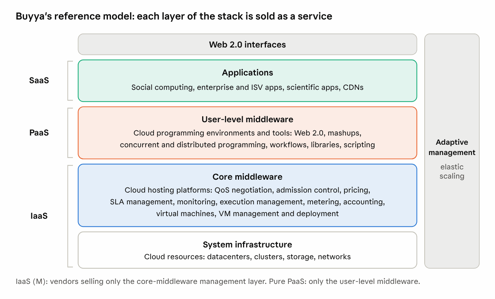

#### (a) Infrastructure as a Service (5 marks)

**Concept.** IaaS rents out virtual hardware: processing, storage and networks on which the consumer can run any software, including its own operating system. The provider manages the physical machines and the virtualization layer; the consumer manages everything from the OS upwards.

**Schematic**

- **User interface:** a web portal and RESTful APIs to request and control VMs.
- **Infrastructure management software:** a scheduler places VM instances on hosts, helped by pricing and billing, monitoring, reservation, QoS/SLA management, a VM image repository, a VM pool manager and provisioning from other clouds.
- **Physical infrastructure:** data centres, clusters and other hardware.

**Example: running a website on Amazon EC2**

1. Choose a machine image (for example Ubuntu Linux) and an instance type (number of virtual CPUs and amount of memory).
2. Attach EBS storage, set a security group (firewall rules) and launch the instance.
3. Connect over SSH and install the web server and the application.
4. Pay only for the time the instance runs; Auto Scaling adds instances at peaks and removes them afterwards.

#### (b) Platform as a Service (5 marks)

**Concept.** PaaS rents out a ready development and runtime platform. The consumer writes the application with the languages, libraries and tools the provider supports and deploys it; the provider manages the servers, OS, runtime, scaling and supporting services such as databases and load balancers.

**Schematic**

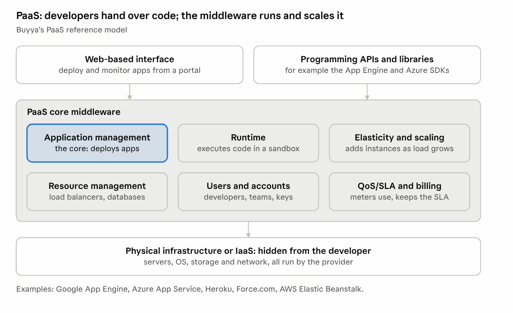

- **Top:** a web-based interface, plus programming APIs and libraries, through which developers build, deploy and monitor applications.
- **PaaS core middleware:** application management (deploying and configuring applications, the core function), the runtime that executes the code, elasticity and scaling, resource management, user and account management, and QoS/SLA management with billing.
- **Bottom:** the physical infrastructure, or an IaaS cloud, which stays hidden from the developer.

Buyya groups PaaS offerings into three classes:

| Class | What it offers | Examples |
| --- | --- | --- |
| PaaS-I | A web-hosted development environment with a runtime, for quick application building | Force.com, LongJump |
| PaaS-II | A runtime that scales web applications | Google App Engine, Heroku, AppScale |
| PaaS-III | Middleware and a programming model for distributed applications in the cloud | Microsoft Azure, Manjrasoft Aneka |

**Example: Google App Engine**

1. Write the application in a supported language such as Python, Java or Go.
2. Describe it in a short configuration file (app.yaml) and deploy it with one command (`gcloud app deploy`).
3. App Engine builds it, starts instances, balances the load and scales the number of instances with traffic, down to zero when idle (standard environment).
4. Billing follows the instance hours and other resources used.

#### (c) Software as a Service (5 marks)

**Concept.** SaaS rents out a finished application, used through a browser or an API. One multi-tenant instance serves many customer organisations; the provider runs and upgrades everything, and the consumer manages only its users, data and settings.

**Schematic**

- Tenants reach the application over HTTPS, through a load balancer.
- One code base serves every tenant; each tenant's customisation is stored as metadata.
- A shared database keeps each tenant's rows apart with a tenant ID.

**Example: Salesforce CRM.** A company signs up and pays per user per month. Its administrator creates users and adds custom fields and workflows (stored as metadata, not code). Sales staff sign in from a browser or the mobile app to track leads and deals. Salesforce upgrades every customer at the same time, three times a year.

**Summary**

| Model | The consumer gets | The consumer manages | Example |
| --- | --- | --- | --- |
| IaaS | Virtual servers, storage, networks | OS, middleware, applications, data | Amazon EC2 |
| PaaS | A runtime platform with tools and services | Application code and data | Google App Engine |
| SaaS | A ready application | Users, data and settings | Salesforce CRM |

**Conclusion:** IaaS gives virtual hardware, PaaS a place to run your code and SaaS a finished application; each step up the stack trades control for convenience.

### C14. Write about the NIST model.

*About 7–8 marks: part (b) of a 15-mark question · PYQ 2018. Part (a), the life cycle of cloud computing, belongs to Unit 3.*

The National Institute of Standards and Technology (NIST, USA) published the most widely used definition of cloud computing in **SP 800-145 (2011)**: “a model for enabling ubiquitous, convenient, on-demand network access to a shared pool of configurable computing resources (e.g., networks, servers, storage, applications, and services) that can be rapidly provisioned and released with minimal management effort or service provider interaction.”

**1. The NIST visual model (5-3-4)**

- **Five essential characteristics:** on-demand self-service, broad network access, resource pooling, rapid elasticity and measured service.
- **Three service models:** Software as a Service, Platform as a Service and Infrastructure as a Service.
- **Four deployment models:** private, community, public and hybrid cloud.
- **Common characteristics,** shown at the base of the figure: massive scale, homogeneity, virtualization, resilient computing, low-cost software, geographic distribution, service orientation and advanced security.

**2. The NIST cloud computing reference architecture (SP 500-292, 2011).** It describes *who* takes part in cloud computing and what each party does:

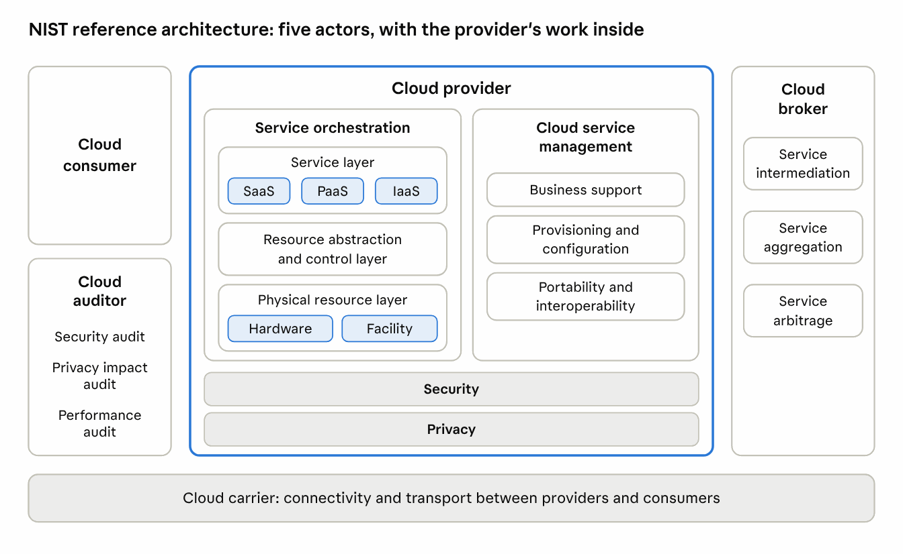

| Actor | Role | Example |
| --- | --- | --- |
| Cloud consumer | Uses services from providers and pays for them | A firm using Microsoft 365 |
| Cloud provider | Makes services available: deploys them, orchestrates its resources (service layer, resource abstraction and control layer, physical resource layer), manages the services, and looks after security and privacy | AWS, Google Cloud |
| Cloud broker | Manages the use, performance and delivery of services and negotiates between providers and consumers, through service intermediation, aggregation and arbitrage | A multi-cloud management service |
| Cloud auditor | Independently assesses services through security, privacy-impact and performance audits | An ISO/IEC 27001 auditor |
| Cloud carrier | Provides connectivity and transport between consumers and providers | A telecom operator or ISP |

**3. Why the NIST model matters.** It gives everyone a vendor-neutral vocabulary for comparing services, writing SLAs and contracts, and planning security; the Cloud Security Alliance's guidance, for example, uses NIST's definitions.

**Conclusion:** the NIST model describes cloud computing in two parts: *what* it is (5 characteristics, 3 service models, 4 deployment models) and *who* does what (5 actors).
